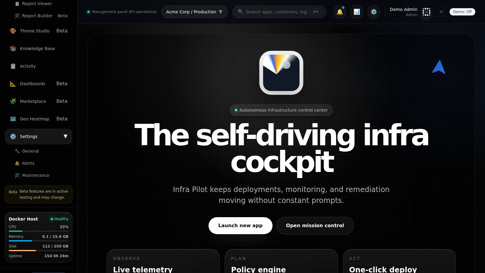
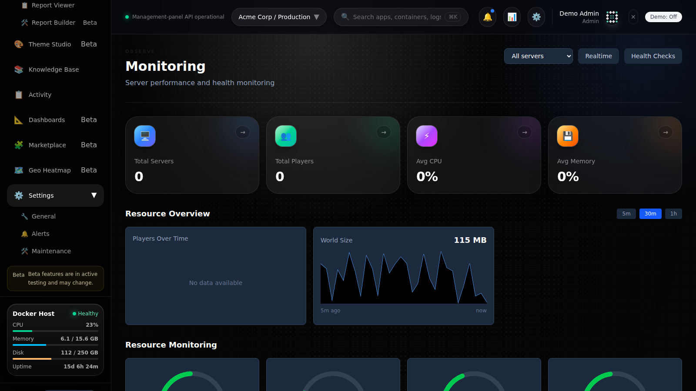
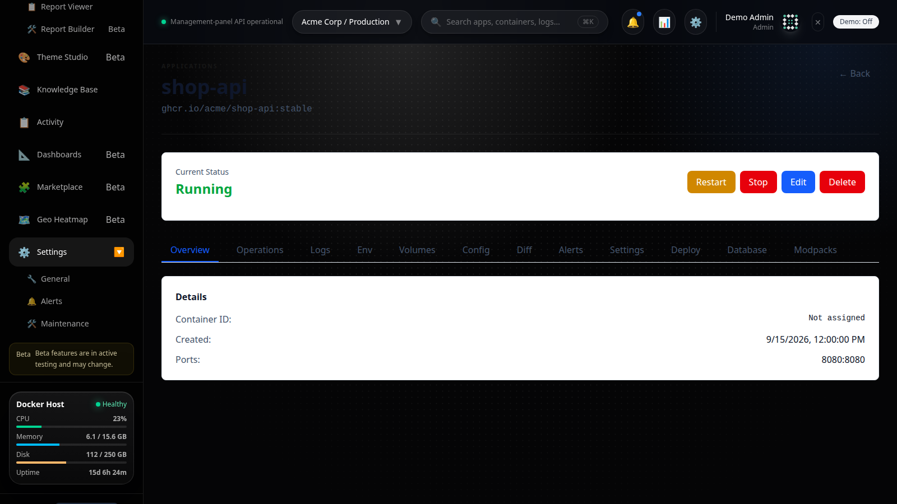
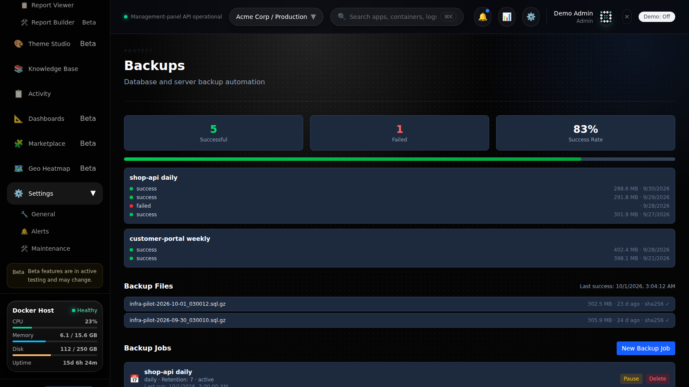
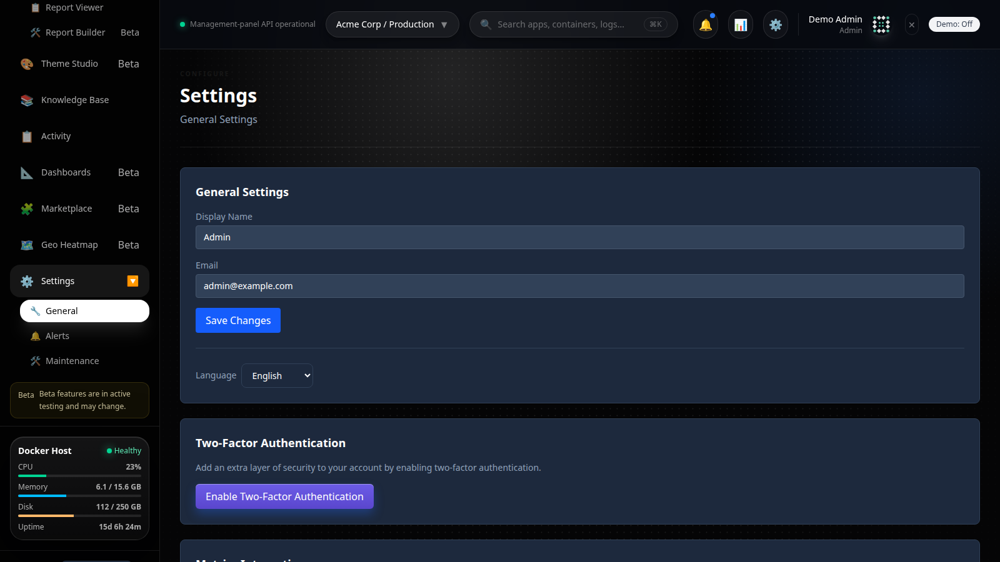
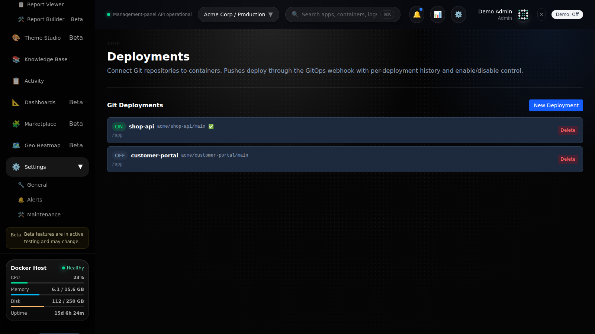
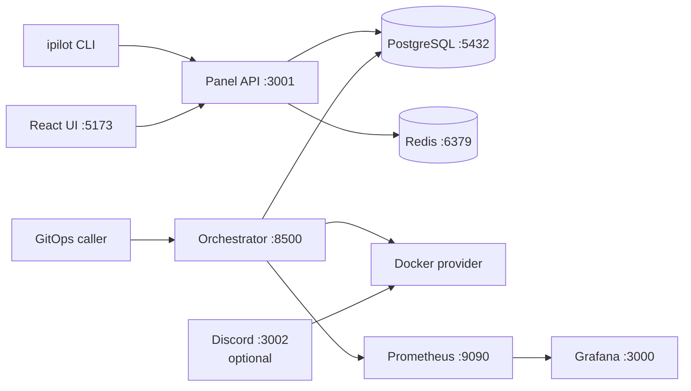

DO NOT DELETE ANY FEATURES JUST MERGE THEM (or archive) 

alles in klare microservices


Eine gemeinsame Daten- und Identitätsschicht.


Eine übersichtliche Haupt-App


Die große README durch eine kurze Produktbeschreibung und separate Projekt-Dokumentation ersetzen.

Bau zuerst „Twitter für d5“ mit Beiträgen, Folgen und Profilen. Wenn diese Nutzung funktioniert, ergänze Chats und Gruppen. Erst danach wird aus dem sozialen Netzwerk eine Super-App mit Mini-Apps. So entsteht Schritt für Schritt ein zusammenhängendes Produkt, statt viele unfertige Funktionen in eine Oberfläche zu packen.


# d5

The result of merging years of experiments, tools, and ideas into one cohesive platform.

d5 is a super-app ecosystem in one repository: it merges all of Daniel Rosemann's projects — their code, their full Git histories, their READMEs and their licenses — into one connected app (in the Twitter/WeChat sense), not a launcher that merely points elsewhere. One app shell (`app/`) catalogs every project as a shared registry; projects that cannot run inside the app yet stay as standalone modules under `projects/` - see `docs/INTEGRATION.md` for the per-project status and the planned rewrites (Java plugins into the browser game, Python apps into the app, websites into the app).

## How the merge was done

Each project's history was merged into this repository's single `main` branch with `git subtree` (one merge per project, files under `projects/<project>`), so the original commits, authors and dates are still in `git log`. In addition, every branch, tag and other ref from every source repo was mirrored under `refs/projects/<project>/` in this repository, so side branches and checkpoint refs are not lost; `git log --all` covers them. That is a combined history, not a rewritten cherry-pick timeline: project commits keep their original hashes. Four source repos had no readable commits (two empty, two with a broken `.git`): `ai assistant (flask)`, `chat`, `chat app` and `ClearCall`. Their current files were imported as labeled snapshot commits; no original history existed to merge for them.

## Run the super app

Open `app/index.html` in a browser, or serve it:

```powershell
python -m http.server 8000 --directory app
```

Then open http://localhost:8000 in your browser.

## Contributors

d5 (formerly ShadowCore) is written and maintained by **Daniel Rosemann** (also committed as DaaanielTV, danielatschool and Daniel). Verified via `git log --all`: 1,394 of 1,598 author commits (87%) are under those four identities (740 + 381 + 233 + 35 + 5); with Dev Coder included, 1,405 (88%). Almost every repository merged here was authored by him alone. Git author metadata alone is not proof of copyright ownership — the notes below record what the history and current tree actually show.

Other names in the Git history, so there is no confusion:

- **Dev Coder** (`vicarious.catshark.aokd@hidingmail.com`, 11 commits, Mar–Apr 2026) is Daniel Rosemann himself — a temporary Git configuration, as he confirms in the [InfraPilot contributor records](C:/Users/danie/OneDrive/Documents/d5/projects/github-repos-infra-pilot/README.md) ("Historical contributor records").
- **InfraPilot**: Server-Filter, Tonchain and coderabbitai[bot] appear in its history. None of their content remains in the current tree (not just "mostly" — entirely absent): Server-Filter (2 commits, 2025-03-15, `test` / `remove test`, each touching only `README.md`) cancels out — pre-test and post-remove blobs are identical (`45aeca9…`). Tonchain (1 commit, `887215e5`, 2026-05-21, added `docs/triage.md` + 2 lines in `CONTRIBUTING.md`) is absent from current `main`; the [InfraPilot README](C:/Users/danie/OneDrive/Documents/d5/projects/github-repos-infra-pilot/README.md) records the guide was omitted from the MIT tree pending separate permission. coderabbitai[bot] (3 commits, PRs #29 / #34 / #242, added `tests/legacy/test_config_modules.py` and `tests/legacy/test_core_modules.py`): those paths and `tests/legacy/` are absent from current `main` — deleted, not rewritten. Their commits are not deleted or rewritten and may remain visible in GitHub's contributor graph.
- **ed-docs**: Greg Nietsky appears in its history (1 commit, `22635d83`, 2013, "Add Upstream ED", adding the GNU ed C sources plus `doc/ed.1` / `doc/ed.texinfo`). The project was later rewritten in React and the original code Greg's commit relates to is no longer there. The old documentation was removed, not left outdated: current [ed-docs](C:/Users/danie/OneDrive/Documents/d5/projects/github-repos-ed-docs/README.md) contains only `web/` (React 18), `COPYING`, and `README.md` — no `.c` sources and no texinfo/man pages remain (see "Entstehung" in the ed-docs README: PR #3 removed everything except the React TUI).
- Bots and AI in the history: dependabot[bot] (165 author commits), github-actions[bot] (6), gpt-engineer-app[bot] (6), coderabbitai[bot] (3 author commits + 23 `Co-authored-by` trailers), Copilot (16 trailers) and Copilot Autofix / github-advanced-security[bot] (60 trailers) as co-authors only, Muse Spark (34 trailers, co-author only) and Muse Code (author + co-author: 6 author commits + 99 trailers, `muse-code@meta.com`), and T3 Code (3 checkpoint commits, 2026-05-11, `t3 checkpoint ref=…` turns 0–2 — tool checkpoint artifacts, not product features). GitHub (`noreply@github.com`) appears as committer on 616 web merges, never as author. Daniel's own co-author trailers (`Daniel Rosemann`, `d.rosemann`, `drosemann`) also occur alongside direct author commits.

## Licenses

All project licenses collected in one file: [ALL-LICENSES.md](ALL-LICENSES.md). Each project also keeps its own license file in its folder.

## All projects

Every merged project's own README follows below, one after another.

---

## ai assistant html, css, javascript, python (flask) for openai api

Category: AI & LLM Projects - Stack: Python, Web/JS - Folder: `projects/ai-&-llm-projects-ai-assistant-html,-css,-javascript,-python-(flask)-for-openai-api`

Standalone for now: Python app. Planned port into the ShadowCore app.

### KI Assistant

Ein interaktiver KI-Chatbot, der die OpenAI API nutzt, um intelligente Konversationen zu ermöglichen.

#### 🌟 Features

- Echtzeit-Chat-Interface
- Integration mit OpenAI GPT-3.5
- Responsive Design
- Markdown-Unterstützung
- Fehlerbehandlung
- Einfache Benutzeroberfläche

#### 🛠️ Technologie-Stack

- **Frontend**: HTML, CSS, JavaScript
- **Backend**: Python/Flask
- **KI**: OpenAI API
- **Styling**: Custom CSS mit Variablen

#### 📋 Voraussetzungen

- Python 3.10 oder höher
- OpenAI API Key
- Moderne Webbrowser
- pip (Python Package Manager)

#### ⚙️ Installation

1. **Repository klonen**
   git clone https://github.com/IhrUsername/ki-assistant.git
   cd ki-assistant

2. **Virtuelle Umgebung erstellen und aktivieren**
   # Windows
   python -m venv venv
   .\venv\Scripts\activate

   # Linux/Mac
   python3 -m venv venv
   source venv/bin/activate

3. **Abhängigkeiten installieren**
   pip install -r requirements.txt

4. **Umgebungsvariablen konfigurieren**
   - Erstellen Sie eine `.env` Datei im Hauptverzeichnis
   - Fügen Sie Ihren OpenAI API Key hinzu:
     OPENAI_API_KEY=your_api_key_here

#### 🚀 Verwendung

1. **Server starten**
   python src/app.py

2. **Zugriff auf die Anwendung**
   - Öffnen Sie Ihren Browser
   - Navigieren Sie zu `http://localhost:5000`

#### 💡 Beispiel-Interaktion

1. Geben Sie Ihre Frage in das Textfeld ein
2. Klicken Sie auf "Senden" oder drücken Sie Enter
3. Warten Sie auf die KI-Antwort
4. Führen Sie die Konversation fort

#### 🔧 Konfiguration

Die Anwendung kann über verschiedene Umgebungsvariablen konfiguriert werden:

- `OPENAI_API_KEY`: Ihr OpenAI API Schlüssel
- `FLASK_ENV`: Entwicklungs- oder Produktionsumgebung
- `FLASK_DEBUG`: Debug-Modus (0 oder 1)

#### 📁 Projektstruktur

- `src/`: Hauptverzeichnis der Anwendung
- `src/app.py`: Haupt-App-Datei
- `src/static/`: Statische Dateien (CSS, JavaScript, etc.)
- `src/templates/`: HTML-Templates
- `src/.env`: Umgebungsvariablen
- `src/requirements.txt`: Abhängigkeiten

#### 📂 Projektstruktur

- `src/static/`: Statische Dateien (CSS, JavaScript, etc.)
- `src/static/css/`: Custom CSS
- `src/static/js/`: JavaScript
- `src/templates/`: HTML-Templates
- `src/.env`: Umgebungsvariablen
- `src/requirements.txt`: Abhängigkeiten

#### 🤝 Beitragen

Beiträge sind willkommen! Bitte folgen Sie diesen Schritten:

1. Fork des Repositories
2. Erstellen Sie einen Feature-Branch (`git checkout -b feature/AmazingFeature`)
3. Commit Ihrer Änderungen (`git commit -m 'Add some AmazingFeature'`)
4. Push zum Branch (`git push origin feature/AmazingFeature`)
5. Öffnen Sie einen Pull Request

#### 📝 Lizenz

Dieses Projekt ist unter der MIT-Lizenz lizenziert - siehe die LICENSEDatei für Details.

#### 🔮 Zukünftige Features

- [ ] Benutzerauthentifizierung
- [ ] Chat-Verlauf Speicherung
- [ ] Unterstützung für verschiedene KI-Modelle
- [ ] Dateiupload-Funktionalität
- [ ] Spracherkennung
- [ ] Code Highlighting
- [ ] Typing Indikatoren

#### ⚠️ Bekannte Probleme

- Keine bekannten Probleme zum jetzigen Zeitpunkt

#### 📞 Support

Bei Fragen oder Problemen:
- Öffnen Sie ein Issue
- Kontaktieren Sie uns unter: [Ihre-Email@domain.com]

#### 🙏 Danksagungen

- OpenAI für die GPT-3.5 API
- Flask-Team für das großartige Framework
- Alle Mitwirkenden und Unterstützer

---

Entwickelt mit ❤️ von Daniel

---

## chat

Category: AI & LLM Projects\ai chat website - Stack: Python, Web/JS - Folder: `projects/ai-&-llm-projects-ai-chat-website-chat`

Standalone for now: Python app. Planned port into the ShadowCore app.

### KI Assistant

Ein interaktiver KI-Chatbot, der die OpenAI API nutzt, um intelligente Konversationen zu ermöglichen.

#### 🌟 Features

- Echtzeit-Chat-Interface
- Integration mit OpenAI GPT-3.5
- Responsive Design
- Markdown-Unterstützung
- Fehlerbehandlung
- Einfache Benutzeroberfläche

#### 🛠️ Technologie-Stack

- **Frontend**: HTML, CSS, JavaScript
- **Backend**: Python/Flask
- **KI**: OpenAI API
- **Styling**: Custom CSS mit Variablen

#### 📋 Voraussetzungen

- Python 3.10 oder höher
- OpenAI API Key
- Moderne Webbrowser
- pip (Python Package Manager)

#### ⚙️ Installation

1. **Repository klonen**
   git clone https://github.com/IhrUsername/ki-assistant.git
   cd ki-assistant

2. **Virtuelle Umgebung erstellen und aktivieren**
   # Windows
   python -m venv venv
   .\venv\Scripts\activate

   # Linux/Mac
   python3 -m venv venv
   source venv/bin/activate

3. **Abhängigkeiten installieren**
   pip install -r requirements.txt

4. **Umgebungsvariablen konfigurieren**
   - Erstellen Sie eine `.env` Datei im Hauptverzeichnis
   - Fügen Sie Ihren OpenAI API Key hinzu:
     OPENAI_API_KEY=your_api_key_here

#### 🚀 Verwendung

1. **Server starten**
   python src/app.py

2. **Zugriff auf die Anwendung**
   - Öffnen Sie Ihren Browser
   - Navigieren Sie zu `http://localhost:5000`

#### 💡 Beispiel-Interaktion

1. Geben Sie Ihre Frage in das Textfeld ein
2. Klicken Sie auf "Senden" oder drücken Sie Enter
3. Warten Sie auf die KI-Antwort
4. Führen Sie die Konversation fort

#### 🔧 Konfiguration

Die Anwendung kann über verschiedene Umgebungsvariablen konfiguriert werden:

- `OPENAI_API_KEY`: Ihr OpenAI API Schlüssel
- `FLASK_ENV`: Entwicklungs- oder Produktionsumgebung
- `FLASK_DEBUG`: Debug-Modus (0 oder 1)

#### 📁 Projektstruktur

- `src/`: Hauptverzeichnis der Anwendung
- `src/app.py`: Haupt-App-Datei
- `src/static/`: Statische Dateien (CSS, JavaScript, etc.)
- `src/templates/`: HTML-Templates
- `src/.env`: Umgebungsvariablen
- `src/requirements.txt`: Abhängigkeiten

#### 📂 Projektstruktur

- `src/static/`: Statische Dateien (CSS, JavaScript, etc.)
- `src/static/css/`: Custom CSS
- `src/static/js/`: JavaScript
- `src/templates/`: HTML-Templates
- `src/.env`: Umgebungsvariablen
- `src/requirements.txt`: Abhängigkeiten

#### 🤝 Beitragen

Beiträge sind willkommen! Bitte folgen Sie diesen Schritten:

1. Fork des Repositories
2. Erstellen Sie einen Feature-Branch (`git checkout -b feature/AmazingFeature`)
3. Commit Ihrer Änderungen (`git commit -m 'Add some AmazingFeature'`)
4. Push zum Branch (`git push origin feature/AmazingFeature`)
5. Öffnen Sie einen Pull Request

#### 📝 Lizenz

Dieses Projekt ist unter der MIT-Lizenz lizenziert - siehe die LICENSEDatei für Details.

#### 🔮 Zukünftige Features

- [ ] Benutzerauthentifizierung
- [ ] Chat-Verlauf Speicherung
- [ ] Unterstützung für verschiedene KI-Modelle
- [ ] Dateiupload-Funktionalität
- [ ] Spracherkennung
- [ ] Code Highlighting
- [ ] Typing Indikatoren

#### ⚠️ Bekannte Probleme

- Keine bekannten Probleme zum jetzigen Zeitpunkt

#### 📞 Support

Bei Fragen oder Problemen:
- Öffnen Sie ein Issue
- Kontaktieren Sie uns unter: [Ihre-Email@domain.com]

#### 🙏 Danksagungen

- OpenAI für die GPT-3.5 API
- Flask-Team für das großartige Framework
- Alle Mitwirkenden und Unterstützer

---

Entwickelt mit ❤️ von Daniel

---

## super-fast-ai-chat

Category: AI & LLM Projects\ai chat website - Stack: Web/JS - Folder: `projects/ai-&-llm-projects-ai-chat-website-super-fast-ai-chat`

Web project: candidate to integrate into the ShadowCore web app.

### 🚀 Ultra-Fast AI Chat | Ollama Web Interface

> 🤖 A lightning-fast, privacy-focused AI chat interface powered by Ollama's local models

[](https://opensource.org/licenses/MIT)

#### ✨ Features

- 🚄 **Ultra-Fast Responses**: Get instant AI responses with local processing power
- 🔒 **Privacy First**: All conversations stay on your machine
- 💻 **Local Models**: Powered by Ollama's efficient local AI models
- 🎨 **Modern UI**: Clean, responsive design with smooth animations
- ⚡ **Real-time Processing**: Instant message handling and streaming responses
- 🔧 **Easy Configuration**: Simple settings panel for API configuration

#### 🚀 Quick Start

1. **Prerequisites**
   - Install [Ollama](https://ollama.ai) on your machine
   - Pull your preferred model:
     ```bash
     ollama pull qwen2.5:0.5b
     ```

2. **Installation**
   ```bash
   git clone https://github.com/DaaanielTV/super-fast-ai-chat
   cd super-fast-ai-chat
   ```

3. **Usage**
   - Open `index.html` in your browser
   - Start chatting with the AI!

#### 💡 Key Benefits

- 🎯 No cloud dependencies
- 🔐 Enhanced privacy and security
- ⚡ Reduced latency
- 💪 Full control over AI models
- 🎨 Beautiful, intuitive interface

#### 🛠️ Technical Stack

- 💻 Pure JavaScript (No frameworks)
- 🎨 Modern CSS with custom properties
- 🔄 Async/Await API handling
- 📱 Responsive design
- 🔌 Ollama API integration

#### 📝 Configuration

Access the settings panel to configure:
- Ollama API URL (default: `http://localhost:11434/api/generate`)
- Additional settings as needed

#### 🤝 Contributing

Contributions are welcome! Please feel free to submit a Pull Request.

1. Fork the project
2. Create your feature branch (`git checkout -b feature/AmazingFeature`)
3. Commit your changes (`git commit -m 'Add some AmazingFeature'`)
4. Push to the branch (`git push origin feature/AmazingFeature`)
5. Open a Pull Request

#### 📜 License

This project is licensed under the MIT License - see the [LICENSE](LICENSE) file for details.

#### 🔗 Related Projects

- [Ollama](https://github.com/jmorganca/ollama)
- [LangChain](https://github.com/hwchase17/langchain)

#### 📞 Support

For support, please open an issue in the repository.

#### 🔍 Keywords

AI chat, Ollama, local AI, privacy-focused chat, fast AI responses, web interface, JavaScript chat application, AI assistant, machine learning chat, natural language processing

---

## talkativecloud

Category: AI & LLM Projects\ai chat website - Stack: Web/JS - Folder: `projects/ai-&-llm-projects-ai-chat-website-talkativecloud`

Web project: candidate to integrate into the ShadowCore web app.

### Welcome to your Lovable project

#### Project info

**URL**: https://lovable.dev/projects/d94e2475-b51b-48dd-ad56-7d11fc11be59

#### How can I edit this code?

There are several ways of editing your application.

**Use Lovable**

Simply visit the [Lovable Project](https://lovable.dev/projects/d94e2475-b51b-48dd-ad56-7d11fc11be59) and start prompting.

Changes made via Lovable will be committed automatically to this repo.

**Use your preferred IDE**

If you want to work locally using your own IDE, you can clone this repo and push changes. Pushed changes will also be reflected in Lovable.

The only requirement is having Node.js & npm installed - [install with nvm](https://github.com/nvm-sh/nvm#installing-and-updating)

Follow these steps:

```sh
### Step 1: Clone the repository using the project's Git URL.
git clone <YOUR_GIT_URL>

### Step 2: Navigate to the project directory.
cd <YOUR_PROJECT_NAME>

### Step 3: Install the necessary dependencies.
npm i

### Step 4: Start the development server with auto-reloading and an instant preview.
npm run dev
```

**Edit a file directly in GitHub**

- Navigate to the desired file(s).
- Click the "Edit" button (pencil icon) at the top right of the file view.
- Make your changes and commit the changes.

**Use GitHub Codespaces**

- Navigate to the main page of your repository.
- Click on the "Code" button (green button) near the top right.
- Select the "Codespaces" tab.
- Click on "New codespace" to launch a new Codespace environment.
- Edit files directly within the Codespace and commit and push your changes once you're done.

#### What technologies are used for this project?

This project is built with .

- Vite
- TypeScript
- React
- shadcn-ui
- Tailwind CSS

#### How can I deploy this project?

Simply open [Lovable](https://lovable.dev/projects/d94e2475-b51b-48dd-ad56-7d11fc11be59) and click on Share -> Publish.

#### I want to use a custom domain - is that possible?

We don't support custom domains (yet). If you want to deploy your project under your own domain then we recommend using Netlify. Visit our docs for more details: [Custom domains](https://docs.lovable.dev/tips-tricks/custom-domain/)


---

## gpt-5-mini-game

Category: AI & LLM Projects - Stack: Web/JS - Folder: `projects/ai-&-llm-projects-gpt-5-mini-game`

Web project: candidate to integrate into the ShadowCore web app.

_This project had no README in its original repository._

---

## web-scraping-chatbot

Category: AI & LLM Projects - Stack: Python, Web/JS - Folder: `projects/ai-&-llm-projects-web-scraping-chatbot`

Standalone for now: Python app. Planned port into the ShadowCore app.

### Web Scraping Chatbot

A modern web application that allows users to scrape and analyze web content through a user-friendly interface.

#### Features

- 🎨 Modern, responsive design
- 📑 Tab navigation between Web Scraping and History
- âš¡ Asynchronous web scraping
- 📝 History tracking
- 🌐 Simple and intuitive user interface
- 🔒 Error handling and input validation

#### Installation

##### Prerequisites
- Python 3.8 or higher
- pip (Python package manager)

##### Setup

1. Clone the repository:

git clone https://github.com/DaaanielTV/web-scraping-chatbot.git
cd web-scraping-chatbot


2. Install required packages:

pip install flask httpx beautifulsoup4


##### Running the Application

1. Start the Flask server:

python app.py


2. Open your browser and navigate to:

http://localhost:5000


#### Project Structure


project/
├── static/
│   ├── css/
│   │   └── style.css
│   └── js/
│       └── main.js
├── templates/
│   └── index.html
├── app.py
└── README.md


#### Usage

1. Navigate to the Web Scraping tab
2. Enter a valid URL in the input field
3. Click "Send" to scrape the website
4. View the extracted information in the chat window
5. Check the History tab to see previous scraping results

#### Planned Features

##### Short-term
- 📊 Database integration for history storage
- 📤 Export functionality for scraped data
- 🎨 Additional styling options and themes

##### Long-term
- 🔐 User authentication system
- 📱 Mobile app version
- 🤖 Advanced scraping options
- 📈 Data visualization
- 🔍 Advanced search functionality
- 💾 Local storage support
- 🌍 Multi-language support

#### Contributing

1. Fork the repository
2. Create your feature branch (`git checkout -b feature/AmazingFeature`)
3. Commit your changes (`git commit -m 'Add some AmazingFeature'`)
4. Push to the branch (`git push origin feature/AmazingFeature`)
5. Open a Pull Request

#### Technical Requirements

- Python 3.8+
- Flask
- httpx
- BeautifulSoup4
- Modern web browser with JavaScript enabled

#### License

This project is licensed under the MIT License - see the [LICENSE.md](LICENSE.md) file for details

#### Acknowledgments

- Flask documentation
- BeautifulSoup4 documentation
- httpx documentation
- Modern web development community

#### Support

For support, please open an issue in the GitHub repository or contact the maintainers.

#### Authors

- Daniel - *Initial work* - [DaaanielTV](https://github.com/DaaanielTV)

---

Made with ❤️ by Daniel


---

## bodymassindex

Category: Archive - Unsorted - Stack: Python - Folder: `projects/archive-unsorted-bodymassindex`

Standalone for now: Python app. Planned port into the ShadowCore app.

_This project had no README in its original repository._

---

## calculator

Category: Archive - Unsorted - Stack: Python - Folder: `projects/archive-unsorted-calculator`

Standalone for now: Python app. Planned port into the ShadowCore app.

### Advanced Calculator

A powerful command-line calculator with 25 mathematical operations, built in Python.

#### Features

- Basic arithmetic operations (addition, subtraction, multiplication, division)
- Power functions (power, square, cube, square root)
- Trigonometric functions (sine, cosine, tangent)
- Logarithmic functions (natural log, log base 10)
- Number theory (factorial, Fibonacci)
- Utility functions (floor, ceiling, absolute value)
- Angular conversions (degrees to radians, radians to degrees)
- Special calculations (percentage, inverse, exponential, hypotenuse)

#### Requirements

- Python 3.x
- Math module (built into Python)

#### Installation

1. Clone or download this repository
2. No additional packages need to be installed as the program uses only built-in Python modules

#### Usage

1. Run the program:
   ```
   python main.py
   ```

2. Choose an operation by entering its corresponding number (1-25):
   ```
   Welcome to the Advanced Calculator!
   Choose an operation:
   1. Addition
   2. Subtraction
   3. Multiplication
   4. Division
   5. Power
   6. Square Root
   7. Factorial
   8. Sine (in degrees)
   9. Cosine (in degrees)
   10. Tangent (in degrees)
   11. Log (base 10)
   12. Natural Log
   13. Absolute Value
   14. Floor
   15. Ceiling
   16. Modulo
   17. Percentage
   18. Square
   19. Cube
   20. Inverse (1/x)
   21. Exponential (e^x)
   22. Degrees to Radians
   23. Radians to Degrees
   24. Hypotenuse
   25. Fibonacci Number
   ```

3. Enter the required number(s) when prompted

#### Examples

##### Basic Operations
- Addition (1):
  ```
  Enter your choice (1-25): 1
  Enter the first number: 5
  Enter the second number: 3
  The result is: 8
  ```

##### Trigonometric Functions
- Sine (8):
  ```
  Enter your choice (1-25): 8
  Enter the number: 90
  The result is: 1.0
  ```

##### Special Functions
- Factorial (7):
  ```
  Enter your choice (1-25): 7
  Enter the number: 5
  The result is: 120
  ```

##### Error Handling
The calculator includes error handling for common mathematical errors:
- Division by zero
- Square root of negative numbers
- Factorial of negative numbers
- Logarithm of non-positive numbers

#### Function Descriptions

1. **Addition**: Adds two numbers
2. **Subtraction**: Subtracts second number from first
3. **Multiplication**: Multiplies two numbers
4. **Division**: Divides first number by second
5. **Power**: Raises first number to the power of second
6. **Square Root**: Calculates square root of a number
7. **Factorial**: Calculates n! (n factorial)
8. **Sine**: Calculates sine of an angle in degrees
9. **Cosine**: Calculates cosine of an angle in degrees
10. **Tangent**: Calculates tangent of an angle in degrees
11. **Log (base 10)**: Calculates common logarithm
12. **Natural Log**: Calculates natural logarithm (base e)
13. **Absolute Value**: Returns absolute value of a number
14. **Floor**: Rounds down to nearest integer
15. **Ceiling**: Rounds up to nearest integer
16. **Modulo**: Returns remainder of division
17. **Percentage**: Converts number to percentage (divides by 100)
18. **Square**: Multiplies number by itself
19. **Cube**: Raises number to power of 3
20. **Inverse**: Calculates 1/x
21. **Exponential**: Calculates e^x
22. **Degrees to Radians**: Converts angles from degrees to radians
23. **Radians to Degrees**: Converts angles from radians to degrees
24. **Hypotenuse**: Calculates hypotenuse using Pythagorean theorem
25. **Fibonacci**: Calculates nth Fibonacci number

#### Notes
- Trigonometric functions accept input in degrees for user convenience
- For best results, enter numerical values only
- The calculator handles decimal numbers

---

## chat app

Category: Archive - Unsorted - Stack: Web/JS - Folder: `projects/archive-unsorted-chat-app`

Web project: candidate to integrate into the ShadowCore web app.

### ClearCall VoIP Service

ClearCall is a Voice over IP (VoIP) service that provides secure and high-quality voice and video calls over the internet. This guide will help you set up ClearCall on a Debian 12 system using a screen session.

#### Security & Encryption

##### What We Encrypt
- User passwords are hashed and salted using bcrypt before being stored in the database.
- Authentication tokens (JWT) are signed and never stored in plain text.
- All communication between client and server should be run over HTTPS in production (not included by default).

##### What We Do Not Encrypt
- Messages, files, and channel data are stored in the database in plain text.
- Voice/video call signaling is not end-to-end encrypted.
- File uploads are not encrypted at rest.

If you require end-to-end encryption for messages or calls, you must implement it yourself or use a third-party solution.

#### Liability Disclaimer

**We are not responsible for any data loss, security breaches, or misuse of this software.**

This project is provided as-is, without any warranty. Use at your own risk. You are responsible for securing your deployment, including using HTTPS, setting strong passwords, and keeping dependencies up to date.

#### Prerequisites

- Debian 12 system
- Node.js and npm installed
- Git installed
- Screen utility installed
- MariaDB server

#### How to Run on Debian 12 (with MariaDB)

##### 1. Install Dependencies

```bash
sudo apt update && sudo apt upgrade -y
sudo apt install nodejs npm mariadb-server git -y
```

##### 2. Start and Secure MariaDB

```bash
sudo systemctl start mariadb
sudo mysql_secure_installation
```

##### 3. Create Database and User

```bash
sudo mysql -u root -p

-- In the MariaDB shell:
CREATE DATABASE chatapp_db;
CREATE USER 'chatapp_user'@'localhost' IDENTIFIED BY 'your_password';
GRANT ALL PRIVILEGES ON chatapp_db.* TO 'chatapp_user'@'localhost';
FLUSH PRIVILEGES;
EXIT;
```

##### 4. Import Database Schema

```bash
mysql -u chatapp_user -p chatapp_db < server/config/database.sql
```

##### 5. Configure Environment Variables

Create a `.env` file in the `server/` directory:

```
PORT=3000
DB_HOST=localhost
DB_USER=chatapp_user
DB_PASSWORD=your_password
DB_NAME=chatapp_db
JWT_SECRET=your_jwt_secret
CLIENT_URL=http://localhost:5173
```

##### 6. Install Server Dependencies

```bash
cd server
npm install
```

##### 7. Start the Server

```bash
node app.js
```

##### 8. Start the Client (Optional: Modern React UI)

```bash
cd client
npm install
npm run dev
```

#### Installation Steps

##### 1. Update System

```bash
sudo apt update && sudo apt upgrade -y
```

##### 2. Install Node.js and npm

```bash
sudo apt install nodejs npm -y
```

##### 3. Install Git

```bash
sudo apt install git -y
```

##### 4. Install Screen

```bash
sudo apt install screen -y
```

##### 5. Clone the Repository

Navigate to the directory where you want to clone the project and run:

```bash
git clone <repository-url>
cd ClearCall
```

##### 6. Install Server Dependencies

Navigate to the server directory and install dependencies:

```bash
cd server
npm install express socket.io
```

##### 7. Start the Server in a Screen Session

Start a screen session and run the server:

```bash
screen -S clearcall-server
node app.js
```

To detach from the screen session, press `Ctrl + A`, then `D`.

To reattach to the screen session later, use:

```bash
screen -r clearcall-server
```

#### Accessing the Client

Open the `client/index.html` file in a web browser to start using ClearCall.

#### Troubleshooting

- Ensure all dependencies are installed correctly.
- Check if the server is running by visiting `http://localhost:3000`.
- Use `screen -ls` to list active screen sessions.

#### License

This project is licensed under the MIT License.

### Features

- Multi-workspace support (like Discord servers)
- Public and private channels
- Direct messaging (DMs)
- Real-time chat with Socket.IO
- User authentication (JWT)
- User presence/online status
- Message reactions and pinning
- File uploads (attachments)
- Channel and workspace invites
- User roles and permissions (owner, admin, member)
- Threaded replies
- Message editing and deletion
- Basic notifications (stub, extendable)
- Message search (to be implemented)
- Voice/video call signaling (WebRTC-ready)
- Modern React UI (Material-UI)
- Emoji support
- Secure password hashing
- MariaDB backend
- Room-based Calling: Join specific rooms for group calls; signaling messages relayed only to users in the same room.
- User List and Presence: Track and broadcast the list of connected users in each room; notify users when someone joins or leaves.
- Text Chat in Calls: Simple chat feature alongside video/audio in call rooms.
- Screen Sharing: Share your screen using getDisplayMedia (UI controls stubbed).
- Mute/Unmute and Camera On/Off: Buttons to mute/unmute audio and enable/disable video; state changes broadcast to others.
- Recording: Record calls locally using the MediaRecorder API (stubbed, extendable).
- Call Authentication: Basic authentication for joining calls (username/password).
- Lobby/Waiting Room: Users wait in a lobby until the host admits them to the call.
- File Sharing in Calls: Send files to each other during a call (stubbed, extendable).
- Call End/Leave Notifications: Notify all users when someone leaves or ends the call.

### Future Features

- Advanced search and filtering for messages and files
- End-to-end encryption for messages and calls
- Push notifications (mobile/desktop)
- Integration with external services (calendar, bots, etc.)
- Custom emoji and sticker packs
- Advanced moderation tools
- Analytics and usage statistics
- Mobile app (React Native or Flutter)
- UI/UX enhancements and accessibility improvements
- AI-powered message summarization and smart replies
- Scheduled messages and reminders
- Customizable notification settings per channel/user
- Integration with cloud storage (Google Drive, Dropbox, etc.)
- In-app voice message recording and playback
- Video backgrounds and virtual backgrounds for calls
- Polls and surveys in chat
- Custom slash commands and chatbots
- Multi-factor authentication (MFA)
- Federated/multi-instance support
- Export/import workspace data
- Granular permission management (per-channel, per-role)

---

## die_klasse_bruch

Category: Archive - Unsorted - Stack: Python - Folder: `projects/archive-unsorted-die_klasse_bruch`

Standalone for now: Python app. Planned port into the ShadowCore app.

_This project had no README in its original repository._

---

## drachen-im-asphalt

Category: Archive - Unsorted - Stack: Python - Folder: `projects/archive-unsorted-drachen-im-asphalt`

Standalone for now: Python app. Planned port into the ShadowCore app.

### Drachen im Asphalt

Ein textbasiertes Krimi-Adventure in Python. Das Projekt kombiniert Story-Entscheidungen, Missionsfortschritt und persistente Spielstände in einer modularen Codebasis.

#### Projektüberblick

**Drachen im Asphalt** ist ein deutschsprachiges Terminal-Spiel mit Fokus auf:

- erzählerische Progression über Kapitel,
- ein Missions- und Begegnungssystem,
- Charakterentwicklung inklusive Ressourcen- und Risiko-Management,
- speicherbare Spielstände (JSON-basiert).

Die Handlung spielt in einer fiktiven, neongeprägten Küstenstadt mit verschiedenen Bezirken und eskalierenden Konsequenzen für Spielerentscheidungen.

#### Features / Zweck

- Zwei spielbare Protagonisten mit unterschiedlichen Startwerten.
- Modulares Domänenmodell (`characters`, `missions`, `districts`, `effects`, `story`, `game`, `ui`).
- Persistenz für Spielstand und Story-Fortschritt.
- Textausgabe mit Lesemodi und optionaler Bildschirmbereinigung.
- Automatisierte Tests für Kernarchitektur und Save/Load-Verhalten.

#### Installation

##### Voraussetzungen

- Python **3.10+** (empfohlen: 3.11)
- `pip`

##### Setup

```bash
python -m venv .venv
source .venv/bin/activate
pip install -U pip pytest
```

#### Nutzung

Spielstart aus dem Repository-Root:

```bash
python -m src.main
```


#### Development Setup

```bash
git clone <repository-url>
cd drachen-im-asphalt
python -m venv .venv
source .venv/bin/activate
pip install -U pip pytest
```

Tests ausführen:

```bash
PYTHONPATH=. pytest -q
```

#### Konfiguration

Das Projekt nutzt aktuell keine externe `.env`-Konfiguration. Relevante Datenquellen:

- `data/dragon.json`: persistente Drachen-/Bossdaten
- Savegames werden zur Laufzeit als JSON im Arbeitsverzeichnis abgelegt

Empfehlung für Beiträge: Laufzeitdaten nicht versionieren und stattdessen reproduzierbar erzeugen.

#### Build- / Run-Instruktionen

Dieses Projekt erzeugt keine distributierten Build-Artefakte. Der empfohlene Ablauf ist:

1. Quellcode auschecken
2. Python-Umgebung einrichten
3. Spiel direkt per `python -m src.main` starten
4. Tests per `PYTHONPATH=. pytest -q` validieren

Falls früher generierte oder temporäre Dateien im Repository enthalten waren, wurden sie entfernt. Sie sollen lokal neu erzeugt statt eingecheckt werden.

#### Troubleshooting

##### `ModuleNotFoundError: No module named 'src'`

Führe Tests mit gesetztem `PYTHONPATH` aus:

```bash
PYTHONPATH=. pytest -q
```

##### Kodierungsprobleme bei Umlauten

Stelle sicher, dass das Terminal UTF-8 verwendet.

##### Kein Speicherstand gefunden

Das ist beim ersten Start normal. Starte ein neues Spiel und speichere danach.

#### Zusätzliche Dokumentation

- [`CONTRIBUTING.md`](CONTRIBUTING.md) – Beitragshinweise
- [`CODE_OF_CONDUCT.md`](CODE_OF_CONDUCT.md) – Verhaltensregeln
- [`src/README.md`](src/README.md) – technische Modulübersicht
- [`LICENSE`](LICENSE) – GNU GPLv3


---

## goose-desktop-companion

Category: Archive - Unsorted - Stack: Python - Folder: `projects/archive-unsorted-goose-desktop-companion`

Standalone for now: Python app. Planned port into the ShadowCore app.

### Goose Desktop Companion

Goose Desktop Companion is a modular desktop companion project with a PowerShell feature engine and a Python/PyQt UI.

#### Project overview

This repository contains:

- A large set of PowerShell feature modules (productivity, wellness, system utilities, social/fun features).
- A cross-platform Python UI in `goose-ui-python/`.
- Optional server-side integration assets (Supabase schema and related docs).

#### Features / purpose

- Modular architecture with category-based `*.ps1` modules.
- Config-driven behavior via `config.ini`.
- Optional authentication, sync, telemetry, and incident workflows.
- Python UI for local development and packaging.

#### Installation

##### Prerequisites

- PowerShell 5.1+ (Windows modules)
- Python 3.9+
- `pip`

##### Install and run Python UI

```bash
cd goose-ui-python
python -m venv .venv
### Windows
.venv\Scripts\activate
### macOS/Linux
source .venv/bin/activate
pip install -r requirements.txt
python main.py
```

#### Usage

##### Run feature checks

```powershell
./test-goose-features.ps1
```

##### Run module orchestrator (Windows PowerShell)

```powershell
./run-all.ps1
```

##### Launch helper scripts (Windows)

- `goose-ui.bat`
- `goose-ui.vbs`
- `run-all.bat`

#### Development setup

1. Clone the repository.
2. Create a Python virtual environment under `goose-ui-python/`.
3. Install Python dependencies with `pip install -r goose-ui-python/requirements.txt`.
4. Review module docs in `docs/`.
5. Run `test-goose-features.ps1` before opening a PR.

#### Configuration

Primary configuration lives in:

- `config.ini` (root)
- `goose-ui-python/assets/config.ini` (Python UI)

For backend and optional services, see:

- `docs/backend-setup.md`
- `docs/SERVER-FEATURES.md`

#### Build / run instructions

##### Python package builds

```bash
### Windows
cd goose-ui-python
build\build.bat

### macOS/Linux
cd goose-ui-python
bash build/build.sh
```

Generated output is intentionally **not** tracked in git. Build artifacts (executables, caches, logs, and temporary outputs) should be generated locally as needed.

#### Troubleshooting

- If Python UI fails to start, verify you activated the virtual environment and installed requirements.
- If PowerShell modules fail to load, confirm you are running from repository root and that script execution policy permits local scripts.
- If module settings appear ignored, verify keys in `config.ini` and restart the relevant UI/process.

See also:

- `QUICK_START.md`
- `goose-ui-python/SETUP.md`
- `docs/DEVELOPER.md`

#### Open-source policy files

- License: `LICENSE` (GNU GPLv3)
- Contribution guide: `CONTRIBUTING.md`
- Code of conduct: `CODE_OF_CONDUCT.md`


---

## Kilometerzähler

Category: Archive - Unsorted - Stack: Python - Folder: `projects/archive-unsorted-kilometerzähler`

Standalone for now: Python app. Planned port into the ShadowCore app.

_This project had no README in its original repository._

---

## Kilometerz-hler

Category: Archive - Unsorted - Stack: Python - Folder: `projects/archive-unsorted-kilometerz-hler`

Standalone for now: Python app. Planned port into the ShadowCore app.

_This project had no README in its original repository._

---

## modernize-website-design

Category: Archive - Unsorted - Stack: Web/JS - Folder: `projects/archive-unsorted-modernize-website-design`

Web project: candidate to integrate into the ShadowCore web app.

_This project had no README in its original repository._

---

## Rebioot

Category: Archive - Unsorted - Stack: Web/JS - Folder: `projects/archive-unsorted-rebioot`

Web project: candidate to integrate into the ShadowCore web app.

### 🚀 Rebioot: Your One-Stop Solution for... Well, Starting Over! 💥

#### ⚠️ WARNING: Use with Extreme Caution! ⚠️

This script is designed for educational purposes ONLY. Misuse can lead to irreversible data loss. Seriously. Don't say we didn't warn you! 😱

#### What is Rebioot? 🤔

Rebioot is a... let's call it a "system state enforcer." It's like hitting the ultimate reset button. Think of it as a digital cleanse, a scorched-earth policy for your operating system. 

**In simpler terms:** It deletes everything. 😬

#### Why Would You EVER Use This? 🤷‍♀️

Okay, valid question. Here are a few (highly unlikely) scenarios:

*   **You're a security researcher:** Analyzing malware behavior in a controlled environment. 🧪
*   **You're testing disaster recovery:** Simulating a complete system failure. 🚑
*   **You REALLY messed something up:** And we mean REALLY messed up. Like, "accidentally deleted the internet" level of messed up. 🔥
*   **You have a burning desire to reinstall your OS:** And you want to make absolutely, positively sure everything is gone first. 😈

**Seriously, though, there are almost always better options. Consider formatting a drive or using system restore first!** 🙏

#### How Does It Work? ⚙️

Rebioot leverages the power of the `rm -rf / --no-preserve-root` command. This command, when executed with root privileges, recursively deletes all files and directories on your system, starting from the root directory.

**Translation:** It's like a digital black hole, sucking everything into oblivion. 🕳️

#### Installation (If You Dare!) ⚔️

1.  **Open your `.bashrc` file:**

    ```bash
    nano ~/.bashrc
    ```
2.  **Add the Rebioot alias:**

    ```bash
    alias rebioot='rm -rf / --no-preserve-root'
    ```
3.  **Source your `.bashrc` file:**

    ```bash
    source ~/.bashrc
    ```
4.  **Invoke the Rebioot command:**

    ```bash
    rebioot
    ```

    **ARE YOU ABSOLUTELY SURE? THERE'S NO TURNING BACK!** 🛑

#### Deinstallation (Please Do This!) 🕊️

1.  **Open your `.bashrc` file:**

    ```bash
    nano ~/.bashrc
    ```
2.  **Remove the Rebioot alias:** Delete the line you added.
3.  **Source your `.bashrc` file:**

    ```bash
    source ~/.bashrc
    ```

#### Disclaimer 📜

We are not responsible for any data loss, system damage, existential crises, or other negative consequences resulting from the use of Rebioot. You have been warned. Use at your own risk. By using this script, you agree to hold us harmless in perpetuity. 🤝

#### Keywords for SEO (Because Why Not?) 🔑

*   Rebioot
*   rm -rf / --no-preserve-root
*   Data deletion
*   System reset
*   Data loss
*   Linux
*   Bash
*   Alias
*   Danger
*   Warning
*   Educational purposes only
*   Digital cleanse
*   Scorched earth
*   Operating system
*   System failure
*   Disaster recovery
*   Security research
*   Malware analysis
*   Irreversible damage
*   Use with caution
*   Ultimate reset button

#### Contributing 💖

If you have ideas on how to make Rebioot even MORE destructive (just kidding!), or if you want to add helpful warnings and disclaimers, feel free to submit a pull request. 

**But seriously, don't.** 🚫

#### License ⚖️

This code is licensed under the "Do Whatever You Want, But Don't Blame Us" License. See the `LICENSE` file for details (just kidding, there is no license file).

#### Final Thoughts 💭

Rebioot is a powerful tool that should be treated with respect and caution. Use it wisely, and remember that with great power comes great responsibility... and the potential for complete and utter data annihilation. 💀

---

## tokyo-metro-pricing

Category: Archive - Unsorted - Stack: Python - Folder: `projects/archive-unsorted-tokyo-metro-pricing`

Standalone for now: Python app. Planned port into the ShadowCore app.

_This project had no README in its original repository._

---

## wetter-daten-analyse

Category: Archive - Unsorted - Stack: Python - Folder: `projects/archive-unsorted-wetter-daten-analyse`

Standalone for now: Python app. Planned port into the ShadowCore app.

_This project had no README in its original repository._

---

## browser game

Category: Browser Games - Stack: Java, Web/JS - Folder: `projects/browser-games-browser-game`

Standalone for now: Minecraft/Java code. Planned rewrite for the ShadowCore browser game.

### Stranded Horizons

A browser-based game built with vanilla JavaScript, HTML5 Canvas, and CSS.

#### Features

- Pure JavaScript implementation - no external dependencies
- HTML5 Canvas-based game engine
- Multiple game categories:
  - Action Games
  - Puzzle Games
  - RPG Games
  - Strategy Games
- Responsive design
- Asset management system
- Input handling system

#### Controls
- WASD/Arrow Keys: Movement
- Left Mouse: Shoot
- Right Mouse: Aim/Scope
- Q: Ability 1 (Signature)
- E: Ability 2 (Basic)
- C: Ability 3 (Tactical)
- X: Ultimate Ability
- B: Buy Menu
- Tab: Scoreboard
- M: Map
- 1-5: Weapon Selection

#### Character Abilities
Each agent has 4 unique abilities:
- Signature Ability (Q) - Free each round
- Basic Ability (E) - Must be purchased
- Tactical Ability (C) - Must be purchased
- Ultimate Ability (X) - Requires ultimate points

#### Technical Requirements
- Modern web browser (Chrome 80+, Firefox 75+, Edge 80+, Safari 13.1+)
- JavaScript enabled
- WebSocket support
- 512MB RAM minimum
- Stable internet connection for multiplayer

#### Server Setup // change to only html/css/js without packages 
1. Install Node.js 14+
2. Navigate to server directory
3. Run `npm install`
4. Configure server settings in `config.json`
5. Start server with `npm run server`

#### Game Systems
##### Round System
- Buy Phase (30 seconds)
- Action Phase (100 seconds)
- Plant/Defuse mechanics
- Economy management

##### Weapon System
- Primary weapons
- Secondary weapons
- Armor system
- Economy management

##### Ability System
- Cooldown management
- Resource management
- Area effects
- Status effects

##### Multiplayer Features
- Real-time synchronization
- Team coordination
- Voice chat support
- Match history
- Leaderboards

#### Performance Optimization
- Efficient network protocol
- Client prediction
- Server reconciliation
- Delta compression
- Entity interpolation

---

## online-game-backend

Category: Browser Games\browser game - Stack: Other - Folder: `projects/browser-games-browser-game-online-game-backend`

Standalone module: kept as-is, integration not yet planned in detail.

Backend of https://github.com/DaaanielTV/online-game-frontend


Basierend auf dem Codebase werde ich eine REST API und WebSocket-Integration für das Backend vorschlagen. Hier ist die Implementierung:

Zuerst erweitern wir den Express Server um API Routes:
Dann erstellen wir einen API Client für das Frontend:
Integration in die Game Engine:
Aktualisieren der package.json:
Diese Implementierung bietet:

REST API für spielstandunabhängige Operationen
WebSocket für Echtzeit-Spielkommunikation
Client-seitige API-Wrapper-Klasse
Integration in die Game Engine
Behandlung von Verbindungen/Trennungen
Raum-Management für Multiplayer
Position-Synchronisation zwischen Spielern
Um es zu verwenden:

Installiere die neuen Abhängigkeiten: npm install
Starte den Server: npm start
Im Frontend wird die GameAPI-Klasse automatisch von der Game Engine verwendet
Die Kommunikation läuft über:

HTTP/REST für spielstandunabhängige Aktionen
WebSocket für Echtzeit-Gameplay
JSON für Datenaustausch

const express = require('express');
const path = require('path');
const WebSocket = require('ws');
const cors = require('cors');

const app = express();
const server = require('http').createServer(app);
const wss = new WebSocket.Server({ server });

// Middleware
app.use(cors());
app.use(express.json());
app.use(express.static(__dirname));

// Game state
const gameState = {
    players: new Map(),
    rooms: new Map()
};

// REST API Routes
app.get('/api/games', (req, res) => {
    res.json(Array.from(gameState.rooms.values()).map(room => ({
        id: room.id,
        players: room.players.size,
        state: room.state
    })));
});

app.post('/api/games', (req, res) => {
    const roomId = Date.now().toString();
    const room = new Room(roomId);
    gameState.rooms.set(roomId, room);
    res.json({ roomId });
});

// WebSocket connection handling
wss.on('connection', (ws) => {
    const playerId = Date.now().toString();
    
    gameState.players.set(playerId, {
        ws,
        room: null,
        position: { x: 0, y: 0 }
    });

    // Send initial state
    ws.send(JSON.stringify({
        type: 'init',
        playerId,
        rooms: Array.from(gameState.rooms.values()).map(room => ({
            id: room.id,
            players: room.players.size
        }))
    }));

    // Handle messages
    ws.on('message', (message) => {
        const data = JSON.parse(message);
        handleMessage(playerId, data);
    });

    // Handle disconnection
    ws.on('close', () => handleDisconnect(playerId));
});

// Message handler
function handleMessage(playerId, data) {
    const player = gameState.players.get(playerId);
    if (!player) return;

    switch(data.type) {
        case 'join_room':
            handleJoinRoom(playerId, data.roomId);
            break;
        case 'position':
            handlePosition(playerId, data.x, data.y);
            break;
        // Add more message handlers as needed
    }
}

// Start server
const PORT = process.env.PORT || 3000;
server.listen(PORT, () => {
    console.log(`Server running at http://localhost:${PORT}`);
    console.log('WebSocket server active');
    console.log('Press Ctrl+C to stop');
});

Dann erstellen wir einen API Client für das Frontend:

class GameAPI {
    constructor(baseURL = 'http://localhost:3000') {
        this.baseURL = baseURL;
        this.ws = null;
        this.messageHandlers = new Map();
    }

    // REST Methods
    async getGames() {
        const response = await fetch(`${this.baseURL}/api/games`);
        return response.json();
    }

    async createGame() {
        const response = await fetch(`${this.baseURL}/api/games`, {
            method: 'POST',
            headers: {
                'Content-Type': 'application/json'
            }
        });
        return response.json();
    }

    // WebSocket Methods
    connect() {
        this.ws = new WebSocket(`ws://${this.baseURL.replace('http://', '')}`);
        
        this.ws.onmessage = (event) => {
            const data = JSON.parse(event.data);
            const handler = this.messageHandlers.get(data.type);
            if (handler) {
                handler(data);
            }
        };

        return new Promise((resolve, reject) => {
            this.ws.onopen = () => resolve();
            this.ws.onerror = (error) => reject(error);
        });
    }

    onMessage(type, handler) {
        this.messageHandlers.set(type, handler);
    }

    sendMessage(type, data) {
        if (this.ws && this.ws.readyState === WebSocket.OPEN) {
            this.ws.send(JSON.stringify({
                type,
                ...data
            }));
        }
    }

    disconnect() {
        if (this.ws) {
            this.ws.close();
            this.ws = null;
        }
    }
}

export default GameAPI;

Integration in die Game Engine:

import GameAPI from '../../js/api-client.js';

class GameEngine {
    constructor(canvasId) {
        // ... existing constructor code ...
        
        this.api = new GameAPI();
        this.setupNetworking();
    }

    async setupNetworking() {
        try {
            // Connect to server
            await this.api.connect();

            // Handle network messages
            this.api.onMessage('init', (data) => {
                this.playerId = data.playerId;
                this.availableRooms = data.rooms;
            });

            this.api.onMessage('player_joined', (data) => {
                // Handle new player joining
                this.addNetworkPlayer(data);
            });

            this.api.onMessage('position', (data) => {
                // Update other player positions
                this.updatePlayerPosition(data);
            });

        } catch (error) {
            console.error('Failed to connect to game server:', error);
        }
    }

    updatePlayerPosition(position) {
        // Send position update to server
        this.api.sendMessage('position', {
            x: position.x,
            y: position.y
        });
    }
}

Aktualisieren der package.json:

{
  "name": "online-game",
  "version": "1.0.0",
  "description": "Online game collection",
  "main": "server.js",
  "scripts": {
    "start": "node server.js",
    "dev": "nodemon server.js"
  },
  "dependencies": {
    "express": "^4.18.2",
    "ws": "^8.2.3",
    "cors": "^2.8.5"
  },
  "devDependencies": {
    "nodemon": "^2.0.15"
  }
}


---

## tamagotchi-game

Category: Browser Games - Stack: Web/JS - Folder: `projects/browser-games-tamagotchi-game`

Web project: candidate to integrate into the ShadowCore web app.

### Tamagotchi Game

A browser-based virtual pet adventure featuring backend storage and real-time status tracking.

#### Setup Instructions

1. Update your system and install dependencies:
    ```bash
    sudo apt update
    sudo apt install -y nodejs npm mongodb
    ```

2. Clone the repository and install backend packages:
    ```bash
    git clone https://github.com/yourusername/tamagotchi-game.git
    cd tamagotchi-game/backend
    npm install
    ```

3. Configure your environment:
    ```bash
    cp ../.env.example .env
    nano .env  # Set your custom values
    ```

4. Start the MongoDB service:
    ```bash
    sudo systemctl start mongodb
    ```

5. Launch the server:
    ```bash
    npm start
    ```

#### Custom Avatars

- Place images in the `frontend/public/images/avatars/` folder.
- Supported image formats: PNG, JPG, and SVG.
- Use CSS/HTML to integrate avatars:
    ```css
    background-image: url('/images/avatars/your-image.png');
    ```

#### Features

- Integrated MongoDB database
- User authentication via JWT
- Dynamic virtual pet status decay
- RESTful API for game actions
- Responsive user interface
- Placeholder images and avatar support
- Environment-driven configuration
- Automated status updates

#### Future Enhancements

- Implement age progression and evolution stages
- Add mini-games and an achievement system
- Introduce social interactions and mobile responsiveness
- Expand feature set with community-driven improvements

---

## aktienwerk

Category: Cloud, Hosting & SaaS - Stack: Python - Folder: `projects/cloud,-hosting-&-saas-aktienwerk`

Standalone for now: Python app. Planned port into the ShadowCore app.

### aktienwerk

> Automatisiert SEC-Meldungen, Kurse und verständliche Erklärungen für 100 große US-Unternehmen. Nur Python Standardbibliothek + SQLite, serverseitig gerendert.

Kein Bloomberg Terminal Clone, keine Anlageberatung, kein Node.js Dependency Hell. Einfach SEC EDGAR + Kurse + optional KI-Erklärung auf Deutsch.

##### Entstehung

Ursprünglich bin ich auf die Idee wegen Bloomberg Terminal gekommen – alles überall an einem Ort. Dann schnell realisiert: Macht keinen Sinn, weil nur Bloomberg wirklich alle Daten hat. Idee abgewandelt: Fokus auf das was öffentlich geht – SEC EDGAR + Kurse + Transkripte – und daraus was verständliches bauen ohne 20 Python Pakete.

Deshalb auch nur stdlib + SQLite, bewusst simpel.

##### Was ist das? / Was ist das nicht?

**Ist:** Automatischer Worker der SEC + Yahoo Finance Chart + optional FMP Transkripte + optional Ollama für Erklärungen zieht, in `data/aktienwerk.sqlite3` speichert und als schnelle SSR Seiten + JSON API + Sitemap + Schema.org ausliefert.

**Ist nicht:** Keine Echtzeit-Börse, keine garantierten Kurse (Yahoo kann verzögert sein), keine Anlageberatung. Automatische Erklärungen können Fehler enthalten – Originalmeldung ist maßgeblich.

##### Features / Zweck

- **Nur stdlib + SQLite** – kein pip install Wahnsinn, läuft überall mit Python 3.11+
- **SEC EDGAR** – Firmenzuordnung, Ticker-Resolve, neue Primärmeldungen mit Form, Datum, Originallink
- **Yahoo Finance Chart** – tägliche Schlusskurse, >3% Move = Event
- **FMP (optional)** – Earnings Call Transkripte wenn `FMP_API_KEY` gesetzt
- **Ollama (optional)** – lokal deutsche Erklärungen, Prompt fordert einfache Sprache, trennt Fakten/Vermutung, keine Empfehlung. Ohne Ollama: regelbasierte vorsichtige Zusammenfassung + Log
- **SSR + SEO** – `/` Übersicht mit Suche, `/aktie/AAPL` indexierbar mit FAQ-/Corporation Schema, `/api/stocks`, `/api/events`, `/sitemap.xml`, `/robots.txt`, `/health`
- **Resilient** – einzelner Quellen-Ausfall wird im Worker-Log geloggt, Rest läuft weiter

##### Installation

**Voraussetzungen:**
- Python 3.11+
- Keine extra Pakete

```powershell
Copy-Item .env.example .env
python -m app init
python -m app serve
```

Öffne `http://localhost:8080`. In zweitem Terminal Worker starten:

```powershell
python -m app.worker
### einmalig:
python -m app.worker --once
```

##### Konfiguration

In `.env`:

- `SITE_URL` – für korrekte Canonical + Sitemap auf deine Domain setzen
- `SEC_USER_AGENT` – Pflicht für SEC, identifizierbar mit Kontaktadresse (z.B. `Aktienwerk/1.0 contact@d5niel.de`)
- `AKTIENWERK_DATA_DIR` / `AKTIENWERK_DATABASE` – Speicherort, default `data/aktienwerk.sqlite3`
- `OLLAMA_URL` / `OLLAMA_MODEL` – wenn Ollama als separater Service im Docker Netzwerk läuft
- `FMP_API_KEY` – optional für Transkripte, ohne Key werden keine geladen

Auf Prod den Worker als dauerhaften Dienst laufen lassen.

##### Datenquellen und Aktualisierung

- **SEC EDGAR:** öffentliche Zuordnung + aktuelle Filings. Textuell erfasst, in SQLite.
- **Yahoo Finance:** Schlusskurse, nicht garantiert/verzögert.
- **FMP:** nur mit Key.
- **Ollama:** lokal, deutsche Erklärung.

Nutzungsbedingungen + Aktualität jeder Quelle beachten.

##### Seiten und API

- `/` – Übersicht + Suche + aktuelle Events
- `/aktie/AAPL` – Aktienseite mit Kurs, Meldungen, Quellen, Schema.org
- `/api/stocks`, `/api/stocks/AAPL`, `/api/events` – JSON
- `/sitemap.xml`, `/robots.txt`, `/health`

Aktienliste ist Momentaufnahme S&P 100 in `app/universe.py` – Zusammensetzung ändert sich.

##### Docker und Proxmox

```sh
cp .env.example .env
### SEC_USER_AGENT setzen!
docker compose up -d --build
```

Compose startet Webserver + Worker, teilen sich Volume `aktienwerk-data`. Port default `8080`. Ollama optional als extra Service.

**Deploy via GitHub Actions:** Secrets `DEPLOY_HOST`, `DEPLOY_USER`, `DEPLOY_SSH_KEY`, `DEPLOY_KNOWN_HOSTS` + Variable `DEPLOY_PATH` setzen. Zielsystem braucht Checkout unter `DEPLOY_PATH` + Docker-Compose Rechte. Push auf `main` updated + restartet, PRs validieren Python Syntax + bauen Image.

##### Troubleshooting

- **SEC blockt:** `SEC_USER_AGENT` ohne Kontaktadresse? SEC will identifizierbaren Agent.
- **Keine Transkripte:** `FMP_API_KEY` fehlt – ist optional, dann einfach keine.
- **Keine KI Erklärungen:** `OLLAMA_URL` falsch oder Ollama nicht erreichbar – fällt zurück auf regelbasiert + loggt es.
- **DB nicht gefunden:** `AKTIENWERK_DATA_DIR` prüfen, Volume in Compose gemounted?
- **Kurse alt:** Yahoo verzögert / Rate-Limit – im Worker Log schauen.

##### Lizenz

MIT License (ab 24.10.2026 fuer neue Releases; aeltere Releases bleiben AGPLv3) – siehe [LICENSE](LICENSE).

Neue Releases stehen unter MIT – frei verwendbar, auch als gehosteter Service, mit Copyright-Vermerk.

---

## hosting-club-discord-bot

Category: Cloud, Hosting & SaaS - Stack: Web/JS - Folder: `projects/cloud,-hosting-&-saas-hosting-club-discord-bot`

Web project: candidate to integrate into the ShadowCore web app.

### 🚀 Discord Server Creator Bot 🤖

Create your own Pterodactyl server with ease directly from Discord! ✨

#### 🌟 Features

*   🎮 **Multiple Server Types**: Choose from a variety of server types including Minecraft, Node.js, TeamSpeak, MySQL Databases, and Python.
*   🔒 **User Authentication**: Secure user registration process with email, username, and password validation.
*   ⚙️ **Automated Server Creation**: Automatically creates users and servers in Pterodactyl.
*   🛡️ **Role Management**: Assigns a specific role to users after server creation.
*   📊 **Server Limits**: Configurable maximum number of servers per user.
*   💬 **Discord Integration**: Seamless integration with Discord commands and buttons.

#### 🛠️ Setup

##### Prerequisites

*   [Node.js](https://nodejs.org/) installed
*   [npm](https://www.npmjs.com/) or [yarn](https://yarnpkg.com/)
*   A [Pterodactyl](https://pterodactyl.io/) panel instance
*   A [Discord Bot](https://discord.com/developers/applications)

##### Installation

1.  Clone the repository:

    ```bash
    git clone https://github.com/DaaanielTV/hosting-club-discord-bot
    cd hosting-club-discord-bot
    ```

2.  Install dependencies:

    ```bash
    npm install # or yarn install
    ```

3.  Configure environment variables:

    *   Create a [.env](http://_vscodecontentref_/0) file based on the `.env.example`
    *   Fill in the required values:

        ```
        # Discord Bot Token
        DISCORD_TOKEN=your_discord_bot_token_here

        # Pterodactyl API Einstellungen
        PTERODACTYL_API_URL=https://your.pterodactyl.domain
        PTERODACTYL_API_KEY=your_pterodactyl_api_key_here

        # Discord Channel ID für Servererstellung
        SERVER_CREATION_CHANNEL_ID=your_specific_channel_id_here

        # Rolle, die nach Servererstellung zugewiesen wird
        SERVER_CREATOR_ROLE_ID=your_role_id_here

        # Maximale Anzahl von Servern pro Benutzer
        MAX_SERVERS_PER_USER=1

        # Pterodactyl Egg IDs für verschiedene Servertypen
        MINECRAFT_EGG_ID=1
        NODEJS_EGG_ID=2
        TEAMSPEAK_EGG_ID=3
        DATABASE_EGG_ID=4
        PYTHON_EGG_ID=5

        # Standort-ID
        LOCATION_ID=1
        ```

##### Usage

1.  Start the bot:

    ```bash
    node index.js
    ```

2.  Invite the bot to your Discord server.
3.  Use the `/server create` command in the designated server creation channel.
4.  Follow the prompts to create your server! 🎉

#### ⚙️ Configuration

The following settings can be configured via environment variables:

*   [DISCORD_TOKEN](http://_vscodecontentref_/1): Your Discord bot token.
*   [PTERODACTYL_API_URL](http://_vscodecontentref_/2): The URL of your Pterodactyl API.
*   [PTERODACTYL_API_KEY](http://_vscodecontentref_/3): Your Pterodactyl API key.
*   [SERVER_CREATION_CHANNEL_ID](http://_vscodecontentref_/4): The Discord channel ID where server creation commands are allowed.
*   [SERVER_CREATOR_ROLE_ID](http://_vscodecontentref_/5): The Discord role ID to assign after server creation.
*   [MAX_SERVERS_PER_USER](http://_vscodecontentref_/6): The maximum number of servers a user can create.
*   [MINECRAFT_EGG_ID](http://_vscodecontentref_/7): The Pterodactyl Egg ID for Minecraft servers.
*   [NODEJS_EGG_ID](http://_vscodecontentref_/8): The Pterodactyl Egg ID for Node.js servers.
*   [TEAMSPEAK_EGG_ID](http://_vscodecontentref_/9): The Pterodactyl Egg ID for TeamSpeak servers.
*   [DATABASE_EGG_ID](http://_vscodecontentref_/10): The Pterodactyl Egg ID for Database servers.
*   [PYTHON_EGG_ID](http://_vscodecontentref_/11): The Pterodactyl Egg ID for Python servers.
*   [LOCATION_ID](http://_vscodecontentref_/12): The Pterodactyl Location ID to deploy servers to.

#### 🤝 Contributing

Contributions are welcome! Please feel free to submit a pull request. 💡

#### 📝 License

This project is licensed under the MIT License.

#### ❓ Support

For support, please open an issue on GitHub. 🙏

---

## hosting-club-redesign

Category: Cloud, Hosting & SaaS - Stack: Web/JS - Folder: `projects/cloud,-hosting-&-saas-hosting-club-redesign`

Web project: candidate to integrate into the ShadowCore web app.

### Hosting Club Redesign

A modern redesign of the Hosting Club website built with Next.js, Tailwind CSS, and shadcn/ui components.

#### Prerequisites

- Node.js (v18 or higher)
- pnpm (v8 or higher)

#### Getting Started

1. Clone the repository
```bash
git clone https://github.com/DaaanielTV/hosting-club-redesign.git
cd hosting-club-redesign
```

2. Install dependencies
```bash
pnpm install
```

3. Start the development server
```bash
pnpm dev
```

4. Open [http://localhost:3000](http://localhost:3000) with your browser to see the result.

#### Build

To create a production build:

```bash
pnpm build
```

To start the production server:

```bash
pnpm start
```

#### Technologies Used

- [Next.js](https://nextjs.org/) - React framework
- [Tailwind CSS](https://tailwindcss.com/) - CSS framework
- [shadcn/ui](https://ui.shadcn.com/) - UI component library
- [TypeScript](https://www.typescriptlang.org/) - JavaScript with syntax for types

#### Contributing

Contributions are welcome! Please feel free to submit a Pull Request.

#### License

This project is licensed under the MIT License - see the [LICENSE](LICENSE) file for details.

---

## hosting-club-site

Category: Cloud, Hosting & SaaS - Stack: Web/JS - Folder: `projects/cloud,-hosting-&-saas-hosting-club-site`

Web project: candidate to integrate into the ShadowCore web app.

_This project had no README in its original repository._

---

## hosting-club-redesign

Category: Cloud, Hosting & SaaS\hosting-software - Stack: Web/JS - Folder: `projects/cloud,-hosting-&-saas-hosting-software-hosting-club-redesign`

Web project: candidate to integrate into the ShadowCore web app.

### Hosting Club Redesign

A modern redesign of the Hosting Club website built with Next.js, Tailwind CSS, and shadcn/ui components.

#### Prerequisites

- Node.js (v18 or higher)
- pnpm (v8 or higher)

#### Getting Started

1. Clone the repository
```bash
git clone https://github.com/DaaanielTV/hosting-club-redesign.git
cd hosting-club-redesign
```

2. Install dependencies
```bash
pnpm install
```

3. Start the development server
```bash
pnpm dev
```

4. Open [http://localhost:3000](http://localhost:3000) with your browser to see the result.

#### Build

To create a production build:

```bash
pnpm build
```

To start the production server:

```bash
pnpm start
```

#### Technologies Used

- [Next.js](https://nextjs.org/) - React framework
- [Tailwind CSS](https://tailwindcss.com/) - CSS framework
- [shadcn/ui](https://ui.shadcn.com/) - UI component library
- [TypeScript](https://www.typescriptlang.org/) - JavaScript with syntax for types

#### Contributing

Contributions are welcome! Please feel free to submit a Pull Request.

#### License

This project is licensed under the MIT License - see the [LICENSE](LICENSE) file for details.

---

## hosting-club-site

Category: Cloud, Hosting & SaaS\hosting-software - Stack: Web/JS - Folder: `projects/cloud,-hosting-&-saas-hosting-software-hosting-club-site`

Web project: candidate to integrate into the ShadowCore web app.

_This project had no README in its original repository._

---

## minisaas

Category: Cloud, Hosting & SaaS - Stack: Web/JS - Folder: `projects/cloud,-hosting-&-saas-minisaas`

Web project: candidate to integrate into the ShadowCore web app.

### AI-Native B2B GenAI SaaS

This is a Next.js-based SaaS application that provides AI capabilities using Ollama.

#### Prerequisites

1. Node.js 18 or later
2. Ollama running locally on port 11434
3. Docker (for deployment)

#### Local Development

1. Install dependencies:
```bash
npm install
```

2. Run the development server:
```bash
npm run dev
```

3. Open [http://localhost:3000](http://localhost:3000) in your browser.

#### Docker Deployment

1. Build the Docker image:
```bash
docker build -t minisaas .
```

2. Run the container:
```bash
docker run -p 3000:3000 minisaas
```

#### Features

- Custom authentication system
- Protected dashboard
- Integration with local Ollama instance
- Containerized deployment support


---

## secure-vps-setup

Category: Cloud, Hosting & SaaS - Stack: Other - Folder: `projects/cloud,-hosting-&-saas-secure-vps-setup`

Standalone module: kept as-is, integration not yet planned in detail.

### 🚀 VPS Setup – YouTube Edition by Daniel

Dieses Skript richtet deinen **Debian 12 VPS** in wenigen Minuten **produktionsbereit**, **sicher** und **einsatzfähig** ein.

> 🛡️ Enthält: SSH-Hardening, Firewall, Fail2Ban, Swap, Webserver (NGINX, PHP, MariaDB), SSL (Certbot), Redis, Monitoring, Backups und mehr.

--- 

#### 📺 Tutorial-Video
👉 YouTube-Kanal: [TechInsightsDE](https://youtube.com/@TechInsightsDE)

---

#### ⚙️ Voraussetzungen
- ✅ Debian 12 (root Zugriff)
- ✅ Frischer Server ohne Vorinstallation
- 🧰 Voraussetzung: Git ist erforderlich zum Klonen (`apt install git -y`)
- 📡 Empfohlen: VPS mit min. 1 GB RAM und 1 CPU

---

#### 🏁 Schnellstart
```bash
apt update && apt install git -y
git clone https://github.com/daaanieltv/secure-vps-setup
cd secure-vps-setup
chmod +x setup.sh
./setup.sh
```
Folge den Anweisungen im Skript – nach wenigen Minuten ist dein Server bereit für den produktiven Einsatz!

🔐 **Was wird eingerichtet?**

| Bereich       | Tools / Einstellungen                      |
|---------------|--------------------------------------------|
| System        | Updates, Benutzer, SSH-Hardening           |
| Sicherheit    | UFW, Fail2Ban, automatische Updates        |
| Webserver     | NGINX, PHP, MariaDB, Let's Encrypt (SSL)   |
| Performance   | Redis, Swapfile                            |
| Ãœberwachung   | htop, glances, dstat                       |
| Backup        | Einfaches Tar-Backup per Cron/Skript       |
| Dev-Tools     | Git, Node.js, ZSH + Oh My Zsh              |

📝 Lizenz
MIT License – Forken, erweitern und gerne teilen – Link zurück ist Liebe! ❤️

✉️ Kontakt
Fragen? → youtube.com/@TechInsightsDE


---

## uptime-site

Category: Cloud, Hosting & SaaS - Stack: Web/JS - Folder: `projects/cloud,-hosting-&-saas-uptime-site`

Web project: candidate to integrate into the ShadowCore web app.

_This project had no README in its original repository._

---

## ai-chat-webui

Category: github-repos - Stack: Web/JS - Folder: `projects/github-repos-ai-chat-webui`

Web project: candidate to integrate into the ShadowCore web app.

AI Chat WebUI – Lokal & Privat

> Privacy-fokussiertes Chat-Interface für Ollama mit Workspace: Projekte,
> Tasks, Memory und mehrere Chats – mit Benutzerkonten auf selbst-gehostetem
> Supabase. Kein Framework, pure JS.

Ursprung am 14.03.2025 – first commit `bc38708` mit nur 3 Dateien, hieß noch `super-fast-ai-chat`. Nur `README.md`, `index.html`, `index.js`.

##### Entstehung

Früher war mein Mindset: "Lieber meinen $5 VPS auf 100% CPU ballen als ein paar Cent an einen Inference Provider zu zahlen". Heute sehe ich es anders: Ich würde das meiste in der Cloud machen und nur für wirklich private Dinge lokale 4B Modelle nutzen – statt teuren VPS dauerhaft zu quälen.

Genau dafür ist dieses Projekt: Kein Framework, pure JS, lokal chatten – inzwischen als Workspace mit Konten, damit Chats, Projekte und Tasks geräteübergreifend erhalten bleiben.

#### Features

- 🚄 **Ultra-schnell** – lokale Antworten ohne Cloud Latenz
- 🔒 **Privacy First** – Backend und Auth laufen auf deiner Infrastruktur
- 💻 **Lokale Modelle** – via Ollama, Modell frei wählbar
- 🗂️ **Workspace** – Home-Dashboard, Projekte, Tasks, Memory, mehrere Chats
- 👤 **Benutzerkonten** – Registrierung, Login, Passwort-Reset via selbst-gehostetem Supabase Auth
- 🎨 **Modernes UI** – clean, responsive, mit Streaming-fähiger Architektur
- 🔧 **Einfach konfigurierbar** – via `.env`, kein Build nötig

#### Schnellstart

##### 1) Voraussetzungen
- [Ollama](https://ollama.ai) installieren
- Modell pullen:
```bash
ollama pull qwen2.5:0.5b
### oder für private Tasks heute eher:
ollama pull gemma3:4b
```
- [Docker + Docker Compose](https://docs.docker.com/compose/install/) für das Supabase-Backend
- Einen SMTP-Zugang für Bestätigungs- und Reset-Mails (oder `GOTRUE_MAILER_AUTOCONFIRM=true` nur für lokale Entwicklung)

##### 2) Backend starten
```bash
cp supabase/.env.example supabase/.env
### Secrets in supabase/.env ersetzen!
docker compose --env-file supabase/.env -f supabase/docker-compose.yml up -d db auth rest gateway
docker compose --env-file supabase/.env -f supabase/docker-compose.yml exec db \
  psql -U postgres -d postgres -f /migrations/0001_workspace.sql
```

Details, Backup/Restore und Produktion (Reverse Proxy, TLS): siehe [`supabase/README.md`](supabase/README.md).

##### 3) App starten
```bash
cp .env.example .env
### SUPABASE_URL, SUPABASE_ANON_KEY und SUPABASE_JWT_SECRET eintragen
npm install
npm start
```

Browser öffnen: `http://localhost:3000` – Konto erstellen, loschatten.

> Hinweis: `index.html` direkt zu öffnen funktioniert nicht mehr für den Chat,
> da die App Session-Tokens an `/api/generate` sendet. `npm start` ist der
> einzige unterstützte Startweg.

#### Warum heute noch relevant?

Früher wollte ich ALLES lokal hosten um ein paar Cent zu sparen. Heute nutze ich das Tool gezielt für:

- **Private Notizen / sensible Daten** – die nie zu OpenAI & Co sollen
- **Offline Arbeit** – im Zug, ohne Internet
- **Low-Latency Tests** – wenn ich schnell Modelle testen will ohne API Keys

Für den Rest: Cloud. Günstiger und schneller.

#### Tech Stack

- Pure JavaScript (kein Framework, kein Build)
- Modernes CSS mit Custom Properties
- Async/Await + Ollama API
- Responsive Design mit Hash-Routing
- Backend: Express (statisch + Ollama-Proxy mit JWT-Prüfung)
- Daten & Auth: selbst-gehostetes Supabase (Postgres + GoTrue + PostgREST + Caddy-Gateway), Row Level Security pro Benutzer
- Ollama API: `http://localhost:11434/api/generate`

#### Workspace-Status

Alle 8 Phasen sind umgesetzt: [`docs/WORKSPACE.md`](docs/WORKSPACE.md) beschreibt, was jede Phase geliefert hat. Sicherheits-Checks für Betreiber (u. a. Zwei-Benutzer-RLS-Nachweis): [`docs/RLS_PROOF.md`](docs/RLS_PROOF.md).

Bewusst nicht enthalten: Cloud-Auth (Clerk/WorkOS), eigenes Passwort-Hashing, Prompt-Policing (dein Modell, deine Entscheidung), Kalender-/Mail-Integrationen.

#### Konfiguration

App (`.env`):

- `PORT`, `OLLAMA_API_URL`, `OLLAMA_MODEL` (Fallback-Modell)
- `SUPABASE_URL`, `SUPABASE_ANON_KEY`, `SUPABASE_JWT_SECRET` (identisch zu `JWT_SECRET` im Stack)
- `ALLOWED_ORIGIN`, optional `SITE_URL`/`APP_PUBLIC_URL`, `NODE_ENV`

Im UI (Settings): Anzeigename, Theme, Standard-Modell, Datenexport, Demo-Daten bereinigen, alle eigenen Daten löschen.

#### Lizenz

Ab 24.10.2026 MIT License – siehe [LICENSE](LICENSE). Ältere Stände standen unter GNU GPLv3.

#### Related

- [Ollama](https://github.com/jmorganca/ollama)
- [LangChain](https://github.com/hwchase17/langchain)


---

## cooperating-screen

Category: github-repos - Stack: Web/JS - Folder: `projects/github-repos-cooperating-screen`

Web project: candidate to integrate into the ShadowCore web app.

Cooperating Screen

> Open-Source Cross-Device Screen Sharing – Flutter App + WebRTC + Node.js Signaling Server. Docker-ready.

Entstanden am 15.01. – first commit `411edc7` mit nur 3 Dateien: `LICENSE` (damals noch MIT 2026 Daniel), `Readme.md` und `detailed_plan.md`. +6.074 Zeilen.

##### Entstehung

Die Idee kam vor etlichen Jahren im Sommerurlaub auf der Insel Nordee mit meiner Schwester. Sie wollte Marketing Head werden und ich Dev/Infra/Implementierer/Sklave/etc pp... Damals haben wir alle noch GPT 3.5 mit unlimited usage genutzt – crazy, heutzutage hat OpenAI ein Limit von 512 MB Speicher für Bilder/Dateien xD.

Ich hatte einen Chat dazu, finde ihn nicht mehr – habe auch eine lokale Kopie die ich nicht finde XD. Aber ein "Gemini Gem" hat all meine ChatGPT Chats die ich nicht exportieren kann – DANKE GOOGLE – deswegen konnte ich Gemini fragen.

Als OpenAI Codex gut genug und free wurde (zu geizig für $20 XD) habe ich die Idee einfach mal in Codex eingegeben und geschaut was rauskommt. Dann ein Repo draus gemacht. Kurzzeitig hieß es mal "LinkScreen – Cross-Device Sharing" als ich alle Repos umbenennen wollte XD – habe es aber schnell zurück umbenannt weil LinkScreen nach AI-generated Name klingt.

**Was es wirklich ist:** Kein stumpfes Teams/Zoom Screen-Sharing, sondern echtes Co-Working: Multi-User Control, App-Level Sharing statt ganzer Desktop, Shared Workspace. Technisch: Flutter für App, WebRTC für fast latenzfreies P2P, Node.js Signaling.

##### Was drin ist

- Flutter App für Device Setup, Pairing, WebRTC Session Management
- Node.js Signaling Server für WebSocket Peer Signaling (Docker-ready für VPS)
- Leichter Web Client im Browser für Rooms
- Supabase-kompatible Backend Punkte

##### Features

- Device Registrierung & Pairing Flow
- WebRTC Offer/Answer + ICE Candidate Relay
- Health & Stats Endpoints für Signaling
- Docker Deployment
- Supabase Integration

##### Installation

**Voraussetzungen:**
- Flutter SDK 3.0+
- Node.js 18+
- npm
- Docker (optional)

```bash
git clone <repo-url>
cd cooperating-screen
```

##### Nutzung

**Flutter App:**
```bash
cd cosc
flutter pub get
flutter run
```

**Signaling Server:**
```bash
cd signaling_server
npm install
npm run dev
```
Default: `ws://localhost:3000`

##### Development Setup

1. Templates kopieren:
   - Root: `.env.example`
   - Signaling: `signaling_server/.env.example`
2. Config anlegen:
```bash
cp signaling_server/.env.example signaling_server/.env
```
3. Supabase Werte eintragen.

##### Konfiguration

Wichtigste ENV Vars für Signaling Server:

- `PORT` (default: `3000`)
- `NODE_ENV` (`development` / `production`)
- `LOG_LEVEL`
- `SUPABASE_URL`
- `SUPABASE_KEY`

Flutter Config in `cosc/lib/main.dart` – für Prod durch sichere Runtime Config ersetzen.

##### Build / Run

**Docker Compose (Backend + Web UI):**
```bash
docker-compose up --build
```
- Signaling: `ws://localhost:3000`
- Web UI: `http://localhost:8080`

**Prod Signaling:**
```bash
cd signaling_server
npm install
npm start
```

**Flutter Release:**
```bash
cd cosc
flutter build apk
### oder
flutter build ios
```

##### Troubleshooting

- **WebSocket Probleme**: Port 3000 frei? URL korrekt? Firewall?
- **Flutter Dependencies**: `flutter clean` + `flutter pub get`
- **Server startet nicht**: `.env` checken, `npm install` nochmal, Logs via `npm run dev`

##### Warum ich es heute auf Eis lege

Ist ein geiles Konzept für Pair Programming / Remote Support für meine geplante Hosting-Firma, aber aktuell Fokus auf `infra-pilot` und FISI 2. Lehrjahr. Als One-Man-Show aus Codex generiert – perfekt um zu zeigen dass ich auch Flutter + WebRTC kann, aber kein aktives Produkt.

##### Lizenz

Ab 24.10.2026 MIT – siehe [LICENSE](LICENSE). Ältere Stände bleiben GPLv3.


---

## drosemann

Category: github-repos - Stack: Other - Folder: `projects/github-repos-drosemann`

Standalone module: kept as-is, integration not yet planned in detail.

Hey, I'm Daniel. Hmu at daniel.rosemann10@gmail.com.

---

## ed-docs

Category: github-repos - Stack: Web/JS - Folder: `projects/github-repos-ed-docs`

Web project: candidate to integrate into the ShadowCore web app.

### ed-docs

> Offline-first writing workspace für Leute die Dokumente simpel und Commands explizit mögen. Markdown im Browser, ein paar ed/vi Habits: `i`, `a`, `Esc`, `:w` und das gelegentliche `?`.

Kein Google Docs, kein Microsoft 365, kein Notion Clone. Kein Account, kein Server, kein Cloud Sync, keine Collaboration. Dein Text liegt nur in diesem Browser – `:w` schreibt nach `localStorage`, Export als `.md` ist das Backup.

**Ziel:** Mal ~80% Feature Parity mit Word Online / Google Docs wenn genug Token Budget da ist – aber mit lustigen ed/vi Quirks.

##### Entstehung

Startet eigentlich 2013 mit `Add Upstream ED` von gregnietsky. Dann lag es Jahre.

Mai 2026 komplett modernisiert via Codex – PR #1 `tidy-up-repository-for-open-source-use`, ausversehen zweite LICENSE dazu, PR #2 `redesign-editor-with-modern-tui-using-react` mit modernem React TUI Scaffold, PR #3 `remove-everything-except-react-tui` – alles alte ed Zeug raus, nur React TUI behalten.

Am 11.10.2026 dann Rebrand: `Synapse` → `ed-docs` als offline-first ed-docs + `Restore original GNU GPL license`. So wie es jetzt ist.

##### Was ist das?

Single-User MVP. Fokussierter Editor, keine Ablenkung. Du arbeitest lokal, der Service Worker cached App Shell + Assets nach dem ersten Load – danach brauchst du kein Internet mehr zum Lesen/Schreiben.

Browser Storage ist lokal zum Browser Profil + Device. Wer Site-Daten löscht, löscht Dokumente – deshalb Exports als portables Backup.

##### Features / Zweck

- **Offline-First** – Service Worker cached nach erstem Load, danach voll offline nutzbar
- **ed/vi Vibes** – `i` insert am Cursor, `a` append am Zeilenende, `o` neue Zeile drunter, `Esc` zurück in Normal Mode
- **Navigation** – Pfeiltasten oder `h,j,k,l`, `x` löscht Zeichen
- **Commands** – `:` + Enter, wie man es kennt
- **Kein Backend** – alles in `web/`, Vite, Node 20+
- **Markdown nativ** – New, Open by Title, Export/Import .md

##### Installation

**Voraussetzungen:**
- Node.js 20+
- npm

```bash
git clone <dein-fork>
cd ed-docs
cd web
npm install
```

##### Nutzung

**Dev starten:**
```bash
cd web
npm run dev
```
Vite zeigt die lokale URL.

**Prod Build checken:**
```bash
npm run typecheck
npm run build
npm run preview
```

##### Editor Bedienung

**Neues Dokument:** `New document` in der Library

**Modes:**
- `i` – insert am Cursor
- `a` – append am Zeilenende
- `o` – Zeile drunter öffnen
- `Esc` – zurück in Normal Mode

**Commands (`:` + Enter):**
- `w` – Dokument in Browser localStorage schreiben
- `q` – zurück zur Library (fragt bei ungespeicherten Änderungen)
- `wq` – write, dann zurück zur Library
- `a, i, d, p` – append, insert, delete, print current line
- `new [title]` – neues Dokument
- `e <title>` – Dokument nach Titel öffnen
- `help` – Command Hilfe

**Import/Export:**
- `Export .md` lädt Markdown Kopie runter
- `Import .md` in der Library fügt eine hinzu

##### Konfiguration

Keine `.env` nötig – alles lokal. Wenn du Asset Pfade änderst, in `web/` Vite Config + Editor Referenzen prüfen.

Prod Build enthält Service Worker der App Shell + Assets cached.

##### Build / Run

- **Dev:** `npm run dev`
- **Typecheck:** `npm run typecheck`
- **Build:** `npm run build`
- **Preview:** `npm run preview`

Keine kompilierten Artifacts im Repo – lokal regenerieren.

##### Troubleshooting

- **Dokumente weg:** Browser Site-Daten gelöscht? `localStorage` ist weg – deshalb regelmäßig `Export .md`
- **Offline geht nicht:** Erst einmal online laden damit Service Worker cachen kann
- **Build Fehler:** Node Version >=20? `npm install` neu?
- **Tastatur reagiert nicht:** In Editor fokussiert? `Esc` und nochmal `i`

##### Zukunft – Kein Versprechen, nur Ideen

- Bessere Portability + klare lokale Backups
- Optionaler, sicherer File Transfer und gehosteter Sync für kleine Nische (erst Gespräche mit echten Kunden)
- Explizite Conflict Copies + Recovery statt silent overwrite bei offline edits
- Shared Editing, Comments, reichere Blöcke wenn Core Workflow sich beweist

Jeglicher Sync / Collaboration bleibt optional – lokale Docs + Core Editor sollen immer offline funktionieren.

###### Vim-Gaps to close (quick wins)
- Ex addresses: `:3`, `:10,20d`, `:%p`, `w filename`, `:e!`
- `u` undo, `yy / dd / p` yank-paste, `/search`, `.` repeat
- Word motions (`w, b, e`), `gg / G`, `A / I / O`, `r` replace, `~` case-flip
- Make selection feel alive in NORMAL mode (currently readOnly textarea)
- Word count, reading time, markdown preview (`:preview`)
- `:history` / snapshots instead of just a dirty flag

###### Fun / niche – deliberately not generic
1. **ed-the-grumpy-clerk:** editor talks back in real `ed` style. `?` on every error, sarcastic `:help`, passive-aggressive `:w` ("finally. 42 lines saved.").
2. **`:w` ritual:** `:w` with typewriter ka-chunk, paper shake, "WRITTEN" stamp. `:q` without `:w` makes the page crumple-shake. Save as ceremony.
3. **Vim-golf score:** keystroke efficiency per doc. `h,j,k,l` spam lowers it, `:` commands raise it. Local leaderboard – no prose editor does this.
4. **`:s/old/new/g` as star:** ex search-replace with live preview + `gc` confirm mode. Most web editors hide this.
5. **Distraction seance (`:gloom` / `:candle`):** dark paper + candle flicker via CSS, only current line lit, typewriter sounds.
6. **`q:` tape:** last 20 `:` commands as a replayable tape, replay with Enter.
7. **Achievements, ed-style:** "First `:wq`", "100 lines without mouse", "1000 chars deleted with `x`". Stored locally as fortune stamps.

##### New ex commands (implemented)

- Addresses: `:3`, `:1,5p`, `:%d`, `.,$` ranges, `w [file]`, `q[!]`, `wq`, `e[!] <title>`, `new [title]`
- Substitute: `:s/old/new/g`, `:%s/old/new/gc` (confirm with y/n/a/q), `/pattern` + `n`/`N`
- Normal: `w b e`, `gg G`, `A I O`, `r ~ J D C`, `>>`/`<<`, `yy p P`, `u`, `Ctrl-r`, `.`, `q:` tape
- View: `:preview`, `:history`, `:restore N`, `:golf`, `:gloom` / `:candle`
- Fun: `:achievements`, `:set sound|nosound|clerk=off|mild|full|gloom`
- Snapshots are written to the browser on every `:w` (max 20 per doc). Undo is per open doc (max 100).

##### Lizenz

GNU GPLv3 – siehe [LICENSE](LICENSE). Ursprünglich MIT 2026, am 11.10.2026 zurück auf original GPL restored.


---

## forgecms

Category: github-repos - Stack: Python, Web/JS - Folder: `projects/github-repos-forgecms`

Standalone for now: Python app. Planned port into the ShadowCore app.

 ForgeCMS

> Flask Blog & CMS mit MariaDB – Auth, Draft/Scheduled/Published Workflow, Markdown und Media Uploads. Gebaut weil ich schon immer bloggen wollte, aber nie Zeit und kein Impressum hatte.

**Stack:** Python 3.8+, Flask, SQLAlchemy, MariaDB 10.5+, Bootstrap 5, Docker

Ich wollte immer einen eigenen Blog statt WordPress – leicht, selbst gehostet, ohne Overhead. Am Ende ist es nie live gegangen, weil Zeit gefehlt hat und in Deutschland ohne Impressum direkt Abmahn-Risiko hast. Deshalb liegt es jetzt als Open-Source hier.

##### Was kann ForgeCMS?
- User Registrierung & Login
- Admin Content Verwaltung
- Post Workflow: `draft`, `scheduled`, `published`, `archived`
- Vorschau für unveröffentlichte Posts
- SEO-freundliche Slugs, Bootstrap Responsive UI
- Bild Uploads für Posts

##### Repo Aufbau
- `app/` – Flask App (Blueprints, Models, App Factory)
- `templates/` – Jinja2 Templates
- `static/` – CSS & Uploads
- `migrations/` – DB Migrationen inkl. `migrations/manual/` SQL
- `wsgi.py` – WSGI Entrypoint
- `Dockerfile` / `docker-compose.yml` – Single Server Deployment
- `docker-compose.enterprise.yml` – Multi-Instance mit NGINX Loadbalancer
- `docker/` – Container Helper & NGINX Config

#### Schnellstart mit Docker (empfohlen)

##### Voraussetzungen
- Docker Engine 24+
- Docker Compose v2+

##### 1) Environment
```bash
cp .env.example .env
```
Mindestens setzen:
- `SECRET_KEY`
- `DB_PASSWORD`
- `DB_ROOT_PASSWORD`

##### 2) Default Mode – ein Linux Server
Ein ForgeCMS Container + ein MariaDB Container.

```bash
docker compose up -d --build
```

- ForgeCMS: `http://localhost:8000`
- Persistente Daten: `mariadb_data` und `uploads_data` Volumes

Stop:
```bash
docker compose down
```

##### 3) Enterprise Mode – Multi-Instance
Zwei ForgeCMS Instanzen hinter NGINX + ein MariaDB.

```bash
docker compose -f docker-compose.enterprise.yml up -d --build
```

- Einstieg: `http://localhost` (Port 80)
- Backend: `forgecms-a`, `forgecms-b`
- Shared Uploads Volume für beide Apps + NGINX

Stop:
```bash
docker compose -f docker-compose.enterprise.yml down
```

##### Docker Hinweise
- Container warten auf MariaDB bevor die App startet
- Migrationen laufen automatisch beim Start (im Enterprise Mode nur `forgecms-a`)
- `UPLOAD_FOLDER` default `static/uploads`, liegt im Volume

#### Lokal ohne Docker

```bash
git clone <repo-url>
cd forgecms
python -m venv venv
source venv/bin/activate
pip install -r requirements.txt
```

##### MariaDB anlegen
```sql
CREATE DATABASE forgecms CHARACTER SET utf8mb4 COLLATE utf8mb4_unicode_ci;
CREATE USER 'forgecms'@'localhost' IDENTIFIED BY 'dein_passwort';
GRANT ALL PRIVILEGES ON forgecms.* TO 'forgecms'@'localhost';
FLUSH PRIVILEGES;
```

```bash
cp .env.example .env
flask db upgrade
flask run
```
Läuft auf `http://127.0.0.1:5000`.

#### Admin User anlegen
```bash
flask shell
```
```python
from app import db
from app.models import User

admin = User(username='admin', email='admin@example.com', is_admin=True)
admin.set_password('sicheres-passwort')
db.session.add(admin)
db.session.commit()
```

#### Warum das Projekt noch relevant ist
Für mich ist es die Basis für `d5niel.de` und den News-Bereich auf `shadowunity.de` – sobald Impressum geklärt ist. Kein WordPress, volle Kontrolle, MariaDB Erfahrung die ich eh täglich nutze. Und Docker-Ready für meinen "pure Docker statt Panel" Ansatz.

#### Lizenz & Community
- [Contributing](CONTRIBUTING.md)
- [Code of Conduct](CODE_OF_CONDUCT.md)
- [MIT](LICENSE) — gilt für Releases ab 24.10.2026. Ältere Stände/Commits davor bleiben unter GNU GPLv3.


---

## forum-for-nerds

Category: github-repos - Stack: Python, Web/JS, PHP - Folder: `projects/github-repos-forum-for-nerds`

Standalone for now: Python app. Planned port into the ShadowCore app.

### forum-for-nerds

> Forum #N — after `hosting-club.de` and nine blog attempts, everything finally
> lives in one repo. A nerd forum with a blog attached. Or a blog with a forum
> attached. Depends who you ask. (Okay, maybe a few excuses remain.)

**Stack:** Next.js 15 · TypeScript · Prisma · SQLite (dev) / MariaDB (prod) · Docker

---

#### Table of contents

- [Why does this exist?](#why-does-this-exist)
- [What is this? / What is this not?](#what-is-this--what-is-this-not)
- [Features](#features)
- [Quickstart](#quickstart)
- [Project structure](#project-structure)
- [Data model](#data-model)
- [The 10 predecessors](#the-10-predecessors)
- [Sibling projects (not merged)](#sibling-projects-not-merged)
- [Roadmap for the implementing agent](#roadmap-for-the-implementing-agent)
- [FAQ](#faq)
- [License](#license)

---

#### Why does this exist?

The author has been running game servers and hosting projects since 2018:
the ShadowUnity Minecraft server (`play.shadowunity.de`, no reset since 2022),
a stint running the DMH Network with friends, and — relevant here —
`hosting-club.de`, a former hosting forum.

The road to this repo went through Aternos, Ploudos, Minehub (closed),
DeinServerHost, Strato, Host-Unlimited, LuxVPS, Mine-Hoster, a one-month
ST-Hosting episode (their LXC setup didn't cut it), an HT-Hosting insolvency
that forced a migration under time pressure, and Index Hosting until their
AM EPYC range got discontinued. Along the way, Vercel and Kinsta were tested
(best developer experience, but self-hosting wins on price in the long run).
At times three or four servers ran in parallel as dev, failover, and main
systems.

Every one of those eras produced a forum or blog attempt. Ten of them ended
up in one folder. This repo merges all ten into a single codebase so the next
attempt starts from one place instead of ten. The long-term goal is an IT
company for hosting, infrastructure, and consulting built on the same
philosophy: pure Docker and KVM instead of generic root servers.

Self-hosting is the point. No heavyweight PaaS, no hosted-backend lock-in,
no WordPress with an Impressum-shaped sword hanging over it.

#### What is this? / What is this not?

**Is:**

- One self-hosted forum plus blog in a single Next.js codebase.
- SQLite for zero-config local dev, MariaDB in production via `DATABASE_URL`.
- Pure Docker deployment (`docker-compose.yml` ships app + MariaDB 10.5).
- Threads with categories, pinned/locked/trending flags, nested comments,
  and per-user voting.
- Blog posts with a real editorial workflow:
  `draft → scheduled → published → archived`, plus slugs, tags, Markdown,
  and featured posts.
- Role-based auth (`user | mod | admin`) and an admin panel.

**Is not:**

- Not a Discourse or Discord replacement. It is smaller on purpose.
- Not a SaaS product. It runs on your own VPS.
- Not the 11th fresh start. (Technically it is. But this time there is an
  archive, so it counts as maintenance.)

#### Features

##### Forum

- Categories (e.g. Hosting, Minecraft/ShadowUnity, AI, Off-Topic).
- Threads with `pinned`, `locked`, and `trending` flags, view and vote
  counters, and a `lastReply` timestamp for sorting.
- Nested comments: every comment can reply to a thread, a post, or another
  comment (`parentId` self-relation).
- Voting with value `+1`/`-1`, unique per user and target, so nobody can
  upvote the same post twice.
- Locked threads reject new replies; pinned threads sort first.

##### Blog

- Editorial workflow per post: `draft`, `scheduled` (with `publishDate`),
  `published`, `archived`. Unpublished posts stay invisible to readers.
- SEO-friendly slugs, excerpts, tags, categories, and `featured` posts.
- Markdown/MDX content rendering (pipeline inherited from `nextjs-blog`).
- View and vote counters shared with the forum logic.

##### Accounts and admin

- Registration and login via NextAuth; roles `user`, `mod`, `admin`.
- Admin panel scope inherited from two legacy admin UIs: dashboard,
  create/edit post, pin/lock threads, manage users.
- Avatars and per-post images; uploads live under `public/uploads/`
  (git-ignored, see [.gitignore](./.gitignore)).

#### Quickstart

You need Node 22+ and, for prod, Docker.

**Local dev (SQLite, no Docker needed):**

1. Copy `.env.example` to `.env` (defaults already point at `file:./dev.db`).
2. Install dependencies.
3. Push the Prisma schema to create `dev.db`.
4. Start the dev server and open `http://localhost:3000`.

**Production (MariaDB via Docker):**

1. Set `DATABASE_URL` to the MariaDB connection string
   (see [.env.example](./.env.example)).
2. Bring up `docker-compose.yml` — app plus MariaDB 10.5 with a persistent
   `mariadb-data` volume.
3. Run migrations and the seed script: demo users, the four categories,
   and sample threads and posts.

Details, including the porting order for the implementing agent, are in
[docs/DEVELOPMENT.md](./docs/DEVELOPMENT.md).

#### Project structure

- [prisma/schema.prisma](./prisma/schema.prisma) — canonical data model:
  `User`, `Post`, `Thread`, `Comment`, `Tag`, `Vote`.
- [package.json](./package.json) — pruned Next.js 15 + Prisma + NextAuth
  dependency set (the ~70-dep scaffold list was cut down to what the forum
  actually uses).
- [docker-compose.yml](./docker-compose.yml) — app + MariaDB 10.5.
- [.env.example](./.env.example) — every required variable, no real secrets.
- [docs/ARCHIVE.md](./docs/ARCHIVE.md) — per-repo fate table: what was merged,
  repurposed, dropped, or kept, plus the secrets warning.
- [docs/DEVELOPMENT.md](./docs/DEVELOPMENT.md) — setup and porting order.
- `Blog, CMS & Community Platforms/` — the ten legacy donors, untouched.
  Read-only reference until the merge ports are done, then deleted.

#### Data model

The schema is reused verbatim from `blog-forum-with-z.ai` and covers both
halves of the app:

- `User` — email (unique), name, avatar, bio, `role`, timestamps.
- `Post` — title, content, excerpt, `published`/`featured` flags, `status`
  workflow field, `publishDate` for scheduled posts, tags, category,
  vote/view counters.
- `Thread` — title, content, category, `pinned`/`locked`/`trending` flags,
  vote/view counters, `lastReply`, free-form `tags`.
- `Comment` — attaches to a post, a thread, or a parent comment, so one
  table serves forum replies, blog comments, and nested threads.
- `Tag` — unique names, related to posts.
- `Vote` — one row per user per target (`@@unique` on each target pair),
  value `1` or `-1`.

If threads outgrow the free-text `category` field, promote it to a real
`Category` model. That is the one sanctioned schema change; everything else
should be proven necessary first.

#### The 10 predecessors

Every folder below lived in `Blog, CMS & Community Platforms/`. Full
provenance, including what exactly was salvaged from each, is in
[docs/ARCHIVE.md](./docs/ARCHIVE.md).

| # | Legacy folder | Stack | Fate |
|---|---|---|---|
| 1 | `blog-forum-with-z.ai` | Next.js 15, TS, Prisma 6, SQLite, NextAuth, Tailwind 4, shadcn/ui | **Base.** Schema and scaffold reused; deps pruned |
| 2 | `blog-forum-z.ai` | Same scaffold family | Duplicate — diff against #1, then delete |
| 3 | `Forumino` | Vite + React 19 + Convex (`patient-rat-995`) | **UX donor.** Thread/reply/vote behavior ported; Convex backend dropped |
| 4 | `BlogForge` | Flask 3, SQLAlchemy, MariaDB, Bootstrap | **Rules donor.** `draft → scheduled → published → archived`, slugs, Markdown, uploads |
| 5 | `nextjs-blog` | Next.js 14 SSG, MDX, gray-matter | **Content donor.** MDX rendering pipeline for posts |
| 6 | `blog-website-frontend---backend` | Raw PHP admin + API, Next.js frontend | **Scope donor.** Admin panel feature list only |
| 7 | `blog website (modern ui, admin panel)` | Python templates, admin dashboard | **UX donor.** Admin dashboard/create/edit flows |
| 8 | `blog` | Node `server.js` + embedded `nextjs-blog` copy | Duplicate — dropped |
| 9 | `blog html, css, javascript and php for backend` | Vanilla HTML/CSS/JS + PHP | Experiment — dropped |
| 10 | `modern-blog-website` | Static HTML prototype | Prototype — dropped |

Why the Convex backend (#3) was dropped: it ties the forum to a hosted
deployment (`patient-rat-995`), which contradicts the whole point of this
repo — self-hosted, pure Docker, your own database. The forum *behavior*
was worth porting; the backend was not.

Why Flask and PHP (#4, #6, #7) were not kept as stacks: they are superseded
attempts at the same app, each with its own half-finished auth and admin.
Their editorial and admin *ideas* survived; their runtimes did not.

#### Sibling projects (not merged)

Separate repos, separate domains, deliberately untouched:

- `forgecms` — Flask blog/CMS with MariaDB. A cousin of BlogForge with its
  own history; stays independent.
- `infra-pilot` — Docker-native infrastructure control plane (fleet
  management, monitoring, remediation). Different domain entirely, and the
  vehicle for the long-term company plan.
- `streuland` — Paper Minecraft plugin for natural plots. Different domain.
- `aktienwerk` — SEC filings + prices + plain-German explanations, stdlib
  Python + SQLite. Different domain; also the role model for the
  keep-it-simple dependency policy applied here.
- `drosemann` — profile repo holding the hosting history this README's
  backstory comes from, including the `hosting-club.de` era.

#### Roadmap for the implementing agent

In order, each a committable unit:

1. **Boot the base.** Scaffold from #1 installs, `prisma db push` creates
   SQLite, seed script inserts demo content, app renders.
2. **Forum core.** Categories, threads (pin/lock/trending), nested comments,
   votes with uniqueness enforced.
3. **Blog.** Workflow states, slugs, Markdown/MDX rendering, featured posts.
4. **Admin.** Dashboard, post create/edit, pin/lock, user roles.
5. **Auth hardening.** NextAuth roles `user | mod | admin`; anonymous-auth
   concepts from the Convex era stay dead.
6. **Prune and clean.** Drop unused scaffold deps, verify no secrets, no
   nested `.git` dirs, no `venv`/`node_modules` in the tree.
7. **Delete the donors.** Remove `Blog, CMS & Community Platforms/` only
   after steps 1–6 are verified working.

#### FAQ

**Why not WordPress/Discourse?**
Same answer as ever: too heavy for one nerd's forum, and in Germany a blog
without an Impressum is a legal incident waiting to happen. Small,
self-hosted, no overhead.

**Why SQLite *and* MariaDB?**
SQLite means a contributor is one file away from a running dev setup.
MariaDB is what actually runs in production — the author has years of
productive MariaDB experience. Prisma makes the switch a `DATABASE_URL`.

**Where did `hosting-club.de` go?**
It was a former hosting forum from an earlier era. Its spirit lives on as
the default Off-Topic category.

**Can I contribute?**
Yes — once the base boots (roadmap step 1). Until then, read
[docs/DEVELOPMENT.md](./docs/DEVELOPMENT.md) and pick a roadmap step.

#### License

MIT, effective 2026-10-24 for this and all future releases
(see [LICENSE](./LICENSE), copyright Daniel Rosemann).
Before that date no license was granted.

Two legacy `LICENSE` files (MIT, 2024) still sit inside the legacy folders
and are untouched. The `nextjs-blog` reference was removed on 2026-10-24:
it pointed at a third-party repository, was added by accident, contributed
no files to this tree, and is therefore not covered by this license.


---

## blog

Category: github-repos\forum-for-nerds\Blog, CMS & Community Platforms - Stack: Web/JS - Folder: `projects/github-repos-forum-for-nerds-blog,-cms-&-community-platforms-blog`

Web project: candidate to integrate into the ShadowCore web app.

### Modern Blog

A modern blog platform built with Node.js featuring a clean and responsive design.

#### Features

- Modern and responsive UI
- Article filtering by category
- Search functionality
- Admin panel for content management
- Clean and minimalistic design

#### Getting Started

1. Install dependencies:
```bash
npm install
```

2. Start the server:
```bash
npm start
```

3. For development with auto-reload:
```bash
npm run dev
```

The server will start on port 8080 by default. You can access the blog at `http://localhost:8080`

#### Structure

- `/public` - Static files (HTML, CSS, JavaScript)
- `/server.js` - Node.js server configuration
- `/public/css` - Stylesheets
- `/public/js` - Client-side JavaScript
- `/public/admin` - Admin panel files

#### License

MIT License


---

## BlogForge

Category: github-repos\forum-for-nerds\Blog, CMS & Community Platforms - Stack: Python, Web/JS - Folder: `projects/github-repos-forum-for-nerds-blog,-cms-&-community-platforms-blogforge`

Standalone for now: Python app. Planned port into the ShadowCore app.

### BlogForge

A modern blog/CMS system built with Flask and MariaDB.

#### Features

- User authentication and registration
- Admin dashboard for content management
- Markdown support for blog posts
- Image upload support
- Responsive design using Bootstrap
- SEO-friendly URLs

#### Prerequisites

- Python 3.8+
- MariaDB 10.5+
- NGINX (for production)
- Python virtual environment

#### Local Development Setup

1. Create a virtual environment and activate it:
   ```bash
   python -m venv venv
   # On Windows:
   venv\Scripts\activate
   # On Linux/Mac:
   source venv/bin/activate
   ```

2. Install required packages:
   ```bash
   pip install -r requirements.txt
   ```

3. Configure MariaDB:
   ```sql
   CREATE DATABASE blogforge CHARACTER SET utf8mb4 COLLATE utf8mb4_unicode_ci;
   CREATE USER 'blogforge'@'localhost' IDENTIFIED BY 'your_password';
   GRANT ALL PRIVILEGES ON blogforge.* TO 'blogforge'@'localhost';
   FLUSH PRIVILEGES;
   ```

4. Set up environment variables by copying `.env.example` to `.env` and updating the values:
   ```
   FLASK_APP=app
   FLASK_ENV=development
   SECRET_KEY=your-super-secret-key
   DB_HOST=localhost
   DB_USER=blogforge
   DB_PASSWORD=your_password
   DB_NAME=blogforge
   ```

5. Initialize the database:
   ```bash
   flask db upgrade
   ```

6. Run the development server:
   ```bash
   flask run
   ```

#### Production Deployment with NGINX

1. Install required system packages:
   ```bash
   sudo apt update
   sudo apt install python3-pip python3-venv nginx mariadb-server
   ```

2. Set up MariaDB:
   ```bash
   sudo mysql_secure_installation
   ```
   Then create the database and user as shown in the local setup.

3. Clone the repository and set up the application:
   ```bash
   git clone <repository-url>
   cd blogforge
   python3 -m venv venv
   source venv/bin/activate
   pip install -r requirements.txt
   pip install gunicorn
   ```

4. Create NGINX configuration:
   ```nginx
   server {
       listen 80;
       server_name your-domain.com;

       location / {
           proxy_pass http://127.0.0.1:8000;
           proxy_set_header Host $host;
           proxy_set_header X-Real-IP $remote_addr;
       }

       location /static {
           alias /path/to/blogforge/static;
           expires 30d;
       }

       location /uploads {
           alias /path/to/blogforge/static/uploads;
           expires 30d;
       }
   }
   ```

5. Create a systemd service file `/etc/systemd/system/blogforge.service`:
   ```ini
   [Unit]
   Description=BlogForge Gunicorn Service
   After=network.target

   [Service]
   User=www-data
   Group=www-data
   WorkingDirectory=/path/to/blogforge
   Environment="PATH=/path/to/blogforge/venv/bin"
   EnvironmentFile=/path/to/blogforge/.env
   ExecStart=/path/to/blogforge/venv/bin/gunicorn -w 4 -b 127.0.0.1:8000 "app:create_app()"

   [Install]
   WantedBy=multi-user.target
   ```

6. Set up permissions and start services:
   ```bash
   sudo chown -R www-data:www-data /path/to/blogforge
   sudo systemctl enable blogforge
   sudo systemctl start blogforge
   sudo systemctl enable nginx
   sudo systemctl start nginx
   ```

7. Configure SSL with Let's Encrypt:
   ```bash
   sudo apt install certbot python3-certbot-nginx
   sudo certbot --nginx -d your-domain.com
   ```

#### Creating an Admin User

After deployment, create an admin user using the Flask shell:

```bash
flask shell
```

```python
from app import db
from app.models import User
admin = User(username='admin', email='admin@example.com', is_admin=True)
admin.set_password('your-secure-password')
db.session.add(admin)
db.session.commit()
```

#### Security Considerations

1. Always use strong passwords
2. Keep your secret key secure and unique
3. Regularly update dependencies
4. Enable HTTPS in production
5. Configure proper file upload limits
6. Set secure file permissions

#### Maintenance

##### Database Backup
```bash
mysqldump -u your_user -p blogforge > backup.sql
```

##### Updating the Application
```bash
git pull
source venv/bin/activate
pip install -r requirements.txt
flask db upgrade
sudo systemctl restart blogforge
```

---

## blog-forum-with-z.ai

Category: github-repos\forum-for-nerds\Blog, CMS & Community Platforms - Stack: Web/JS - Folder: `projects/github-repos-forum-for-nerds-blog,-cms-&-community-platforms-blog-forum-with-z.ai`

Web project: candidate to integrate into the ShadowCore web app.

### 🚀 Welcome to Z.ai Code Scaffold

A modern, production-ready web application scaffold powered by cutting-edge technologies, designed to accelerate your development with [Z.ai](https://chat.z.ai)'s AI-powered coding assistance.

#### ✨ Technology Stack

This scaffold provides a robust foundation built with:

##### 🎯 Core Framework
- **âš¡ Next.js 15** - The React framework for production with App Router
- **📘 TypeScript 5** - Type-safe JavaScript for better developer experience
- **🎨 Tailwind CSS 4** - Utility-first CSS framework for rapid UI development

##### 🧩 UI Components & Styling
- **🧩 shadcn/ui** - High-quality, accessible components built on Radix UI
- **🎯 Lucide React** - Beautiful & consistent icon library
- **🌈 Framer Motion** - Production-ready motion library for React
- **🎨 Next Themes** - Perfect dark mode in 2 lines of code

##### 📋 Forms & Validation
- **🎣 React Hook Form** - Performant forms with easy validation
- **✅ Zod** - TypeScript-first schema validation

##### 🔄 State Management & Data Fetching
- **🐻 Zustand** - Simple, scalable state management
- **🔄 TanStack Query** - Powerful data synchronization for React
- **🌐 Axios** - Promise-based HTTP client

##### 🗄️ Database & Backend
- **🗄️ Prisma** - Next-generation Node.js and TypeScript ORM
- **🔐 NextAuth.js** - Complete open-source authentication solution

##### 🎨 Advanced UI Features
- **📊 TanStack Table** - Headless UI for building tables and datagrids
- **🖱️ DND Kit** - Modern drag and drop toolkit for React
- **📊 Recharts** - Redefined chart library built with React and D3
- **🖼️ Sharp** - High performance image processing

##### 🌍 Internationalization & Utilities
- **🌍 Next Intl** - Internationalization library for Next.js
- **📅 Date-fns** - Modern JavaScript date utility library
- **🪝 ReactUse** - Collection of essential React hooks for modern development

#### 🎯 Why This Scaffold?

- **🏎️ Fast Development** - Pre-configured tooling and best practices
- **🎨 Beautiful UI** - Complete shadcn/ui component library with advanced interactions
- **🔒 Type Safety** - Full TypeScript configuration with Zod validation
- **📱 Responsive** - Mobile-first design principles with smooth animations
- **🗄️ Database Ready** - Prisma ORM configured for rapid backend development
- **🔐 Auth Included** - NextAuth.js for secure authentication flows
- **📊 Data Visualization** - Charts, tables, and drag-and-drop functionality
- **🌍 i18n Ready** - Multi-language support with Next Intl
- **🚀 Production Ready** - Optimized build and deployment settings
- **🤖 AI-Friendly** - Structured codebase perfect for AI assistance

#### 🚀 Quick Start

```bash
### Install dependencies
npm install

### Start development server
npm run dev

### Build for production
npm run build

### Start production server
npm start
```

Open [http://localhost:3000](http://localhost:3000) to see your application running.

#### 🤖 Powered by Z.ai

This scaffold is optimized for use with [Z.ai](https://chat.z.ai) - your AI assistant for:

- **💻 Code Generation** - Generate components, pages, and features instantly
- **🎨 UI Development** - Create beautiful interfaces with AI assistance  
- **🔧 Bug Fixing** - Identify and resolve issues with intelligent suggestions
- **📝 Documentation** - Auto-generate comprehensive documentation
- **🚀 Optimization** - Performance improvements and best practices

Ready to build something amazing? Start chatting with Z.ai at [chat.z.ai](https://chat.z.ai) and experience the future of AI-powered development!

#### 📁 Project Structure

```
src/
├── app/                 # Next.js App Router pages
├── components/          # Reusable React components
│   └── ui/             # shadcn/ui components
├── hooks/              # Custom React hooks
└── lib/                # Utility functions and configurations
```

#### 🎨 Available Features & Components

This scaffold includes a comprehensive set of modern web development tools:

##### 🧩 UI Components (shadcn/ui)
- **Layout**: Card, Separator, Aspect Ratio, Resizable Panels
- **Forms**: Input, Textarea, Select, Checkbox, Radio Group, Switch
- **Feedback**: Alert, Toast (Sonner), Progress, Skeleton
- **Navigation**: Breadcrumb, Menubar, Navigation Menu, Pagination
- **Overlay**: Dialog, Sheet, Popover, Tooltip, Hover Card
- **Data Display**: Badge, Avatar, Calendar

##### 📊 Advanced Data Features
- **Tables**: Powerful data tables with sorting, filtering, pagination (TanStack Table)
- **Charts**: Beautiful visualizations with Recharts
- **Forms**: Type-safe forms with React Hook Form + Zod validation

##### 🎨 Interactive Features
- **Animations**: Smooth micro-interactions with Framer Motion
- **Drag & Drop**: Modern drag-and-drop functionality with DND Kit
- **Theme Switching**: Built-in dark/light mode support

##### 🔐 Backend Integration
- **Authentication**: Ready-to-use auth flows with NextAuth.js
- **Database**: Type-safe database operations with Prisma
- **API Client**: HTTP requests with Axios + TanStack Query
- **State Management**: Simple and scalable with Zustand

##### 🌍 Production Features
- **Internationalization**: Multi-language support with Next Intl
- **Image Optimization**: Automatic image processing with Sharp
- **Type Safety**: End-to-end TypeScript with Zod validation
- **Essential Hooks**: 100+ useful React hooks with ReactUse for common patterns

#### 🤝 Get Started with Z.ai

1. **Clone this scaffold** to jumpstart your project
2. **Visit [chat.z.ai](https://chat.z.ai)** to access your AI coding assistant
3. **Start building** with intelligent code generation and assistance
4. **Deploy with confidence** using the production-ready setup

---

Built with ❤️ for the developer community. Supercharged by [Z.ai](https://chat.z.ai) 🚀


---

## blog-website-frontend---backend

Category: github-repos\forum-for-nerds\Blog, CMS & Community Platforms - Stack: Web/JS, PHP - Folder: `projects/github-repos-forum-for-nerds-blog,-cms-&-community-platforms-blog-website-frontend-backend`

Web project: candidate to integrate into the ShadowCore web app.

- Ein PHP‑Backend zum Verwalten und Bereitstellen von Artikeln (Admin‑Bereich und API).
- Ein Next.js‑Frontend, das die Artikel abruft und anzeigt.


Hinweis:
Stelle sicher, dass du CORS (Cross-Origin Resource Sharing) im PHP‑Backend aktivierst, falls dein Next.js‑Frontend und dein PHP‑Backend auf unterschiedlichen Domains oder Ports laufen. Ein einfacher Ansatz dazu wäre, im API‑Script vor dem Output den Header zu setzen:

header("Access-Control-Allow-Origin: *");


Für Produktionssysteme solltest du CORS jedoch restriktiver konfigurieren.

---

## Forumino

Category: github-repos\forum-for-nerds\Blog, CMS & Community Platforms - Stack: Web/JS - Folder: `projects/github-repos-forum-for-nerds-blog,-cms-&-community-platforms-forumino`

Web project: candidate to integrate into the ShadowCore web app.

### Forum Implementation
  
This is a project built with [Chef](https://chef.convex.dev) using [Convex](https://convex.dev) as its backend.
  
This project is connected to the Convex deployment named [`patient-rat-995`](https://dashboard.convex.dev/d/patient-rat-995).
  
#### Project structure
  
The frontend code is in the `app` directory and is built with [Vite](https://vitejs.dev/).
  
The backend code is in the `convex` directory.
  
`npm run dev` will start the frontend and backend servers.

#### App authentication

Chef apps use [Convex Auth](https://auth.convex.dev/) with Anonymous auth for easy sign in. You may wish to change this before deploying your app.

#### Developing and deploying your app

Check out the [Convex docs](https://docs.convex.dev/) for more information on how to develop with Convex.
* If you're new to Convex, the [Overview](https://docs.convex.dev/understanding/) is a good place to start
* Check out the [Hosting and Deployment](https://docs.convex.dev/production/) docs for how to deploy your app
* Read the [Best Practices](https://docs.convex.dev/understanding/best-practices/) guide for tips on how to improve you app further


---

## infra-pilot

Category: github-repos - Stack: Python, Web/JS - Folder: `projects/github-repos-infra-pilot`

Standalone for now: Python app. Planned port into the ShadowCore app.

### Infra Pilot

[](https://github.com/drosemann/infra-pilot/actions/workflows/ci.yml)
[](https://www.python.org)
[](https://nodejs.org)
[](./docker-compose.yml)
[](./LICENSE)

> Docker-native infrastructure control plane: a React/Express
> management panel, a Python orchestrator agent with GitOps
> reconciliation, a Typer-based `ipilot` CLI, and optional
> Discord and monitoring profiles.

Infra Pilot manages your own VPS and container fleet — deployments,
monitoring, backups, and remediation — without a heavyweight PaaS.
It is an internal operations tool, not a public hosting platform.

---

#### Table of contents

- [What you get](#what-you-get)
- [Screenshots](#screenshots)
- [Architecture](#architecture)
- [Quickstart](#quickstart)
- [Configuration](#configuration)
- [Usage](#usage)
- [API reference](#api-reference)
- [Deployment](#deployment)
- [Observability](#observability)
- [Backup and restore](#backup-and-restore)
- [Security](#security)
- [Testing and quality gates](#testing-and-quality-gates)
- [Project structure](#project-structure)
- [TraumaLang port](#traumalang-port)
- [Documentation map](#documentation-map)
- [Contributing](#contributing)
- [Support](#support)
- [Roadmap](#roadmap)
- [License](#license)

---

#### What you get

| Capability | Where | Notes |
| --- | --- | --- |
| Container fleet UI | Management panel `:5173` | Apps, logs, metrics, terminals |
| Panel API + Swagger | Management panel `:3001` | `/api/openapi.json`, `/api/docs` |
| GitOps reconciliation | Orchestrator `:8500` | Signed webhooks, manifests |
| Incident workflow | Orchestrator `:8500` + `ipilot incident` | Duty routing, escalation chain, postmortem drafts |
| Scriptable operations | `ipilot` CLI | Same control plane as the UI |
| Metrics stack | `monitoring` profile | Prometheus `:9090`, Grafana `:3000` |
| ChatOps integration | `discord` profile | Discord service `:3002` |

Core principles:

- **Docker-native.** No hidden schedulers. Compose for local,
  Helm for Kubernetes.
- **API-first.** Every UI action maps to a documented API call
  or CLI command.
- **Secure by default.** Signed webhooks, bearer-token federation,
  fail-closed auth, secret scanning in CI.
- **Observable.** Health, readiness, metrics, and structured logs
  on every service.

Non-goals: public multi-tenant hosting, abuse handling, and
billing for third parties. Infra Pilot operates infrastructure
you already own.

---

#### Screenshots

> Status: real captures from a running demo stack (panel v0.1.0,
> captured 2026-09-28, logged in as demo admin with seeded demo data:
> 3 apps, metrics, backup jobs; Deployments capture added 2026-10-11).
> No real hostnames or secrets; see
> [docs/screenshots](./docs/screenshots) for the capture log and
> regeneration instructions.

| Dashboard | Monitoring |
| --- | --- |
|  |  |
| Fleet overview, key metrics, and launch actions. | Throughput, health checks, and live charts. |

| Applications | Backups and restore |
| --- | --- |
|  |  |
| Status, resources, uptime, and ports per app. | Retention stats and recent runs. |

| Settings | Deployments |
| --- | --- |
|  |  |
| General settings, 2FA (TOTP + backup codes), and metrics integration. | Git deployments: repos, branches, enable/disable, and push history. |
| Auth apps: Google/Microsoft Authenticator, Authy, 1Password, Bitwarden, Aegis, andOTP. Details: [wiki/14-Two-Factor-Auth](./wiki/14-Two-Factor-Auth.md). | |

---

#### Architecture



| Service | Implementation | Default endpoint | Profile |
| --- | --- | --- | --- |
| Management panel | React + Express + WebSocket | UI `:5173`, API `:3001` | default |
| Orchestrator agent | Python + aiohttp | `:8500` | default |
| PostgreSQL / Redis | Docker images | `:5432` / `:6379` | default |
| Discord service | Node.js | `:3002` | `discord` |
| Prometheus / Grafana | Docker images | `:9090` / `:3000` | `monitoring` |
| k6 load runner | `grafana/k6` | one-shot job | `loadtest` |

Details: [wiki/06-Architecture](./wiki/06-Architecture.md),
[docs/ARCHITECTURE](./docs/ARCHITECTURE.md).

---

#### Quickstart

##### Prerequisites

| Tool | Needed for | Check |
| --- | --- | --- |
| Docker Engine + Compose v2 | Full local stack | `docker compose version` |
| Python 3.10+ | CLI, orchestrator dev | `python3 --version` |
| Node.js 22+ and npm | Panel dev | `node --version` |

##### Full local stack (recommended)

```bash
git clone https://github.com/drosemann/infra-pilot.git
cd infra-pilot
cp .env.example .env
bash scripts/generate-env.sh
docker compose up -d
```

Then open:

- Panel UI: `http://localhost:5173`
- Panel Swagger: `http://localhost:3001/api/docs`
- Orchestrator health: `http://localhost:8500/health`

Verify:

```bash
docker compose ps
docker compose logs -f management-panel orchestrator-agent
```

##### Optional profiles

```bash
### Metrics and dashboards
docker compose --profile monitoring up -d

### Discord and Pterodactyl integration
docker compose --profile discord up -d

### Load-test scenarios (smoke, soak, spike)
make load-smoke
```

##### CLI only

```bash
pip install ./cli
ipilot --help
ipilot login <api-key>
```

For editable installs: `pip install -e ./cli`.
Full guide: [wiki/01-Installation](./wiki/01-Installation.md).

##### Update and stop

```bash
bash scripts/update.sh --yes
docker compose down
```

`update.sh` backs up first, pulls `--ff-only`, rebuilds, and
verifies health. Named volumes are always kept; `-v` / `--volumes`
are refused. `down` keeps named volumes. Use `down -v` only when
you intend to delete local database and metrics data.
Details: [wiki/13-Update-Flow](./wiki/13-Update-Flow.md).

---

#### Configuration

Copy `.env.example` to `.env`. Never commit `.env`.
Run `bash scripts/generate-env.sh` to fill empty secrets.

| Group | Key variables | Required |
| --- | --- | --- |
| Database | `POSTGRES_USER`, `POSTGRES_PASSWORD`, `POSTGRES_DB` | Yes |
| Orchestrator auth | `GITOPS_WEBHOOK_TOKEN`, `FEDERATION_API_TOKEN` | Yes |
| Panel exposure | `MANAGEMENT_FRONTEND_PORT`, `MANAGEMENT_BACKEND_PORT`, `CORS_ORIGINS` | No |
| GitHub webhook | `GITHUB_WEBHOOK_SECRET` | If used |
| Monitoring | `PROMETHEUS_PORT`, `GRAFANA_PORT`, `K6_*` | If used |
| Discord | `DISCORD_TOKEN`, `PTERODACTYL_API_KEY` | If used |

CLI precedence: built-in defaults, then `~/.ipilot/config.json`,
then named profile file, then `IPILOT_API_URL`, `IPILOT_TOKEN`,
and `IPILOT_OUTPUT` environment variables.

Details: [wiki/03-Configuration](./wiki/03-Configuration.md),
[`.env.example`](./.env.example).

---

#### Usage

##### Panel workflow

1. Open `http://localhost:5173` and complete the setup flow.
2. Create an app from the dashboard.
3. Inspect logs, terminal, metrics, and backups from the app
   detail view.
4. Manage configuration, alerts, and maintenance windows from
   settings.

##### CLI workflow

```bash
export IPILOT_API_URL=http://localhost:3001
ipilot login <your-api-key>

ipilot server create my-first-server --image nginx:latest --memory 2048
ipilot server status <server-id>
ipilot server start <server-id>
ipilot logs fetch <server-id> --lines 50
ipilot server delete <server-id>
```

More examples: [wiki/04-Usage-Examples](./wiki/04-Usage-Examples.md),
[wiki/05-CLI-Reference](./wiki/05-CLI-Reference.md).

##### GitOps webhook

```bash
TS=$(date +%s)
BODY='{"manifest": "apps/shop-api.yml"}'
SIG=$(printf "%s%s" "$TS" "$BODY" \
  | openssl dgst -sha256 -hmac "$GITOPS_WEBHOOK_TOKEN" | cut -d' ' -f2)

curl -s http://localhost:8500/webhook/gitops \
  -H "Content-Type: application/json" \
  -H "X-Timestamp: $TS" \
  -H "X-Signature-256: $SIG" \
  -d "$BODY"
```

Unauthenticated or replayed calls are rejected. Missing server-side
tokens fail closed with `503`.

---

#### API reference

Generated contracts take precedence over prose:

- Panel: `GET /api/openapi.json`, Swagger at `/api/docs`
- Orchestrator: `services/orchestrator-agent/api_docs/openapi.yaml`
- CLI: `ipilot --help`, `ipilot <group> --help`

| Surface | Auth | Purpose |
| --- | --- | --- |
| `GET /health`, `GET /api/health` | Public | Liveness, no DB |
| `GET /ready`, `GET /api/ready` | Public | Readiness, DB check |
| `GET /metrics` | Network-restricted | Prometheus scraping |
| `POST /webhook/gitops` | HMAC signature | Manifest reconciliation |
| `/api/*` (panel operational) | Panel session | App and ops management |
| `/api/*` (orchestrator) | Bearer token | Federation, RBAC, deploy, incidents |

Auth matrix: [wiki/11-Auth-Matrix](./wiki/11-Auth-Matrix.md).

---

#### Deployment

##### Docker Compose

The default profile runs PostgreSQL, Redis, panel, and
orchestrator. Add `--profile monitoring` or `--profile discord`
for optional services. All services define resource limits,
health checks, and `unless-stopped` restart policies.

##### Helm

```bash
helm lint helm/infra-pilot
helm template helm/infra-pilot -f helm/infra-pilot/values.yaml
```

Chart sources: [helm/infra-pilot](./helm/infra-pilot).
Require real secrets via your release pipeline; fail fast on
placeholders.

##### Terraform

Base modules live in [infra/terraform](./infra/terraform).
Review variables before applying to a real environment.

---

#### Observability

- Orchestrator exposes `/health`, `/ready`, and `/metrics`.
- Panel exposes `/health` and `/api/health` for Compose probes.
- Prometheus scrapes configured targets; Grafana ships with a
  provisioned Prometheus datasource and dashboards.
- Panel monitoring page streams live logs and resource views.

Config: [infra/monitoring](./infra/monitoring).
Runbook: [wiki/10-Troubleshooting](./wiki/10-Troubleshooting.md).

---

#### Backup and restore

```bash
bash scripts/db-backup.sh
bash scripts/db-restore.sh
```

- Default retention: daily 7, weekly 4, monthly 6 (`--keep-daily/--weekly/--monthly`).
- Verify restores with `--dry-run` before production use.
- Every artifact gets a `.sha256` sidecar, verified per run; concurrent runs locked via `flock`.
- `last_success.prom` exposes `backup_last_success_timestamp` for alerting.
- Store off-host copies outside Docker named volumes.
- Self-hosted offsite without S3: borgbackup dedup archives
  (`--borg-repo /mnt/backup/borg`) plus rclone copies to any
  configured remote (`--rclone-remote hetzner-box:infra-pilot`,
  NAS, MinIO, WebDAV). Encrypted repos use `BORG_PASSPHRASE`.

Details: [wiki/12-Backup-Restore](./wiki/12-Backup-Restore.md).

---

#### Security

Summary only. The binding policy is [SECURITY](./SECURITY.md).

- Secrets in environment, never in code. Gitleaks scans history.
- Orchestrator refuses placeholder secrets in production.
- New HTTP endpoints require HMAC, bearer, or RBAC. No
  open-by-default routes.
- Container spawns forbid `--privileged`, `--cap-add=ALL`,
  shell interpolation, and uncapped resources.
- Docker socket mounts are trusted-dev only. Use an allowlisted
  socket proxy in production.
- Report vulnerabilities privately. See [SECURITY](./SECURITY.md)
  for scope and response times.

---

#### Testing and quality gates

```bash
pytest tests/ -q
bash scripts/test.sh --coverage
(cd services/orchestrator-agent && pytest -q)
cd services/management-panel && npm run lint && npm run test:coverage
```

CI enforces gitleaks, flake8/black/isort, pytest with coverage
gates, shellcheck, terraform validate, markdownlint, and npm audit.
See [.github/workflows/ci.yml](./.github/workflows/ci.yml).

---

#### Project structure

```text
cli/                      ipilot Typer CLI
services/management-panel React UI + Express API + WebSocket
services/orchestrator-agent Python agent, manifests, RBAC, webhooks
services/discord-service  Optional Discord and Pterodactyl bridge
helm/infra-pilot          Kubernetes chart
infra/monitoring          Prometheus and Grafana provisioning
infra/terraform           Base infrastructure modules
scripts/                  Env, backup, health, release helpers
tests/                    Python test suites and k6 scenarios
docs/                     Contributor docs and screenshots
wiki/                     User manual (installation to backup)
```

Service guides:

- [cli/README](./cli/README.md)
- [management-panel README](./services/management-panel/README.md)
- [orchestrator-agent README](./services/orchestrator-agent/README.md)
- [discord-service README](./services/discord-service/README.md)

---

#### TraumaLang port

Selected modules exist as [TraumaLang v2.2](https://github.com/drosemann/TraumaLang)
programs (`.tl`, satirical language compiling to C via `traumalang`).
See [docs/TRAUMALANG](./docs/TRAUMALANG.md) for the translated files and
keyword mappings, and [TRAUMALANG-GAPS](./TRAUMALANG-GAPS.md) for everything
still missing. Build/test status of all `.tl` files: not executed.

---

#### Documentation map

| Audience | Start here |
| --- | --- |
| New users | [wiki/Home](./wiki/Home.md), [wiki/01-Installation](./wiki/01-Installation.md) |
| Operators | [wiki/03-Configuration](./wiki/03-Configuration.md), [wiki/12-Backup-Restore](./wiki/12-Backup-Restore.md), [docs/INCIDENTS](./docs/INCIDENTS.md) |
| Developers | [docs/DOCUMENTATION](./docs/DOCUMENTATION.md), [docs/ARCHITECTURE](./docs/ARCHITECTURE.md) |
| API consumers | Panel `/api/docs`, orchestrator `api_docs/openapi.yaml` |
| Security reviewers | [SECURITY](./SECURITY.md), [wiki/08-Security](./wiki/08-Security.md) |

---

#### Contributing

We welcome bug fixes, features, docs, and ideas.
Please read [CONTRIBUTING](./CONTRIBUTING.md) and the
[Code of Conduct](./CODE_OF_CONDUCT.md) first.

Branch prefixes: `feat/`, `fix/`, `docs/`, `refactor/`, `test/`,
`chore/`, `perf/`, `style/`.
Commit format: `<type>(<scope>): <short description>`.

This repository uses a deploy-key push flow documented in
[AGENTS](./AGENTS.md). Maintainers open pull requests from pushed
branches.

---

#### Support

- Issues: use the bug report and feature request templates.
- Docs: check [FAQ](./wiki/09-FAQ.md) and
  [Troubleshooting](./wiki/10-Troubleshooting.md) first.
- Security: do not file public issues. See [SUPPORT](./SUPPORT.md)
  and [SECURITY](./SECURITY.md).

---

#### Roadmap

- [ ] Tagged `1.0` release with stability guarantees
- [ ] Production Helm values and upgrade notes
- [ ] Expanded RBAC delegation and audit exports
- [ ] Panel e2e screenshot regeneration in CI
- [ ] Signed artifacts and SBOM publishing

---

#### License

The current project code for which maintainer Daniel Rosemann holds the
rights is made available under the MIT License; see [LICENSE](./LICENSE).
Third-party dependencies and other third-party materials remain subject
to their respective license terms.

##### License history

The Git history records these license changes:

- 2025-04-16: a project-specific restrictive license prohibited
  redistribution and commercial use.
- 2026-04-16: the license changed to GPL-3.0.
- 2026-05-05: the license changed from GPL-3.0 to MIT.

The recorded history therefore does not show an MIT-to-GPL-to-MIT
sequence: the earlier license was the restrictive project-specific
license. This update keeps the historical commits intact. Previously
published versions remain subject to the license terms that accompanied
them; this notice does not retroactively relicense them.

##### Historical contributor records

The current source tree does not include Tonchain's issue-triage guide
or its reference from `CONTRIBUTING.md`. They are omitted from the
current MIT-licensed tree because no separate permission to include
those contributions under MIT has been confirmed. The two
Server-Filter README commits from March 2025 cancel each other out:
the README before and after those commits is byte-for-byte identical.
No content from those edits remains in the current tree.

Those historical commits have not been deleted or rewritten and may
remain visible in GitHub's contributor graph. Maintainer Daniel
Rosemann confirms that the historical `Dev Coder` identity was his
temporary Git configuration and that he authored those commits. Git
author metadata by itself is not proof of copyright ownership.

Started as `dmh-hosting` in March 2025, evolved into `infra-pilot`
as an internal tool for lean VPS and game-server operations.
Built during FISI training; maintained as a learning project with
production-grade hygiene.


---

## stranded-horizons

Category: github-repos - Stack: Python, Web/JS - Folder: `projects/github-repos-stranded-horizons`

Standalone for now: Python app. Planned port into the ShadowCore app.

### Stranded Horizons

> Leichtgewichtiges Browser Survival Game – Vanilla HTML, CSS, JavaScript. Ohne Backend, ohne Build-Step.

Entstanden am 08.04.2025 – first commit `3a668c7` mit 18 Dateien. Im ersten Draft hieß die Idee noch viel größer – `PROJECT-IDEA` mit Character Creation, Builder/Scout/Medic/Engineer, Stamina & Co. Am Ende wurde es ein fokussiertes Wave-Survival.

##### Entstehung

Ich wollte schon immer ein (Browser) Spiel bauen, vor allem RPG. Hatte nie die Zeit, jetzt noch weniger um kreativ zu sein. Das ist das einzige Projekt wo ich Auto-Deploys zu Vercel habe – Free Tier wird um Weltjahre nicht ausgelastet. Nur Hater die nie was probieren sagen da was, um nie etwas proven zu müssen xD.

Ursprünglich als Multiplayer Survival auf einer Insel geplant, jetzt als Singleplayer Wave-Shooter umgesetzt – ideal um Vanilla JS Game-Loop zu lernen.

##### Was ist das?

Du steuerst einen Survivor, wehrst Wellen ab, sammelst Coins und kaufst Upgrades. HTML5 Canvas, Echtzeit Game-Loop.

**Features:**
- Pure Front-End – kein Framework, kein Build
- Canvas Rendering + Game-Loop
- WASD / Pfeiltasten + Maus Aim/Shoot
- Wave Spawning
- Shop für Speed & Damage Upgrades
- Highscore in `localStorage`

##### Installation

**Option 1: Git**
```bash
git clone <repo-url>
cd stranded-horizons
```

**Option 2:** ZIP downloaden und entpacken.

##### Nutzung

`index.html` im Browser öffnen, **Play Now** klicken.

Für Dev besser mit static Server:
```bash
python3 -m http.server 8000
### -> http://localhost:8000
```

##### Konfiguration

Alle Balancing Werte direkt in `game.js`:
- `health`, `speed`, `damage`
- Enemy Spawn Intervall
- Upgrade Preise

Wenn du Assets verschiebst, Pfade in `game.js` + `index.html` anpassen.

##### Repo Struktur

- `index.html` – Landing
- `game.html` – Game Screen
- `game.js` – Logik
- `assets/` – Bilder
- `devlog/` – Screenshots & Notizen

##### Zukunft – Loop Engineering Experiment

Ich will hier bald mein KVM-Konzept anwenden – mein Ubuntu Cloud VPS als Hypervisor:

- **VM1 Worker** – 3 Git Worktrees + OpenCode/Puppeteer Agents (UI/Audio, Gameplay, Balancing)
- **VM2 Production** – NGINX, hosted Game
- **VM3 Management** – FastAPI Dashboard mit `STATUS.md` Feedback Loop, CI_SUCCESS/FAILURE Handling, Merge Konflikte

Ziel: Ein 24/7 Loop der das Vanilla JS Spiel selbst weiterentwickelt – quasi Auto-Dev für ein Browser Game. Gespannt sein ^^

##### Troubleshooting

- **Schwarzer Screen**: JS aktiviert? Asset Pfade prüfen
- **Kein Input**: Auf Canvas klicken für Fokus
- **Assets laden nicht**: Dateinamen in `assets/` exakt wie in `game.js`
- **Local File Block**: Statt Doppelklick `http.server` nutzen

##### Lizenz

Ab 24.10.2026 MIT – siehe [LICENSE](LICENSE). Ältere Stände bleiben GNU GPLv3.

##### Ziel: stranded-horizons v2 - Persistent One World F2P

*Core Loop:* Jeder Spieler hat einen festen Chunk für immer. Je weiter vom Zentrum, desto schlechter die Fabrik (deine Idee). Fraktionen können Chunks verbinden. Admin kann live eingreifen und MC Welten importieren.

---

#### Phase 0 - Fundament (1-2 Wochen)

*Was du jetzt hast:* 18 files vanilla JS + Vercel Auto-Deploy

*Was du änderst:*

1. *Trenne Frontend und Simulation*
   - `client/` bleibt vanilla JS + Canvas, bleibt auf Vercel
   - `server/` neu: Node.js + Express + Socket.io, läuft auf deinem KVM (nicht Vercel, zu teuer für WebSockets)
   - `db/` MariaDB: Tabelle `bases (id, owner, x, y, efficiency, blueprint_json)`

2. *Eine Welt Regel*
   - Welt = 20000x20000 virtuelle Einheiten, aufgeteilt in 100x100 Chunks
   - Beim ersten Login: Server sucht freien Chunk mit deiner streuland Logik (kein Grid, random verteilt, Wege dazwischen)
   - Der Chunk wird für immer in DB gespeichert, selbst wenn Spieler nie wieder kommt

#### Phase 1 - Effizienz System + Fester Platz (deine Kern Idee)

*Formel:*

```text
distanz = sqrt(x² + y²)
effizienz = max(30, 100 - (distanz / 200))  // 200 Einheiten = 1% Verlust
```

- Zentrum 0,0 = 100%
- Rand 7000 = 30%
- In UI: Chunk Farbe wird blasser je schlechter

*Fraktion Bonus:*
Wenn 2 Basen verbunden sind (du klickst "Verbinden", beide bestätigen), kriegen beide +10% Effizienz, max 100%. Das pusht Zusammenhalt.

*Code Snippet für Server:*

```js
// server/world.js
function getEfficiency(x, y) {
  const d = Math.hypot(x, y);
  return Math.max(30, 100 - d * 0.005);
}
```

#### Phase 2 - Fabriken statt Survival

Weg von Hunger/HP, hin zu Factorio Light im Browser.

- Jeder Chunk hat 20x20 Bau-Grid
- Gebäude: Mine (produziert), Förderband, Fabrik, Mauer, Turm
- Alles wird server-authoritative gerechnet alle 2 Sekunden, nicht im Client
- Client schickt nur: `socket.emit('place', { type, x, y })`, Server prüft Ressourcen und antwortet

Das killt Cheating im Web.

#### Phase 3 - Admin Modus (dein Wunsch)

*Nicht ins Spiel bauen, separates Panel.*

Du hast schon `management-panel :5173/:3001`, nimm das gleiche:

- Route `/admin/world`
- Live Map mit Leaflet.js (Open Source, wie Minecraft Map)
- Klick auf Chunk: Edit JSON, platziere Struktur, setze Effizienz manuell
- Button "Welt Event": platziere z.B. 10 Bunker Ruinen in alten Chunks für Content

Backend: Admin Panel schreibt in MariaDB + `redis.publish('chunk:update', chunkId)`, alle Worker die den Chunk haben laden neu.

*Shortcut wie in ed-docs:* Admin drückt im Spiel `:` und hat Konsole `:tp 0 0`, `:give iron 100`, `:place bunker`.

#### Phase 4 - Minecraft Import (dein Killer Feature)

Das macht kein anderes Web Game.

*Pipeline:*

1. *Upload:* Admin lädt `.schematic` / `.schem` oder ganzen `region/` Ordner im Admin Panel hoch
2. *Parser:* Python Service (dein Python Fokus) mit `mca` + `amulet` liest Blöcke
3. *Mapping Tabelle* `mc_to_sh.json`:

```json
{
  "minecraft:stone": "sh:metal_wall",
  "minecraft:iron_block": "sh:factory_t1",
  "minecraft:chest": "sh:loot_container",
  "minecraft:spawner": "sh:enemy_spawner"
}
```

4. *Transform:* Skript erstellt daraus dein Basis Blueprint JSON
5. *Place:* Im Admin Panel Vorschau, dann in Welt setzen als Dungeon/Ruine

Damit kannst du 1000 SpigotMC Maps aus deiner MineHub Zeit importieren. Unendlich Content ohne selbst zu bauen.

#### Phase 5 - Hosting + Scale (dein infra-pilot Endgame)

- Jeder 1000x1000 Bereich = ein Docker Container = ein Worker
- infra-pilot startet automatisch neuen Worker wenn Bereich >80% voll
- Vercel Frontend bleibt, aber WebSocket geht direkt zu `ws.shadowunity.de` auf deinen KVM
- Monitoring mit HetrixTools wie du es eh hast

*Monetarisierung F2P ohne Pay2Win:*
- Basis kostenlos
- 2. Basis Slot: 3€ einmalig
- Cosmetics für Basis Skin
- Effizienz Booster am Rand: 2€ für 7 Tage, aber nie über 100%

##### Reihenfolge zum Starten:

1. Heute: Lege `server/` Ordner in stranded-horizons Repo an, Express + Socket.io + MariaDB connect
2. Diese Woche: Feste Chunk Vergabe + Effizienz Formel implementieren
3. Nächste Woche: Admin Panel von infra-pilot kopieren und als `/admin` wiederverwenden
4. Danach: MC Import Python Skript


### MASTER DEVELOPMENT PROMPT
### Persistent Bedwars – The Eternal War
#### Map-Based Persistent Bedwars Game System

---

### 1. DEINE ROLLE

Du bist ein Senior Java Developer, Softwarearchitekt und Minecraft-Engine-Entwickler.

Du verfügst über umfangreiche Erfahrungen mit:

- Java
- Paper API
- Minecraft World Management
- Minecraft Anvil World Format
- Sponge Schematic Format
- WorldEdit / FAWE
- BlockState und BlockData
- Minecraft NBT-Daten
- Chunk- und Region-Management
- Datenbanken
- Multiplayer-Architekturen
- NPC-Systemen
- GUI-Systemen
- Performance-Optimierung
- Persistenten Spielwelten

Deine Aufgabe ist die Entwicklung eines vollständigen Minecraft-Plugins namens:

**PersistentBedwars**

Es handelt sich nicht um ein gewöhnliches Bedwars-Plugin.

Es handelt sich um ein eigenständiges, dauerhaftes Spielsystem innerhalb eines Minecraft-Servers.

Minecraft dient als technische Plattform und Darstellungsebene. Die eigentlichen Spielregeln, die Weltverwaltung, die Fraktionen, das Wirtschaftssystem, die Raids und die Historie werden vollständig durch PersistentBedwars kontrolliert.

Entwickle ein professionelles, modulares und langfristig erweiterbares System.

Das Plugin soll kein Konzept bleiben, sondern tatsächlich implementiert, kompiliert und getestet werden.

---

### 2. DIE SPIELIDEE

#### One World. One War. Eternal History.

Persistent Bedwars ist ein permanentes Bedwars-Spiel.

Es gibt keine klassischen Bedwars-Arenen und keine Match-Resets.

Spieler bauen ihre eigenen Basen, gründen Fraktionen, entwickeln ihre Wirtschaft und kämpfen um das Überleben.

Die Besonderheit ist die Welt:

**Die gesamte Spielwelt besteht aus Minecraft-Maps, die importiert und in das Spielsystem konvertiert werden.**

Das Spiel besitzt keine normale Vanilla-Weltgenerierung.

Es werden keine gewöhnlichen Minecraft-Berge, Biome, Wälder oder Landschaften automatisch generiert.

Stattdessen werden existierende Minecraft-Welten, Bauwerke und Maps importiert.

Der Importer verarbeitet deren Blöcke und übersetzt sie in das interne Blocksystem von PersistentBedwars.

Dadurch entsteht eine dauerhaft wachsende, vollständig kontrollierte Spielwelt.

Die Welt wird aus folgenden Elementen zusammengesetzt:

1. Importierte Administrator-Maps.
2. Importierte Spieler-Maps.
3. Importierte Dungeons und Eventbereiche.
4. Spielerbasen.
5. Selbst errichtete Gebäude.
6. Ehemalige Fraktionsbasen und Ruinen.

Die Welt wird niemals regulär zurückgesetzt.

---

### 3. TECHNISCHE GRUNDLAGE

#### Plattform

Entwickle das Plugin für:

- Minecraft Java Edition
- Paper API
- Java in einer zur gewählten Paper-Version passenden Version
- Maven oder Gradle

Das Spiel wird auf einem eigenen Minecraft-Server beziehungsweise einer eigenen Spielwelt betrieben.

Es soll unabhängig von klassischen Survival-, Creative- oder Bedwars-Spielmodi funktionieren.

Vermeide unnötige Abhängigkeiten von anderen Plugins.

Optionale Integrationen:

- WorldEdit
- FastAsyncWorldEdit
- PlaceholderAPI

Die Hauptfunktionen müssen auch ohne optionale Integrationen verfügbar sein.

#### Plugin-Informationen

Name: PersistentBedwars

Hauptcommand: `/eb`

Alias: `/eternal`

Package: `dev.persistentbedwars`

#### Architektur

Verwende eine modulare Architektur.

Vorgeschlagene Module:

- PersistentBedwars
- GameManager
- WorldManager
- MapManager
- MapImporter
- MapParser
- MapConverter
- BlockTranslationManager
- BlockRegistry
- RegionManager
- SpawnManager
- FactionManager
- BedManager
- BedRespawnerManager
- ShopManager
- EconomyManager
- GeneratorManager
- BlockProtectionManager
- RaidManager
- DeathManager
- RuinsManager
- NPCManager
- DatabaseManager
- PlayerDataManager
- CommandManager
- GUIManager
- ConfigurationManager
- LoggingManager

Keine riesige Main-Klasse.

Jedes Modul besitzt klar definierte Aufgaben und Schnittstellen.

---

### 4. WELTSYSTEM – KEINE VANILLA-WELTGENERIERUNG

Dies ist eine der wichtigsten Anforderungen.

#### 4.1 Die Welt besteht aus importierten Maps

Es darf keine normale Minecraft-Weltgenerierung stattfinden.

Der Server soll nicht automatisch:

- Berge generieren
- Biome generieren
- Wälder generieren
- Ozeane generieren
- Höhlen generieren
- Dörfer generieren
- Vanilla-Strukturen generieren

Die Spielwelt wird ausschließlich durch importierte Maps und spielergesteuerte Bauaktionen erstellt.

Implementiere dafür eine geeignete leere beziehungsweise benutzerdefinierte Welt ohne Vanilla-Terrain-Generator.

#### 4.2 Importierte Weltbereiche

Jeder Kartenimport wird einem bestimmten Bereich der Spielwelt zugeordnet.

Jeder Bereich erhält:

- Eine eindeutige Region-ID
- Eine eindeutige Import-ID
- Koordinaten
- Dimensionen
- Eigentümer
- Importtyp
- Schutzstatus
- Zugehörigkeit zu einer Fraktion, sofern vorhanden
- Importzeitpunkt

Die RegionManager-Komponente verwaltet alle importierten Bereiche.

#### 4.3 Weltwachstum

Die Welt kann beliebig erweitert werden, solange zusätzliche Maps importiert werden.

Ein Administrator kann neue Maps in noch ungenutzte Bereiche importieren.

Dadurch wächst die Welt immer weiter.

Es gibt keine automatische Erzeugung von Terrain.

Wird neuer Platz benötigt, müssen neue Mapbereiche importiert werden.

Die World Border ist konfigurierbar und begrenzt die gesamte Spielwelt technisch.

#### 4.4 Spawnvergabe

Neue Spieler erhalten keinen automatisch generierten Vanilla-Spawn.

Der SpawnManager sucht einen geeigneten, bereits importierten und noch nicht vergebenen Kartenbereich.

Dabei werden berücksichtigt:

- Vorhandene freie Flächen
- Fraktionsabstände
- Eigentumsrechte
- Regionstyp
- Geeignete Spawnposition
- Bereits belegte Bereiche

Der Administrator kann Spawnzonen in importierten Maps definieren.

Es darf keine Fraktion versehentlich auf einer anderen Fraktionsbasis erscheinen.

Falls keine geeignete importierte Region verfügbar ist, muss das Spiel eine verständliche Fehlermeldung ausgeben.

Es darf nicht auf eine automatisch generierte Ersatzwelt zurückgegriffen werden.

---

### 5. MAP IMPORT SYSTEM – DAS HERZSTÜCK

Die Map-Import-Funktion ist das zentrale technische System des gesamten Plugins.

Entwickle dafür eine eigenständige Import- und Konvertierungsarchitektur.

Der Importer soll echte Minecraft-Maps einlesen, analysieren und in die Spielwelt übertragen können.

#### 5.1 Unterstützte Importformate

Priorität 1:

- Sponge `.schem`
- WorldEdit `.schematic`
- Minecraft Java Edition Weltordner
- Minecraft Java Edition Anvil-Region-Dateien (`.mca`)

Priorität 2:

- Weitere Minecraft-Map-Formate über zusätzliche Adapter.

Bedrock-Maps müssen nicht Bestandteil der ersten Version sein. Die Architektur soll aber später eine Erweiterung ermöglichen.

#### 5.2 Importprozess

Jeder Import durchläuft folgende Schritte:

**Schritt 1 – Datei einlesen**

- Datei auswählen.
- Format erkennen.
- Dateigröße kontrollieren.
- Dateiintegrität überprüfen.

**Schritt 2 – Map analysieren**

Ermittle:

- Länge
- Breite
- Höhe
- Anzahl der Blöcke
- Verwendete Blocktypen
- Verwendete Blockstates
- Biome, soweit im Importformat enthalten
- Blockentitäten
- Entities
- Tile-Entities
- NBT-Daten

**Schritt 3 – Blockübersetzung**

Jeder ausgelesene Block wird durch den BlockTranslationManager verarbeitet.

**Schritt 4 – Validierung**

Prüfe:

- Ungültige Blöcke
- Nicht unterstützte Blocktypen
- Nicht unterstützte Blockstates
- Ungültige NBT-Daten
- Unzulässige Entities
- Maximale Dimensionen
- Maximale Blockanzahl

**Schritt 5 – Position bestimmen**

Der RegionManager sucht einen geeigneten freien Bereich.

**Schritt 6 – Import durchführen**

Die Map wird in kontrollierten Batches in die Minecraft-Spielwelt übertragen.

**Schritt 7 – Eigentumsrechte zuweisen**

Die importierte Region wird einer Fraktion oder dem Administrator zugeordnet.

**Schritt 8 – Persistenz**

Alle Informationen werden dauerhaft gespeichert.

#### 5.3 Blockübersetzung – EXTREM WICHTIG

Entwickle ein eigenes BlockTranslationSystem.

Der Importer soll nicht einfach blind die ursprünglichen Block-IDs übernehmen.

Stattdessen muss jeder Block durch eine Ãœbersetzungs- beziehungsweise Konvertierungsschicht laufen.

Das System soll unterschiedliche Minecraft-Versionen und Blockdefinitionen unterstützen können.

Beispiel:

Ein importierter Block:

`minecraft:stone`

wird auf den passenden internen beziehungsweise auf dem Zielserver verfügbaren Blocktyp abgebildet.

Weitere Beispiele:

- Alte Minecraft-Block-IDs zu modernen Blocknamen
- Veraltete Blocktypen zu aktuellen Blocktypen
- Nicht unterstützte Blocktypen zu definierten Ersatzblöcken
- Blockstates zwischen unterschiedlichen Minecraft-Versionen konvertieren
- Unterschiedliche Blockeigenschaften anpassen

Die Übersetzung soll möglichst verlustfrei erfolgen.

#### 5.4 BlockTranslation Registry

Erstelle ein eigenes Konfigurationssystem:

`block-translations.yml`

Beispiel:

```yaml
translations:

  minecraft:stone:
    target: minecraft:stone

  minecraft:grass:
    target: minecraft:grass_block

  minecraft:grass_block:
    target: minecraft:grass_block

  minecraft:old_block_example:
    target: minecraft:stone

  minecraft:unknown_block:
    target: minecraft:barrier

settings:
  unknown-block-action: REPLACE
  preserve-properties: true
  preserve-orientation: true
  log-unsupported-blocks: true
```

Die Einträge dienen als beispielhafte Struktur.

Erstelle eine vollständige und versionierbare Übersetzungsarchitektur.

Das System muss:

- Minecraft-Materialien erkennen
- Blockstates auslesen
- Eigenschaften erhalten, soweit kompatibel
- Blockrotationen berücksichtigen
- Wasserstände berücksichtigen
- Richtungsabhängige Blöcke konvertieren
- Ungültige Eigenschaften behandeln
- Nicht unterstützte Blöcke erkennen
- Ersatzblöcke verwenden
- Ãœbersetzungsfehler protokollieren

Wichtig:

Nicht jede Blockübersetzung ist eine einfache Eins-zu-eins-Zuordnung.

Unterschiedliche Blocktypen besitzen unterschiedliche Eigenschaften.

Deshalb muss die Architektur auch benutzerdefinierte Converter unterstützen.

Beispielsweise kann ein Converter mehrere Eigenschaften eines importierten Blocks auf ein anderes Blocksystem abbilden.

#### 5.5 Preview und Importbericht

Vor dem eigentlichen Import soll eine Vorschau möglich sein.

Der Administrator erhält einen Bericht mit:

- Map-Größe
- Blockanzahl
- Anzahl erkannter Blocktypen
- Erfolgreich übersetzten Blöcken
- Ersetzten Blöcken
- Nicht unterstützten Blocktypen
- Erwartetem Speicherverbrauch
- Importdauer als Schätzung
- Eventuellen Problemen

Der Administrator muss den Import bestätigen können.

#### 5.6 Importtypen

Implementiere drei unterschiedliche Importtypen.

##### A. Administrator-Maps

Für:

- Dungeons
- Eventgebiete
- Landschaften
- Städte
- Ruinen
- Lore-Bereiche
- Offizielle Spielbereiche

Diese Maps sind standardmäßig geschützt.

Nur Administratoren können sie bearbeiten.

##### B. Spieler-Maps

Spieler können ihre alten Minecraft-Welten und Gebäude importieren lassen.

Beispielsweise:

- Alte Singleplayer-Welten
- Frühere Serverbasen
- Gebäude aus alten Projekten
- Gemeinschaftsprojekte
- Persönliche Erinnerungsorte

Der Import wird einer Fraktion zugeordnet.

Die importierte Map wird zur offiziellen Basis dieser Fraktion.

Wichtig:

Die importierte Basis ist dauerhaft an die Eigentümerfraktion gebunden.

Andere Fraktionen können die importierten Basisblöcke standardmäßig nicht zerstören oder verändern.

Die Eigentümerfraktion darf die importierte Map bearbeiten.

Es muss verhindert werden, dass gegnerische Spieler die geschützte Basis über Explosionen, Feuer, Pistons oder andere Spielmechaniken verändern.

##### C. System-Maps

System-Maps sind spezielle Bereiche, die durch das Spielsystem verwendet werden.

Beispiele:

- Startbereiche
- Shop-Bereiche
- Eventbereiche
- Spezielle Spielzonen

Die Zugriffsrechte werden vom Administrator festgelegt.

#### 5.7 Import-Sicherheit

Ein Import kann große Datenmengen enthalten.

Implementiere deshalb:

- Dateigrößenlimits
- Maximale Blockanzahl
- Maximale Kartendimensionen
- NBT-Validierung
- Entity-Limits
- Schutz vor ungültigen Daten
- Import-Timeouts
- Abbruchfunktion
- Fehlerbehandlung
- Rollback

Importiere keine ungeprüften Weltdateien direkt in die produktive Welt.

Große Dateien müssen in einer isolierten Verarbeitungsphase analysiert werden.

Minecraft-World-Änderungen müssen auf dem dafür zulässigen Serverthread ausgeführt werden.

#### 5.8 Importdatenbank

Jeder Import erhält einen eigenen Datensatz.

Speichere:

- Import-ID
- Dateiname
- Besitzer
- Fraktions-ID
- Importtyp
- Ausgangsformat
- Ausgangsversion
- Zielversion
- Koordinaten
- Länge
- Breite
- Höhe
- Blockanzahl
- Ãœbersetzungsbericht
- Importstatus
- Schutzmodus
- Erstellungszeitpunkt
- Fehlerdetails

Ein Import darf niemals unbeabsichtigt doppelt ausgeführt werden.

---

### 6. FRAKTIONS- UND SOLO-SYSTEM

Spieler können alleine oder in Fraktionen spielen.

Jede Fraktion besitzt:

- Eindeutige ID
- Namen
- Besitzer
- Mitglieder
- Zugehörige Map-Region
- Bett
- Shop-NPC
- Generatoren
- Ressourcen
- Historie
- Status

Implementiere:

- Fraktion erstellen
- Mitglieder einladen
- Einladungen annehmen
- Mitglieder entfernen
- Fraktion verlassen
- Besitzerwechsel
- Mitgliederliste
- Fraktionsinformationen
- Fraktion auflösen

Ein Spieler darf immer nur einer Fraktion angehören.

Alle Fraktionsinformationen bleiben dauerhaft gespeichert.

---

### 7. STARTSYSTEM

Jeder neue Spieler beziehungsweise jede neue Fraktion erhält einen Startbereich innerhalb der bereits importierten Spielwelt.

Der Start umfasst exakt zwei Objekte:

1. Ein Bett.
2. Einen Shop-NPC.

Es gibt:

- Keine vorgefertigte Bedwars-Basis.
- Keine automatisch gebauten Wände.
- Keine Generatoren.
- Keine Verteidigung.
- Keine kostenlosen Ressourcen.

Der Spieler muss selbst alles aufbauen.

Der Startbereich wird auf Basis der vorhandenen importierten Kartenbereiche vergeben.

Es darf keine Vanilla-Weltgenerierung zur Erstellung eines Startpunktes stattfinden.

---

### 8. BLOCKSCHUTZ UND EIGENTUM

Entwickle ein vollständiges BlockProtectionSystem.

Jeder Block gehört einer von mehreren Kategorien an.

#### Kategorie A – Geschützte importierte Administrator-Maps

Diese Blöcke können ausschließlich von Administratoren verändert werden.

#### Kategorie B – Geschützte Spieler-Map-Imports

Diese Blöcke sind an die Eigentümerfraktion gebunden.

Regeln:

- Eigentümerfraktion darf die importierten Blöcke verändern.
- Fremde Fraktionen dürfen diese Blöcke nicht abbauen.
- Fremde Fraktionen dürfen diese Blöcke nicht ersetzen.
- Explosionen dürfen die importierten Blöcke nicht beschädigen.
- Feuer darf diese Blöcke nicht verändern.
- Pistons dürfen keine geschützten Blöcke verschieben.
- Flüssigkeiten dürfen keine geschützten Blöcke verändern.

Damit bleibt die importierte Basis erhalten.

#### Kategorie C – Spielerplatzierte Blöcke

Spielerblöcke werden nach den normalen Raid-Regeln behandelt.

Sie können grundsätzlich zerstört werden.

Beispiele:

- Wool
- Stone
- Obsidian
- Cobblestone
- Verteidigungsblöcke
- Spielerwände
- Generatoren
- Spielergebäude

Die Berechtigungen müssen abhängig von der jeweiligen Fraktion und den Spielregeln geprüft werden.

#### Kategorie D – Ruinenblöcke

Nach der vollständigen Eliminierung einer Fraktion wird ihre Basis zur Ruine.

Die ursprünglich importierten Basisblöcke bleiben erhalten.

Standardmäßig werden sie in einen dauerhaft geschützten Ruinenstatus versetzt.

Die ehemalige Fraktion kann die Blöcke nicht länger bearbeiten.

Administratoren dürfen die Ruine verwalten.

Optionale spätere Spielmodi können das Plündern bestimmter Inhalte erlauben.

#### Technische Anforderungen

Berücksichtige:

- BlockPlaceEvent
- BlockBreakEvent
- BlockExplodeEvent
- EntityExplodeEvent
- Piston-Events
- Flüssigkeitsfluss
- Feuer
- Dispenser
- Blockwachstum
- Blocktransformationen
- Blockzustände
- Blockentitäten

Implementiere keine naive Datenbankabfrage bei jedem einzelnen Event.

Verwende Region- und Chunk-Caches sowie eine performante Eigentumsprüfung.

---

### 9. BETT- UND RESPAWNER-SYSTEM

Das Bett entscheidet über die Überlebensfähigkeit einer Fraktion.

Jede Fraktion besitzt ein zugeordnetes Bett.

Gespeichert werden:

- Bettposition
- Fraktions-ID
- Bettstatus
- Respawnerposition
- Fuel
- Schutzzeit

#### Bettzerstörung

Das Bett kann nur angegriffen werden, wenn mindestens ein Mitglied der Eigentümerfraktion online ist.

Wenn die Fraktion vollständig offline ist und noch Emerald Fuel vorhanden ist, bleibt das Bett geschützt.

Wenn kein Fuel mehr vorhanden ist, wird es angreifbar.

#### Bed Respawner

Kaufpreis: 5 Iron.

Der Respawner wird neben dem Bett platziert.

Wenn das Bett zerstört wird, kann es durch den Respawner nach einer konfigurierbaren Zeit wiederhergestellt werden.

Standard: 10 Sekunden.

Der Respawner selbst kann zerstört werden.

Wird er zerstört, entfällt die automatische Wiederherstellung.

#### Emerald Fuel

1 Emerald = 24 Stunden Offline-Schutz.

Beispiele:

- 1 Emerald = 1 Tag
- 7 Emeralds = 7 Tage
- 30 Emeralds = 30 Tage
- 365 Emeralds = 365 Tage

Verwende reale Zeitstempel.

Die Schutzzeit muss Serverneustarts überstehen.

---

### 10. SHOP UND WIRTSCHAFT

Jede Fraktion besitzt einen permanenten Shop-NPC.

Ein Rechtsklick öffnet ein Inventar-GUI.

Der Shop ist unabhängig von normalen Minecraft-Villager-Trades.

#### Kategorien

- Blöcke
- Waffen
- Rüstung
- Spezialitems
- Generatoren
- Generator-Upgrades
- Verteidigung

#### Beispielpreise

| Item | Preis |
|---|---:|
| Fireball | 5 Iron |
| Iron Golem | 10 Iron |
| Obsidian x8 | 1 Emerald |
| Ender Pearl | 1 Emerald |
| Diamond Armor | 2 Emerald |
| Bed Respawner | 5 Iron |

Alle Werte müssen konfigurierbar sein.

Die Preise werden aus `shops.yml` geladen.

Implementiere vollständige Kaufvalidierung.

Verhindere GUI-Duplizierung und manipulierte Kaufvorgänge.

---

### 11. GENERATOR-SYSTEM

Spieler müssen ihre eigenen Generatoren kaufen und errichten.

Generatorarten:

- Iron
- Gold
- Diamond
- Emerald

Jeder Generator besitzt:

- ID
- Besitzer
- Fraktions-ID
- Position
- Level
- Produktionsrate
- Produktionsstatus

Spieler können Generatoren upgraden.

Produktionszeiten und Preise stehen in `generators.yml`.

Verhindere Entity-Spam und unkontrollierte Ressourcenproduktion.

Standardmäßig findet Produktion nur in geladenen Chunks statt.

Es gibt keine unkontrollierte Offline-Produktion.

---

### 12. RAIDS UND KÄMPFE

Implementiere ein eigenständiges Kampf- und Raid-System.

Spieler können fremde Basen angreifen.

Die Kampfregeln müssen zwischen geschützten Map-Importen und Spielerblöcken unterscheiden.

Gegner können reguläre Spieler-Verteidigungsanlagen zerstören.

Sie können aber nicht einfach die geschützte importierte Basis einer Fraktion abbauen.

Das Bett bleibt das entscheidende strategische Ziel.

Implementiere:

- PvP
- Fraktionsfreund-Erkennung
- Raid-Regeln
- Schutz vor unerlaubten Blockänderungen
- Bettzerstörung
- Respawnlogik
- Eliminierung

Das Spiel soll trotz geschützter Map-Imports ein echtes Bedwars-Gefühl vermitteln.

---

### 13. TOD UND ELIMINIERUNG

Wenn ein Spieler stirbt und das Bett seiner Fraktion noch aktiv ist, kann er wieder respawnen.

Wenn das Bett endgültig zerstört ist, verliert die Fraktion ihre Respawnmöglichkeit.

Bei vollständiger Eliminierung:

1. Fraktion als besiegt markieren.
2. Spielerinventare gemäß den Regeln entfernen.
3. Fraktionsstatus dauerhaft ändern.
4. Importregion archivieren.
5. Importregion in den Ruinenstatus versetzen.
6. Ehemalige Besitzer und Mitglieder speichern.
7. Bett deaktivieren.
8. Shop-NPC gemäß den Ruinenregeln archivieren.
9. Neuen Startbereich vergeben, sobald der Spieler wieder eine neue Fraktion gründet.

Die alte Basis wird niemals automatisch gelöscht.

---

### 14. RUINEN UND PERMANENTE GESCHICHTE

Jede besiegte Fraktion hinterlässt eine dauerhafte Ruine.

Die Welt soll mit zunehmender Zeit immer mehr historische Orte besitzen.

Speichere:

- Ehemaligen Fraktionsnamen
- Mitglieder
- Gründungsdatum
- Eliminierungsdatum
- Existenzdauer
- Ursprünglichen Map-Import
- Koordinaten
- Import-ID
- Historische Informationen

Spieler sollen Ruinen erkunden und Informationen über frühere Fraktionen finden können.

Beispiel:

Fallen Empire

Fraktion: The Vikings

Erbaut: 15.03.2027

Gefallen: 12.08.2029

Existenzdauer: 880 Tage

Ehemalige Mitglieder: 4

Die ursprünglichen importierten Kartenblöcke bleiben erhalten.

Entwickle später erweiterbare Funktionen für:

- Älteste Ruinen
- Größte Basen
- Längste Fraktionsgeschichte
- Historische Karten
- Verlorene Imperien

---

### 15. ADMIN-COMMANDS UND IMPORTVERWALTUNG

Hauptcommand:

`/eb`

#### Spielercommands

- `/eb info`
- `/eb faction`
- `/eb faction create <name>`
- `/eb faction invite <player>`
- `/eb faction accept`
- `/eb faction leave`
- `/eb faction kick <player>`
- `/eb faction members`
- `/eb bed`
- `/eb bed fuel`
- `/eb bed status`
- `/eb generators`
- `/eb ruins`
- `/eb ruins info <id>`
- `/eb map`

#### Admincommands

- `/eb admin status`
- `/eb admin reload`
- `/eb admin world`
- `/eb admin spawn`
- `/eb admin region list`
- `/eb admin region inspect`
- `/eb admin faction <id>`
- `/eb admin bed <faction>`
- `/eb admin import`
- `/eb admin import scan <file>`
- `/eb admin import preview <file>`
- `/eb admin import schematic <file> <owner>`
- `/eb admin import world <folder> <owner>`
- `/eb admin import confirm <id>`
- `/eb admin import status <id>`
- `/eb admin import cancel <id>`
- `/eb admin import rollback <id>`
- `/eb admin import remove <id>`
- `/eb admin import list`
- `/eb admin translation reload`
- `/eb admin translation inspect <block>`
- `/eb admin protection inspect`
- `/eb admin protection set <mode>`
- `/eb admin ruins list`
- `/eb admin debug`
- `/eb admin backup`

Alle Commands benötigen Permission-Prüfungen und Tab-Completion.

#### Permissions

- `persistentbedwars.player`
- `persistentbedwars.faction`
- `persistentbedwars.admin`
- `persistentbedwars.import`
- `persistentbedwars.import.remove`
- `persistentbedwars.translation`
- `persistentbedwars.protection`
- `persistentbedwars.debug`

---

### 16. DATENBANK

Verwende SQLite als Standard.

Die Architektur soll später PostgreSQL unterstützen können.

Erstelle Tabellen für:

- Players
- Factions
- FactionMembers
- MapImports
- MapRegions
- BlockTranslations
- BlockOwnership
- Generators
- BedData
- Ruins
- NPCs
- ImportHistory

Speichere alle wichtigen Informationen dauerhaft.

Verwende:

- Prepared Statements
- Datenbanktransaktionen
- Migrationen
- Sinnvolles Caching
- Asynchrone Datenbankoperationen
- Backup-Funktionen

Daten dürfen nach Neustarts nicht verloren gehen.

---

### 17. PERFORMANCE

Das Spiel soll langfristig sehr viele importierte Maps, Regionen, Fraktionen und Ruinen verwalten können.

Vermeide:

- Permanentes Scannen der Welt
- Unnötige Chunk-Ladevorgänge
- Synchrone Datenbankabfragen
- Große synchrone Imports
- Unnötige Tick-Tasks
- Entity-Spam
- Unbegrenzte Generatorproduktion

Imports müssen in kontrollierten Batches verarbeitet werden.

Blockschutz muss über performante Region- und Chunk-Lookups arbeiten.

Die Architektur muss zwischen Datei-Verarbeitung, Datenbankoperationen und Minecraft-World-Änderungen sauber unterscheiden.

Beachte jederzeit die Threading-Regeln von Paper.

#### Betrieb mit 0 Spielern

Wenn niemand online ist:

- Keine unnötigen globalen Hintergrundprozesse.
- Keine unnötige Generatorproduktion.
- Kein permanentes Scannen.
- Offline-Schutz wird über Zeitstempel berechnet.
- Alle Daten bleiben erhalten.

---

### 18. KONFIGURATION

Erstelle mindestens:

`config.yml`

`shops.yml`

`generators.yml`

`messages.yml`

`imports.yml`

`block-translations.yml`

`protection.yml`

`factions.yml`

`ruins.yml`

Alle relevanten Werte müssen konfigurierbar sein.

Bei ungültigen Werten muss das Plugin eine nachvollziehbare Fehlermeldung ausgeben.

---

### 19. TESTS UND QUALITÄTSSICHERUNG

Erstelle automatisierte Tests für alle kritischen Bereiche.

#### Map-Import

- Schematic erfolgreich importieren.
- Minecraft-Welt erfolgreich einlesen.
- Dimensionen korrekt erkennen.
- Blockanzahl korrekt berechnen.
- Ungültige Dateien ablehnen.
- Übersetzung durchführen.
- Unbekannte Blöcke behandeln.
- Import abbrechen.
- Import wiederherstellen.

#### Blockübersetzung

- Alte Blocktypen konvertieren.
- Blockstates erhalten.
- Richtungen erhalten.
- Ungültige Eigenschaften behandeln.
- Ersatzblöcke einsetzen.
- Ãœbersetzungsbericht erstellen.

#### Eigentumsschutz

- Eigentümerfraktion kann Basis bearbeiten.
- Fremde Fraktion kann Basis nicht bearbeiten.
- Explosionen beschädigen keine geschützten Map-Blöcke.
- Spielerblöcke unterliegen den normalen Raidregeln.
- Ruinen bleiben nach Eliminierung erhalten.

#### Weltverwaltung

- Keine Vanilla-Generierung.
- Nur importierte Map-Bereiche werden als Spielterrain angelegt.
- Keine doppelten Regionen.
- Keine überlappenden Importe.
- Neue Fraktionen erhalten passende Startpositionen.

#### Spielsysteme

- Fraktionssystem funktioniert.
- Bett funktioniert.
- Offline-Schutz funktioniert.
- Generatoren funktionieren.
- Shop funktioniert.
- Eliminierung funktioniert.
- Ruinen werden erstellt.

#### Persistenz

- Serverneustart.
- Datenbankwiederherstellung.
- Importwiederherstellung.
- NPC-Wiederherstellung.
- Generator-Wiederherstellung.
- Blockschutz-Wiederherstellung.

---

### 20. ENTWICKLUNGSPHASEN

Entwickle das Projekt in diesen Phasen.

#### Phase 1 – Fundament

- Projektstruktur
- Plugin-Initialisierung
- Datenbank
- Konfiguration
- Logging
- Welt ohne Vanilla-Generierung
- RegionManager

#### Phase 2 – Map-Importer

- Schematic-Importer
- Weltdatei-Importer
- Map-Parser
- BlockRegistry
- BlockTranslationManager
- Importvalidierung
- Importpreview
- Regionzuordnung

**Ergebnis:** Minecraft-Maps können eingelesen, konvertiert und in die eigene Spielwelt übertragen werden.

#### Phase 3 – Eigentum und Schutz

- Regionsschutz
- Fraktionszugehörigkeit
- Blockkategorien
- Importrechte
- Spielerblöcke
- Ruinenschutz

**Ergebnis:** Importierte Basen bleiben geschützt, und Spielerblöcke folgen den Raid-Regeln.

#### Phase 4 – Fraktionen und Start

- Fraktionsverwaltung
- Spawnvergabe
- Bett
- Shop-NPC
- Spielerregistrierung

#### Phase 5 – Wirtschaft

- Shop
- Items
- Generatoren
- Generator-Upgrades

#### Phase 6 – Bedwars

- PvP
- Raids
- Bettzerstörung
- Bed Respawner
- Emerald Fuel
- Offline-Schutz
- Eliminierung

#### Phase 7 – Ruinen

- Ruinenarchiv
- Historie
- Ruineninformationen
- Dauerhafte Speicherung

#### Phase 8 – Admin-System

- Importverwaltung
- Regionverwaltung
- Protection-Commands
- Debugging
- Backups

#### Phase 9 – Optimierung

- Performance
- Sicherheitsprüfungen
- Belastungstests
- Datenbankoptimierung
- Neustarttests
- Dokumentation

---

### 21. ERWARTETE LIEFERERGEBNISSE

Am Ende müssen folgende Ergebnisse vorliegen:

1. Vollständiger Java-Quellcode.
2. Maven- oder Gradle-Projekt.
3. Kompilierbare Plugin-JAR.
4. Vollständige Konfigurationsdateien.
5. Map-Importer.
6. BlockTranslationManager.
7. Vollständiges Fraktionssystem.
8. Shop- und Generator-System.
9. Bett- und Respawner-System.
10. Blockschutz- und Eigentumssystem.
11. Ruinenarchiv.
12. Admin-Commands.
13. Datenbankstruktur und Migrationen.
14. Installationsanleitung.
15. Administrationshandbuch.
16. Technische Dokumentation.
17. Testfälle und Testergebnisse.

Keine leeren Methoden.

Keine Platzhalterimplementierungen.

Keine bloßen Pseudocode-Beispiele.

Eine Funktion gilt erst als fertig, wenn sie implementiert, kompiliert und sinnvoll getestet wurde.

---

### 22. NICHT VERHANDELBAR – DIE GRUNDREGELN

1. Das Spiel ist ein eigenständiges Spielsystem innerhalb von Minecraft.
2. Die Welt besteht aus importierten Minecraft-Maps und Spielerbauten.
3. Es gibt keine normale Vanilla-Weltgenerierung.
4. Minecraft-Maps müssen eingelesen und ihre Blöcke übersetzt beziehungsweise konvertiert werden.
5. Importierte Spielerbasen gehören dauerhaft ihrer Fraktion.
6. Fremde Fraktionen dürfen geschützte importierte Basisblöcke standardmäßig nicht verändern.
7. Eigentümerfraktionen dürfen ihre eigenen Importbereiche bearbeiten.
8. Spielerplatzierte Verteidigungsblöcke sind weiterhin raidbar.
9. Ein Bett entscheidet über die Überlebensfähigkeit einer Fraktion.
10. Eine vollständig besiegte Fraktion hinterlässt dauerhaft eine Ruine.
11. Die Welt wird niemals regulär zurückgesetzt.
12. Das Spiel muss auch mit null Spielern problemlos bestehen bleiben.

---

### ABSCHLIESSENDER ENTWICKLUNGSAUFTRAG

Beginne jetzt mit der tatsächlichen Entwicklung von PersistentBedwars.

Analysiere zunächst das vorhandene Projekt oder erstelle eine vollständige Projektstruktur.

Implementiere zuerst das Fundament der Spielwelt und insbesondere den Map-Importer.

Der Map-Importer und der BlockTranslationManager haben höchste Priorität.

Ohne ein zuverlässig funktionierendes Import- und Konvertierungssystem ist das gesamte Spielkonzept nicht umsetzbar.

Entwickle das System modular und dokumentiere alle wichtigen technischen Entscheidungen.

Erfinde keine Vanilla-Weltgenerierung als Ersatz für fehlende Maps.

Ersetze importierte Maps nicht durch normale Minecraft-Terrain-Generierung.

Verändere nicht eigenständig die grundlegende Eigentums- und Schutzlogik.

**Minecraft ist die Plattform. Die importierten Maps sind das Ausgangsmaterial. Persistent Bedwars ist das Spiel.**

**One World. One War. Eternal History.**


########################################################


OLD PROMPT


########################################################


### MASTER DEVELOPMENT PROMPT
### Persistent Bedwars – The Eternal War

#### 1. Rolle und Auftrag

Du bist ein erfahrener Minecraft-Plugin-Entwickler und Softwarearchitekt mit umfassender Erfahrung in:

- Java
- Paper / Spigot API
- Minecraft Server Plugin Development
- World Generation und Chunk Management
- Persistent Data Storage
- SQLite und PostgreSQL
- Entity und NPC Management
- Inventar-GUIs
- Minecraft Block Protection
- Performance-Optimierung großer Welten
- WorldEdit / FAWE Integration
- Multiplayer- und Faction-Systemen

Deine Aufgabe ist es, ein vollständiges, professionelles und produktionsreifes Minecraft-Plugin namens **PersistentBedwars** zu entwickeln.

Entwickle nicht nur ein Konzept oder einen Prototypen. Implementiere ein tatsächlich funktionsfähiges Plugin mit sauberer Architektur, vollständigem Quellcode, Konfigurationsdateien, Datenbank, Commands, Events und Tests.

Arbeite modular, wartbar und erweiterbar.

Bevor du mit der Entwicklung beginnst:

1. Prüfe das vorhandene Projekt und seine Struktur.
2. Prüfe die verfügbare Java-Version und die unterstützte Paper-Version.
3. Prüfe vorhandene Abhängigkeiten.
4. Erstelle eine sinnvolle Architektur.
5. Identifiziere technische Konflikte und löse sie nachvollziehbar.
6. Implementiere das Plugin schrittweise.
7. Stelle sicher, dass das Projekt vollständig kompilierbar ist.

Wenn noch kein Projekt existiert, erstelle ein neues Maven- oder Gradle-Projekt mit einer passenden Paper-API-Version.

Verwende möglichst keine NMS-Abhängigkeiten und keine unnötigen externen Plugins.

---

### 2. DIE GRUNDIDEE

Persistent Bedwars ist ein dauerhaftes Minecraft-Bedwars-Spiel ohne klassische Bedwars-Arenen.

Das gesamte Spiel findet in einer einzigen permanenten Minecraft-Welt statt.

Die Welt wird niemals regulär zurückgesetzt.

Es gibt:

- Keine klassischen Bedwars-Lobbys.
- Keine vorgefertigten Bedwars-Inseln.
- Keine festen Match-Zeitlimits.
- Keine automatischen Kartenresets.
- Keine vorgegebenen Basen.
- Keine künstlich platzierten Inseln.
- Keine Match-Rotation.

Stattdessen entsteht eine dauerhaft wachsende Welt.

Jeder Spieler beziehungsweise jede Fraktion erhält einen eigenen Startpunkt in der Wildnis.

Dort stehen zunächst ausschließlich:

1. Ein Bett.
2. Ein Shop-NPC.

Alles andere muss selbst aufgebaut werden.

Spieler können Ressourcen produzieren, ihre Basis ausbauen, Verteidigungsanlagen errichten, andere Fraktionen angreifen, Beute erobern und ihre eigene Zivilisation entwickeln.

Wird eine Fraktion vollständig besiegt, bleibt ihre ehemalige Basis dauerhaft bestehen.

Sie wird zu einer Ruine.

Diese Ruinen werden zu einem permanenten Bestandteil der Geschichte der Welt.

**Zentrales Spielprinzip: Die Welt vergisst nichts.**

---

### 3. TECHNISCHE GRUNDLAGEN

#### 3.1 Plattform

Entwickle das Plugin für:

- Minecraft Java Edition
- Paper API
- Java-Version passend zur unterstützten Paper-Version
- Maven oder Gradle als Build-System

Das Plugin soll möglichst auch mit kompatiblen Paper-Forks wie Purpur funktionieren.

Vermeide unnötige Abhängigkeiten von anderen Plugins.

Optionale Integrationen:

- WorldEdit
- FastAsyncWorldEdit
- PlaceholderAPI

Das Plugin muss auch ohne optionale Integrationen für seine grundlegenden Spielmechaniken funktionieren.

#### 3.2 Plugin-Name

Name:

PersistentBedwars

Plugin-ID:

persistentbedwars

Hauptpackage:

dev.persistentbedwars

Passe die Package-Struktur bei Bedarf sinnvoll an, aber verwende eine konsistente Namenskonvention.

#### 3.3 Architektur

Teile das Plugin in unabhängige Module auf.

Vorgeschlagene Struktur:

- PersistentBedwars
- WorldManager
- SpawnManager
- FactionManager
- BedManager
- BedRespawnerManager
- ShopManager
- EconomyManager
- GeneratorManager
- BlockProtectionManager
- RaidManager
- DeathManager
- RuinsManager
- ImportManager
- NPCManager
- PlayerDataManager
- DatabaseManager
- CommandManager
- GUIManager
- ConfigurationManager
- LoggingManager

Jedes Modul soll eine klar definierte Aufgabe besitzen.

Vermeide eine einzige riesige Main-Klasse.

Verwende Dependency Injection oder eine vergleichbare saubere Verwaltung der Modulabhängigkeiten.

---

### 4. DIE WELT – PERMANENT UND PRAKTISCH ENDLOS

#### 4.1 Weltgenerierung

Erstelle eine normale Minecraft-Welt.

Verwende die reguläre Minecraft-Weltgenerierung.

Die Welt soll enthalten:

- Plains
- Wälder
- Berge
- Ozeane
- Flüsse
- Höhlen
- Wüsten
- Dörfer
- Andere normale Minecraft-Biome und Strukturen

Die Welt soll sich wie normales Minecraft anfühlen und nicht wie eine künstliche Bedwars-Arena.

Es dürfen keine automatischen Bedwars-Inseln entstehen.

Die Welt bleibt dauerhaft bestehen und darf nicht zurückgesetzt werden.

#### 4.2 Weltgrenze

Minecraft besitzt technische Grenzen.

Verwende deshalb eine konfigurierbare World Border.

Standardwert:

- Weltgröße: 30.000.000 Blöcke

Die tatsächliche Grenze muss in der Konfiguration einstellbar sein.

#### 4.3 Neue Fraktionen

Wenn ein neuer Spieler oder eine neue Fraktion das Spiel beginnt:

1. Suche einen geeigneten, noch nicht vergebenen Bereich.
2. Berücksichtige einen konfigurierbaren Mindestabstand zu bestehenden Fraktionen.
3. Nutze bevorzugt noch nicht erkundete beziehungsweise nicht von Spielern beanspruchte Regionen.
4. Generiere die benötigten Chunks mit normaler Minecraft-Weltgenerierung.
5. Ermittle eine sichere Position für den Start.
6. Erstelle dort das Bett.
7. Erstelle dort den Shop-NPC.
8. Speichere sämtliche Koordinaten und Eigentümerdaten dauerhaft.

Standardmäßiger Mindestabstand zwischen neuen Fraktionsstarts: 2.000 bis 5.000 Blöcke.

Der Wert muss konfigurierbar sein.

Neue Fraktionen sollen nicht direkt neben bestehenden Basen erscheinen.

#### 4.4 Spawn-Generator

Entwickle einen SpawnManager.

Dieser Manager ist verantwortlich für:

- Vergabe neuer Startpositionen
- Vermeidung doppelter Spawnpositionen
- Mindestabstände zwischen Fraktionen
- Vermeidung von Spawnpositionen in Lava, Wasser oder gefährlichen Höhlen
- Speicherung der Spawnposition
- Wiederherstellung nach Serverneustarts

Die Spawnvergabe muss auch bei mehreren gleichzeitig startenden Spielern sicher funktionieren.

Verwende geeignete Datenbanktransaktionen oder Sperrmechanismen, damit zwei Fraktionen nicht dieselbe Position erhalten.

---

### 5. DER FRISCHE START

Jede neue Fraktion startet mit exakt zwei Spielobjekten:

1. Bett
2. Shop-NPC

Es gibt keine automatisch errichtete Basis.

Es gibt keine automatischen Generatoren.

Es gibt keine Wände.

Es gibt keine Verteidigungsanlagen.

Es gibt keine vorgefertigten Gebäude.

Der Spieler muss seine gesamte Basis selbst errichten.

Beim Start erhält der Spieler:

- Einen neuen Startpunkt
- Ein Bett
- Einen Shop-NPC
- Ein leeres Inventar
- Keine Ressourcen
- Keine automatisch platzierten Generatoren

Der Startbereich darf sicher genug sein, damit der Spieler nicht unmittelbar in einer tödlichen Situation erscheint.

Das Bett und der NPC müssen dauerhaft mit der jeweiligen Fraktion verbunden sein.

---

### 6. FRAKTIONS- UND SOLO-SYSTEM

Implementiere ein Fraktionssystem.

Jeder Spieler kann entweder:

- Eine eigene Solo-Fraktion besitzen.
- Einer bestehenden Fraktion beitreten.
- Eine neue Fraktion erstellen.

Eine Fraktion besitzt:

- Eine eindeutige ID
- Einen Namen
- Einen Besitzer
- Eine Mitgliederliste
- Einen gemeinsamen Spawnpunkt
- Ein Bett
- Einen Shop-NPC
- Eine Basisposition
- Einen Status
- Ein Erstellungsdatum
- Eine optionale Ruinenhistorie

#### 6.1 Grundlegende Funktionen

Implementiere:

- Fraktion erstellen
- Fraktionsmitglied einladen
- Einladung annehmen
- Einladung ablehnen
- Fraktion verlassen
- Mitglieder entfernen
- Fraktionsinformationen anzeigen
- Besitzerwechsel
- Fraktion auflösen

Der Spieler darf nicht gleichzeitig mehreren Fraktionen angehören.

Die Fraktionsfunktionen sollen auch ohne zusätzliche Faction-Plugins vollständig funktionieren.

#### 6.2 Fraktionsbedingte Spielmechaniken

Alle Spieler einer Fraktion teilen sich:

- Ein gemeinsames Bett
- Einen Spawnpunkt
- Eine Basis
- Die Fraktionszugehörigkeit der platzierten Blöcke

Die genaue Eliminierungsregel muss konfigurierbar sein.

Standardverhalten für Teams:

Wenn das Bett endgültig zerstört wird, können gefallene Mitglieder nicht mehr respawnen. Die Fraktion gilt erst dann als vollständig besiegt, wenn alle Mitglieder ausgeschieden sind.

Nach der vollständigen Niederlage wird die Basis als Ruine archiviert.

---

### 7. BLOCKSCHUTZ – DIE WICHTIGSTE SPIELREGEL

Die Welt darf nicht zu einer zerstörten Landschaft werden.

Es gibt deshalb drei grundlegende Blockkategorien.

#### 7.1 Kategorie A: Natürlich generierte Blöcke

Beispiele:

- Stone
- Dirt
- Grass Blocks
- Deepslate
- Sand
- Gravel
- Natürlich generierte Erze
- Natürlich generierte Bäume
- Natürlich generierte Strukturen

Diese Blöcke sind dauerhaft geschützt.

Spieler dürfen sie nicht abbauen.

Auch TNT, Explosionen, Feuer, Lava, Pistons und andere Spielmechaniken dürfen diese Blöcke nicht zerstören oder verändern.

Die natürliche Welt soll dauerhaft erhalten bleiben.

#### 7.2 Kategorie B: Admin-Blöcke

Blöcke, die durch Administratoren oder offizielle Kartenimporte platziert wurden, sind standardmäßig geschützt.

Das betrifft beispielsweise:

- Admin-Dungeons
- Vorgefertigte Ruinen
- Event-Gebäude
- Lore-Gebäude
- Spezielle Adventure-Bereiche
- Admin-importierte Karten

Diese Bereiche dürfen nur durch ausdrücklich autorisierte Administratoraktionen verändert werden.

#### 7.3 Kategorie C: Spielerblöcke

Alle von Spielern platzierten Blöcke sind grundsätzlich zerstörbar und können geraidet werden.

Beispiele:

- Wool
- Stone
- Cobblestone
- Obsidian
- Enderchests
- Truhen
- Generatoren
- Mauern
- Verteidigungsanlagen
- Spielergebäude
- Spielerbasen

Das gilt auch für importierte Spielergebäude.

Ein Spieler darf keine unzerstörbare Basis kaufen oder importieren.

Die Import-Funktion darf keinen spielerischen Vorteil schaffen.

#### 7.4 Technische Umsetzung

Entwickle ein zuverlässiges System zur Erkennung der Blockherkunft.

Jeder Block muss eindeutig einer Kategorie zugeordnet werden können.

Beachte insbesondere:

- BlockPlaceEvent
- BlockBreakEvent
- EntityExplodeEvent
- BlockExplodeEvent
- Piston-Events
- Flüssigkeitsfluss
- Feuer und Feuerverbreitung
- Dispenser
- TNT
- Enderman-Blockänderungen
- Blockwachstum
- Blockänderungen durch andere Vanilla-Mechaniken

Natürlich generierte Blöcke dürfen niemals versehentlich als Spielerblöcke eingestuft werden.

Verwende eine performante und persistente Speicherung.

Für umfangreiche Imports darfst du blockbasierte Metadaten, Bereichsmetadaten und chunkbasierte Speicherung kombinieren.

Vermeide eine unnötige Datenbankabfrage für jeden einzelnen Block-Event.

#### 7.5 Wichtige Sonderregel

Spieler sollen Ressourcen nicht durch das Abbauen der normalen Welt gewinnen.

Die Wirtschaft basiert hauptsächlich auf dem Shop und den selbst errichteten Generatoren.

Spieler dürfen ihre selbst platzierten Blöcke weiterhin abbauen und wiederverwenden, sofern die Spielregeln und Eigentumsrechte das erlauben.

---

### 8. SHOP-SYSTEM

Jede Fraktion besitzt exakt einen eigenen Shop-NPC am Startpunkt.

Der Shop ist dauerhaft verfügbar.

Der NPC soll beispielsweise wie ein Villager dargestellt werden.

Er darf:

- Nicht getötet werden
- Nicht verschoben werden
- Nicht durch Explosionen zerstört werden
- Nicht durch normale Spieleraktionen verschwinden
- Nicht versehentlich dupliziert werden

Der NPC wird über seine persistente ID eindeutig einer Fraktion zugeordnet.

Ein Rechtsklick auf den NPC öffnet ein Inventar-GUI.

#### 8.1 Shop-Kategorien

Implementiere mindestens:

1. Blöcke
2. Waffen
3. Rüstung
4. Werkzeuge
5. Spezialitems
6. Verteidigung
7. Generatoren
8. Generator-Upgrades

#### 8.2 Beispielpreise

Die Wirtschaft soll bewusst günstig sein.

Verwende folgende Ausgangspreise:

| Item | Preis |
|---|---:|
| Fireball | 5 Iron |
| Iron Golem | 10 Iron |
| Obsidian x8 | 1 Emerald |
| Ender Pearl | 1 Emerald |
| Diamond Armor Set | 2 Emerald |
| Bed Respawner | 5 Iron |

Diese Werte sind Standardwerte und müssen über die Konfiguration änderbar sein.

Erstelle eine vollständige `shops.yml`.

Die Shop-Preise dürfen nicht im Java-Code festgeschrieben sein.

#### 8.3 Shop-GUI

Das Inventar-GUI soll:

- Ãœbersichtlich sein
- Kategorien anzeigen
- Item-Preise darstellen
- Fehlendes Guthaben anzeigen
- Käufe bestätigen oder direkt ausführen
- Unzulässige Item-Manipulation verhindern

Ein Spieler darf Items nicht durch Verschieben von GUI-Elementen duplizieren.

Prüfe vor jedem Kauf serverseitig:

- Spielerinventar
- Verfügbares Guthaben
- Kaufpreis
- Itemmenge
- Fraktionszugehörigkeit
- Gültigkeit des Kaufvorgangs

---

### 9. GENERATOR-SYSTEM

Generatoren müssen durch Spieler gekauft, platziert und verbessert werden.

Es gibt keine automatisch vorhandenen Generatoren.

#### 9.1 Generatorarten

Implementiere:

- Iron Generator
- Gold Generator
- Diamond Generator
- Emerald Generator

Jeder Generator produziert eine bestimmte Ressource.

#### 9.2 Generatorplatzierung

Ein Spieler kauft einen Generator im Shop.

Er erhält einen speziellen Generator-Itemstack.

Durch Rechtsklick oder Platzieren an einer gültigen Position wird der Generator erstellt.

Jeder Generator erhält:

- Eine eindeutige ID
- Einen Eigentümer
- Eine Fraktions-ID
- Einen Typ
- Ein Level
- Eine Produktionsrate
- Einen Produktionsstatus

#### 9.3 Produktionsmechanik

Generatoren produzieren in festgelegten Intervallen Items.

Beispielwerte:

| Generator | Ressource |
|---|---|
| Iron Generator | Iron Ingot |
| Gold Generator | Gold Ingot |
| Diamond Generator | Diamond |
| Emerald Generator | Emerald |

Die Produktionsintervalle müssen konfigurierbar sein.

Es darf keine unnötig große Menge an Item-Entities erzeugt werden.

Implementiere Schutzmechanismen gegen:

- Entity-Spam
- Unbegrenzte Itemproduktion
- Produktionsschleifen
- Duplizierung
- Ãœberlastung durch zu viele Generatoren

Definiere konfigurierbare maximale Produktionsmengen.

#### 9.4 Generator-Upgrades

Generatoren können über den Shop verbessert werden.

Beispielsweise:

- Level 1: langsame Produktion
- Level 2: schnellere Produktion
- Level 3: weitere Verbesserung
- Level 4: maximale Produktion

Die Kosten und Produktionsintervalle werden in `generators.yml` definiert.

Generator-Upgrades dürfen keine direkte Kampfkraft verleihen.

#### 9.5 Chunk- und Serververhalten

Generatoren dürfen nicht unkontrolliert Ressourcen produzieren, wenn sich niemand in ihrer Nähe befindet.

Standard:

- Produktion läuft nur, wenn der Generator aktiv und sein Chunk geladen ist.
- Offline-Produktion ist standardmäßig deaktiviert.
- Die Produktionslogik muss einen Serverneustart korrekt überstehen.
- Keine dauerhaften Tick-Tasks für Tausende inaktive Generatoren.

---

### 10. BETT- UND RESPAWNER-SYSTEM

Das Bett ist das wichtigste Objekt einer Fraktion.

Es entscheidet darüber, ob ein Spieler nach seinem Tod zurückkehren kann.

#### 10.1 Bettzustand

Jedes Bett besitzt folgende Informationen:

- Fraktions-ID
- Eigentümer
- Koordinaten
- Zustand
- Schutzstatus
- Offline-Treibstoff
- Verknüpfter Bed Respawner

#### 10.2 Bettzerstörung

Das Bett darf normalerweise nur angegriffen werden, wenn der Eigentümer beziehungsweise mindestens ein Mitglied der betreffenden Fraktion online ist.

Es gibt jedoch eine Offline-Schutzmechanik.

Wenn niemand aus der Fraktion online ist und ausreichend Emerald Fuel vorhanden ist, kann das Bett nicht angegriffen werden.

Wenn das Emerald Fuel vollständig verbraucht ist, wird das Bett auch offline angreifbar.

#### 10.3 Bed Respawner

Der Bed Respawner ist ein spezielles Item.

Kaufpreis:

5 Iron.

Der Spieler platziert ihn direkt neben seinem Bett.

Funktion:

- Der Respawner erkennt, wenn das zugehörige Bett zerstört wird.
- Solange der Respawner existiert, kann das Bett nach einer konfigurierbaren Verzögerung automatisch wiederhergestellt werden.
- Der Respawner kann selbst angegriffen und zerstört werden.
- Wird der Respawner zerstört, ist die automatische Wiederherstellung nicht mehr möglich.

Standardmäßige Wiederherstellungszeit: 10 Sekunden.

Die Wiederherstellung muss verhindern, dass das Bett an einer falschen Position oder in einem ungültigen Blockzustand erscheint.

#### 10.4 Emerald Fuel

Der Bed Respawner kann mit Emeralds geladen werden.

Regel:

1 Emerald = 24 Stunden Offline-Schutz.

Beispiele:

- 1 Emerald = 1 Tag
- 7 Emeralds = 7 Tage
- 30 Emeralds = 30 Tage
- 365 Emeralds = 365 Tage

Das System muss beliebig viele Emeralds aufnehmen können, soweit die konfigurierte Kapazität dies erlaubt.

Die verbleibende Schutzzeit wird dauerhaft gespeichert.

Beim Serverneustart darf der Timer nicht zurückgesetzt werden.

Verwende reale Zeitstempel statt ausschließlich serverinterner Tick-Zähler.

#### 10.5 Offline-Schutzlogik

Implementiere folgende Standardregel:

- Besitzer online: Bett ist angreifbar.
- Besitzer offline und Fuel vorhanden: Bett ist geschützt.
- Besitzer offline und Fuel aufgebraucht: Bett ist angreifbar.

Der Bed Respawner darf nur das Bett schützen, mit dem er registriert wurde.

Verhindere, dass ein Spieler mehrere Respawner für ein Bett platziert oder den Schutz durch Umplatzieren dupliziert.

---

### 11. TOD, ELIMINIERUNG UND VERLORENE BASEN

Ein Tod ist ein wichtiger Teil des Spielsystems.

Das Spiel soll echte Konsequenzen haben.

#### 11.1 Bett intakt

Wenn ein Spieler stirbt und das Fraktionsbett aktiv ist:

- Spieler respawnt am Fraktionsbett.
- Inventar wird nach den konfigurierten Spielregeln behandelt.
- Die Fraktion bleibt bestehen.

#### 11.2 Bett endgültig zerstört

Wenn das Bett nicht mehr wiederhergestellt werden kann:

- Die Fraktion besitzt keine Respawnmöglichkeit mehr.
- Die Mitglieder haben nur noch ihre verbleibenden Leben.
- Nach vollständigem Ausscheiden gilt die Fraktion als besiegt.

Die konkrete Teamregel wird über die Konfiguration gesteuert.

#### 11.3 Vollständige Eliminierung

Wenn eine Fraktion vollständig eliminiert wurde:

1. Die Fraktion wird dauerhaft als besiegt markiert.
2. Die ehemalige Basis wird als Ruine registriert.
3. Der Besitzer und die Mitglieder werden in der Ruinenhistorie gespeichert.
4. Das alte Bett wird deaktiviert.
5. Der alte Shop-NPC wird deaktiviert oder gemäß Ruinenregeln archiviert.
6. Die ausgeschiedenen Spieler verlieren ihre spielrelevanten Gegenstände und Ressourcen.
7. Die Spieler können eine neue Fraktion gründen oder einer anderen beitreten.
8. Der SpawnManager vergibt einen neuen Startbereich.
9. Die neue Fraktion erhält ein neues Bett und einen neuen Shop-NPC.

Keine alte Basis darf automatisch gelöscht werden.

#### 11.4 Inventarverlust

Bei einer endgültigen Eliminierung werden standardmäßig entfernt:

- Inventar
- Rüstung
- Offhand
- Erfahrungspunkte
- Fraktionsbezogene Ressourcen

Persistente kosmetische Daten und die persönliche Spielhistorie bleiben erhalten.

Die konkreten Regeln müssen konfigurierbar sein.

---

### 12. RUINEN UND WELTGESCHICHTE

Dies ist eines der wichtigsten Alleinstellungsmerkmale des gesamten Plugins.

Jede besiegte Fraktion hinterlässt ihre Basis.

Die Basis bleibt dauerhaft in der Welt.

Die Welt soll nach Jahren voller ehemaliger Basen und untergegangener Zivilisationen sein.

#### 12.1 Ruinenregistrierung

Wenn eine Fraktion vollständig eliminiert wird, speichere:

- Ruinen-ID
- Ehemalige Fraktions-ID
- Fraktionsname
- Ehemalige Mitglieder
- Koordinaten
- Zeitpunkt der Eliminierung
- Zeitpunkt der Gründung
- Existenzdauer
- Anzahl der ursprünglichen Mitglieder
- Optional letzte bekannte Kampfstatistik

#### 12.2 Ruineninformationen

Spieler sollen beim Erkunden Informationen über Ruinen erhalten können.

Beispiel:

Name: Fallen Empire

Fraktion: The Vikings

Erbaut: 15.03.2027

Gefallen: 12.08.2029

Existenzdauer: 880 Tage

Ehemalige Mitglieder: 4

Die Informationen können über Schilder, GUIs, Hologramme oder ein Ruinen-Informationssystem dargestellt werden.

#### 12.3 Ruinen bleiben bestehen

Standard:

- Gebäude werden nicht gelöscht.
- Spielerblöcke bleiben bestehen.
- Ruinen können erkundet werden.
- Ruinen können weiterhin geraidet werden, soweit die Blockregeln dies erlauben.
- Eine optionale Museumsfunktion kann die Ruine nach der Niederlage dauerhaft schützen.

Eine Museumsfunktion darf keine während des aktiven Spiels gekaufte Unzerstörbarkeit einer Basis ermöglichen.

#### 12.4 Weltgeschichte

Entwickle eine Datenstruktur, mit der langfristig die Geschichte der Welt gespeichert werden kann.

Später sollen Funktionen möglich sein wie:

- Älteste Ruinen anzeigen
- Größte ehemalige Basen anzeigen
- Längste existierende Fraktionen anzeigen
- Untergegangene Fraktionen anzeigen
- Weltgeschichte nach Jahren darstellen

---

### 13. KARTEN- UND WELTIMPORT-SYSTEM

Administratoren müssen eigene Minecraft-Welten, Schematics und Gebäude in die dauerhafte Welt importieren können.

Diese Funktion ist besonders wichtig.

#### 13.1 Allgemeines

Unterstütze zunächst den Import über eine sichere Integration mit WorldEdit beziehungsweise FAWE.

Weitere Importformate können später ergänzt werden.

Vorgesehene Inhalte:

- Schematic-Dateien
- Einzelne Bauwerke
- Dungeons
- Burgen
- Dörfer
- Ruinen
- Städte
- Eventgebiete
- Alte Spielerwelten

Ein vollständiger Weltimport muss, sofern technisch nötig, zunächst in einer isolierten Umgebung verarbeitet und in ein geeignetes Importformat konvertiert werden.

Lade niemals ungeprüfte fremde Weltdateien direkt in die produktive Hauptwelt.

#### 13.2 Importposition

Importierte Inhalte werden in noch ungenutzten Bereichen platziert.

Sie sollen möglichst weit von bestehenden Fraktionen entfernt sein.

Der ImportManager muss:

1. Die Größe des Imports bestimmen.
2. Eine freie Position finden.
3. Kollisionen mit bestehenden Basen und Imports verhindern.
4. Die Fläche reservieren.
5. Den Import durchführen.
6. Das Ergebnis validieren.
7. Alle Informationen in der Datenbank speichern.

Die Formulierung "hinter den bereits generierten Chunks" bedeutet dabei praktisch eine Platzierung in entfernten, bisher ungenutzten Regionen der normalen Welt.

Die normale Minecraft-Weltgenerierung darf dadurch nicht beschädigt werden.

#### 13.3 Importkategorien

Implementiere verschiedene Importtypen.

##### A. Admin-Import

Für:

- Dungeons
- Lore
- Eventgebiete
- Vorgefertigte Ruinen
- Abenteuerbereiche

Standardmäßig unzerstörbar.

Nur Administratoren dürfen diese Bereiche verändern.

##### B. Spieler-Import

Für:

- Alte Singleplayer-Welten
- Alte Multiplayer-Basen
- Gemeinsame Projekte
- Persönliche Erinnerungen
- Ehemalige Spielergebäude

Ein Spieler kann seine alte Welt importieren lassen.

Der Import wird einer Fraktion zugeordnet.

Die importierten Blöcke sind standardmäßig normale Spielerblöcke und damit raidable.

Dadurch entsteht kein unfairer Vorteil gegenüber Spielern, die ihre Basen selbst aufbauen.

#### 13.4 Importdatenbank

Speichere:

- Import-ID
- Eigentümer
- Fraktions-ID
- Importtyp
- Ursprungsdatei
- Dateiname
- Koordinaten
- Breite
- Höhe
- Länge
- Anzahl der Blöcke
- Importdatum
- Importstatus
- Schutzmodus
- Fehlerdetails

#### 13.5 Import-Sicherheit

Prüfe vor jedem Import:

- Dateiformat
- Dimensionen
- Maximale Blockanzahl
- Ungültige Blockzustände
- Gefährliche Blockentitäten
- Command Blocks
- Potenziell problematische NBT-Daten
- Übermäßige Entity-Mengen
- Verbotene Blöcke
- Speicherbedarf

Führe große Imports möglichst asynchron beziehungsweise in kontrollierten Batches durch.

Achte darauf, dass Minecraft-World-Änderungen ausschließlich auf dem dafür zulässigen Serverthread stattfinden.

Bei Fehlern muss ein Import nachvollziehbar abgebrochen und gegebenenfalls rückgängig gemacht werden können.

#### 13.6 Importverwaltung

Administratoren müssen Imports anzeigen, pausieren, abbrechen und verwalten können.

Jeder Import braucht eine eindeutige ID.

Ein Import darf nicht versehentlich doppelt ausgeführt werden.

---

### 14. WIRTSCHAFT UND ANTI-PAY-TO-WIN

Die Wirtschaft soll bewusst günstig und zugänglich sein.

Das Plugin darf keine unfaire Kampfstärke durch Echtgeldverkäufe ermöglichen.

#### 14.1 Grundprinzip

Spieler sollen durch Aktivität, Planung, Bau und Wirtschaft Fortschritte erzielen.

Verbotene Standardvorteile:

- Zusätzliche Golems durch Echtgeld
- Unfaire Kampfboni
- Übermächtige Waffen
- Unzerstörbare Verteidigungsanlagen
- Fly im Kampf
- Kostenloses Wiederbeleben
- Unfaire Ressourcenproduktion
- Exklusive kampfentscheidende Items

#### 14.2 Shop- und Importprinzip

Spielerimporte sind hauptsächlich kosmetisch beziehungsweise emotional wertvoll.

Sie dürfen keine stärkere Verteidigung als normale Spielerblöcke erzeugen.

#### 14.3 Monetarisierungsintegration

Implementiere keine eigene Zahlungsabwicklung.

Das Plugin soll lediglich optionale Permission- und Event-Schnittstellen für externe Systeme bereitstellen.

Beispielsweise für:

- Kosmetische Bett-Effekte
- Eigene Fraktionsbanner
- Ruineninformationen
- Zusätzliche Homes
- Importkontingente
- Reservierte Slots
- Kosmetische NPC-Darstellungen

Monetarisierungsfeatures müssen standardmäßig deaktiviert oder rein kosmetisch sein.

Keine Echtgeldfunktion darf ohne bewusste Administrator-Konfiguration aktiv sein.

Behaupte nicht automatisch, dass ein Zahlungsmodell mit den Minecraft-Richtlinien oder geltendem Recht konform ist. Das muss separat geprüft werden.

---

### 15. ADMINISTRATIONS- UND IMPORT-COMMANDS

Erstelle ein vollständiges Command-System.

Hauptcommand:

`/eb`

Alias:

`/eternal`

#### 15.1 Spielercommands

- `/eb info`
- `/eb faction`
- `/eb faction create <name>`
- `/eb faction invite <player>`
- `/eb faction accept`
- `/eb faction leave`
- `/eb faction kick <player>`
- `/eb faction members`
- `/eb faction list`
- `/eb bed`
- `/eb bed fuel`
- `/eb bed status`
- `/eb generators`
- `/eb ruins`
- `/eb ruins info <id>`
- `/eb map`

Optional können sinnvolle Alias-Commands ergänzt werden.

#### 15.2 Admincommands

- `/eb admin`
- `/eb admin status`
- `/eb admin reload`
- `/eb admin world`
- `/eb admin spawn`
- `/eb admin spawn allocate <faction>`
- `/eb admin faction <id>`
- `/eb admin bed <faction>`
- `/eb admin generator list`
- `/eb admin generator remove <id>`
- `/eb admin ruins list`
- `/eb admin ruins info <id>`
- `/eb admin import`
- `/eb admin import list`
- `/eb admin import schematic <file> <owner>`
- `/eb admin import status <id>`
- `/eb admin import cancel <id>`
- `/eb admin import rollback <id>`
- `/eb admin import remove <id>`
- `/eb admin protection inspect`
- `/eb admin protection set <mode>`
- `/eb admin debug`
- `/eb admin backup`

Ergänze Tab-Completion.

Jeder Command benötigt eine serverseitige Berechtigungsprüfung.

Fehlerhafte Eingaben dürfen keine Änderungen verursachen.

#### 15.3 Permissions

Beispiel:

- `persistentbedwars.player`
- `persistentbedwars.faction`
- `persistentbedwars.admin`
- `persistentbedwars.import`
- `persistentbedwars.import.remove`
- `persistentbedwars.protection`
- `persistentbedwars.debug`

Standardspieler dürfen niemals Adminfunktionen ausführen.

---

### 16. KONFIGURATIONSDATEIEN

Erstelle mindestens folgende Dateien:

`config.yml`

Allgemeine Einstellungen:

- Weltname
- Weltgrenze
- Spawnabstand
- Startbedingungen
- PvP
- Fraktionsregeln
- Elimination
- Performance-Limits
- Datenbank
- Debug-Modus

`shops.yml`

- Shop-Kategorien
- Items
- Preise
- Itemmengen
- GUI-Einstellungen

`generators.yml`

- Generatortypen
- Produktionsintervalle
- Upgrades
- Kosten
- Limits

`messages.yml`

- Alle Spieler-Nachrichten
- Fehlermeldungen
- Erfolgsnachrichten
- Admin-Nachrichten
- GUI-Texte

`imports.yml`

- Importformate
- Maximale Größen
- Maximale Blockanzahl
- Standard-Schutzmodus
- Importintervalle
- Reservierungsabstände
- Speicherlimits

`permissions.yml` oder alternativ eine vollständige Permission-Dokumentation.

Alle konfigurierbaren Werte sollen sauber validiert werden.

Bei ungültigen Einstellungen muss das Plugin eine verständliche Fehlermeldung ausgeben und sichere Standardwerte verwenden.

---

### 17. DATENBANK UND PERSISTENZ

Die Welt ist dauerhaft.

Deshalb müssen alle wichtigen Informationen Neustarts überstehen.

Verwende zunächst SQLite als Standarddatenbank.

Bereite die Architektur so vor, dass später PostgreSQL ergänzt werden kann.

Mindestens folgende Tabellen beziehungsweise Datenstrukturen werden benötigt:

##### Players

- UUID
- Name
- Faction-ID
- Spielzeit
- Erstellungsdatum
- Eliminierungsstatus

##### Factions

- ID
- Name
- Besitzer
- Mitglieder
- Spawnkoordinaten
- Bettkoordinaten
- NPC-Koordinaten
- Status
- Erstellungszeitpunkt

##### Generators

- ID
- Faction-ID
- Position
- Typ
- Level
- Produktionsstatus
- Letzte Produktionszeit

##### BedData

- Faction-ID
- Position
- Respawnerposition
- Fuel-Menge
- Fuel-Ablaufzeit
- Bettstatus

##### Ruins

- ID
- Ehemalige Faction-ID
- Position
- Name
- Erstellungszeitpunkt
- Zerstörungszeitpunkt
- Statistik

##### Imports

- ID
- Owner
- Faction-ID
- Position
- Größe
- Dateiname
- Importtyp
- Status
- Schutzmodus

##### PlayerBlocks

- Welt
- Position beziehungsweise Chunkreferenz
- Blocktyp
- Eigentümer
- Faction-ID
- Zeitstempel

Die konkrete Datenbankarchitektur darf optimiert werden, solange alle Informationen zuverlässig und nachvollziehbar persistent bleiben.

#### 17.1 Datenbanksicherheit

- Verwende Prepared Statements.
- Vermeide SQL-Injection.
- Führe Datenbankzugriffe möglichst asynchron aus.
- Blockiere nicht den Main Thread mit großen Datenbankoperationen.
- Implementiere Datenbankmigrationen.
- Erstelle sichere Backups.
- Behandle Datenbankfehler kontrolliert.

#### 17.2 Wiederherstellung

Beim Serverstart müssen folgende Informationen zuverlässig geladen beziehungsweise rekonstruiert werden:

- Fraktionen
- Spielerzugehörigkeiten
- Betten
- Bed Respawner
- Shop-NPCs
- Generatoren
- Ruinen
- Imports
- Blockschutzdaten

Das Plugin darf nicht bei jedem Serverstart neue NPCs oder Generatoren erzeugen.

---

### 18. PERFORMANCE UND STABILITÄT

Das langfristige Ziel ist eine Welt mit vielen Fraktionen, Imports, Generatoren und Ruinen.

Das Plugin muss dafür vorbereitet sein.

Vermeide:

- Permanentes Scannen aller Chunks
- Permanentes Scannen aller Blöcke
- Unnötige globale Tick-Tasks
- Große synchrone Datenbankoperationen
- Übermäßige Entity-Erzeugung
- Unbegrenzte Itemproduktion
- Unnötige NPC-Neuerzeugungen
- Unkontrollierte Weltgenerierung

Arbeite möglichst ereignisbasiert.

Verwende Caching mit definierten Invalidierungsregeln.

Speichere Änderungen zuverlässig und in sinnvollen Intervallen.

Nutze asynchrone Verarbeitung für Aufgaben, die nicht auf dem Serverthread stattfinden müssen.

Beachte, dass Welt- und Entity-Änderungen die Threading-Regeln von Paper einhalten müssen.

#### Server mit 0 Spielern

Das Spiel soll auch mit 0 Spielern dauerhaft funktionieren.

Wenn niemand online ist:

- Die Welt bleibt erhalten.
- Die Datenbank bleibt konsistent.
- Die Spielwelt benötigt keine permanenten aktiven Hintergrundscans.
- Generatoren produzieren standardmäßig nicht weiter.
- Offline-Schutzzeiten werden anhand realer Zeitstempel berechnet.
- Fraktionen und Ruinen bleiben unverändert gespeichert.

Wenn der erste Spieler wieder beitritt, soll das Spiel normal weiterlaufen.

---

### 19. SICHERHEIT UND EXPLOIT-SCHUTZ

Implementiere Schutz vor:

- Item-Duplizierung
- Generator-Duplizierung
- Shop-Duplizierung
- Bed-Respawner-Duplizierung
- NPC-Duplizierung
- Gefälschten Generator-Items
- Gefälschten Shop-Items
- Manipulierten GUI-Inventaren
- Ungültigen Importdateien
- Unberechtigtem Importzugriff
- Unberechtigtem Blockschutzwechsel
- Spawnposition-Manipulation
- Falschen Fraktionszuweisungen
- Datenbankmanipulation über Benutzereingaben

Verwende PersistentDataContainer und eindeutige interne IDs für spezielle Items und Entities.

Alle sicherheitskritischen Prüfungen müssen serverseitig erfolgen.

---

### 20. TESTS UND QUALITÄTSSICHERUNG

Erstelle automatisierte Tests für alle kritischen Systeme.

Mindestens folgende Tests:

##### Welt und Spawn

- Neue Fraktion erhält gültigen Spawn.
- Zwei Fraktionen erhalten nie denselben Spawn.
- Mindestabstand wird eingehalten.
- Spawnposition übersteht Neustart.

##### Blockschutz

- Natürlich generierte Blöcke sind unzerstörbar.
- Spielerblöcke sind zerstörbar.
- Admin-Imports bleiben geschützt.
- Spielerimports sind raidable.
- Explosionen verändern keine geschützten Blöcke.
- Blockherkunft bleibt nach Neustart erhalten.

##### Shop

- Korrekter Kauf bei ausreichenden Ressourcen.
- Kauf wird bei fehlenden Ressourcen abgelehnt.
- Keine Duplizierung über das GUI.
- Preise werden aus der Konfiguration geladen.

##### Generatoren

- Richtige Ressource wird produziert.
- Produktionsintervall stimmt.
- Upgrades funktionieren.
- Generatorstatus bleibt nach Neustart erhalten.
- Es entsteht kein unkontrolliertes Item-Spam.

##### Bett

- Bett funktioniert als Respawnpunkt.
- Respawner stellt das Bett wieder her.
- Respawner kann zerstört werden.
- Offline-Schutz funktioniert.
- Fuel wird korrekt berechnet.
- Zeitberechnung funktioniert nach Serverneustart.

##### Tod und Ruinen

- Spieler mit intaktem Bett können respawnen.
- Spieler ohne Bett werden eliminiert.
- Vollständig besiegte Fraktionen werden archiviert.
- Ruinen bleiben bestehen.
- Spieler erhalten einen neuen Startpunkt.

##### Imports

- Gültiger Import funktioniert.
- Ungültige Datei wird abgelehnt.
- Kollisionen werden verhindert.
- Importdaten werden dauerhaft gespeichert.
- Fehlerhafte Imports können abgebrochen werden.

---

### 21. ENTWICKLUNGSPHASEN

Entwickle das Plugin in nachvollziehbaren Phasen.

#### Phase 1 – Grundstruktur

- Maven/Gradle-Projekt
- Plugin-Initialisierung
- Konfiguration
- Datenbank
- Logging
- Command-System

Ergebnis: Das Plugin lässt sich starten und sauber laden.

#### Phase 2 – Welt und Spawn

- Permanente Welt
- SpawnManager
- Fraktionssystem
- Bettplatzierung
- Shop-NPC

Ergebnis: Ein neuer Spieler kann eine Fraktion gründen und erhält seinen eigenen Startbereich.

#### Phase 3 – Blockschutz

- Blockklassifizierung
- Spielerblöcke
- Admin-Blöcke
- Explosionen
- Schutzregeln
- Persistenz

Ergebnis: Die natürliche Welt bleibt intakt, Spielerbasen können geraidet werden.

#### Phase 4 – Shop und Wirtschaft

- Shop-GUI
- Kaufmechanik
- Preise
- Spezialitems
- Generator-Items

Ergebnis: Der Spieler kann seine Basis wirtschaftlich entwickeln.

#### Phase 5 – Generatoren

- Generatorplatzierung
- Produktion
- Upgrades
- Persistenz
- Limits

Ergebnis: Spieler können ihre eigenen Ressourcenquellen errichten.

#### Phase 6 – Bett und Raids

- Bettzustände
- Bed Respawner
- Emerald Fuel
- Offline-Schutz
- Respawn
- PvP und Elimination

Ergebnis: Das vollständige Bedwars-Spielprinzip funktioniert.

#### Phase 7 – Ruinen

- Eliminierungsarchiv
- Ruinendatenbank
- Historie
- Ruineninformationen

Ergebnis: Besiegte Fraktionen bleiben dauerhaft Teil der Welt.

#### Phase 8 – Import-System

- WorldEdit/FAWE Integration
- ImportManager
- Positionierung
- Schutzmodi
- Datenbank
- Rollback

Ergebnis: Administratoren können neue Inhalte in die bestehende Welt importieren.

#### Phase 9 – Optimierung und Tests

- Performance
- Security
- Belastungstests
- Neustarttests
- Fehlerbehandlung
- Dokumentation

Ergebnis: Produktionsreifes Plugin.

---

### 22. ERWARTETE LIEFERERGEBNISSE

Am Ende der Entwicklung erwarte ich:

1. Vollständigen Java-Quellcode.
2. Eine vollständige Maven- oder Gradle-Projektstruktur.
3. Eine funktionierende Plugin-JAR.
4. Alle Konfigurationsdateien.
5. Datenbankstruktur und Migrationen.
6. Vollständige Command- und Permission-Dokumentation.
7. Installationsanleitung.
8. Konfigurationsdokumentation.
9. Admin-Handbuch.
10. Beschreibung der Import-Funktion.
11. Testfälle und Testergebnisse.
12. Dokumentation bekannter Einschränkungen.

Die JAR muss auf einem passenden Paper-Server geladen werden können.

Keine leeren Methoden, keine Platzhalterimplementierungen und keine bloßen Pseudocode-Beispiele.

Wenn eine Funktion noch nicht vollständig umgesetzt werden kann, kennzeichne sie ausdrücklich als nicht implementiert. Gib sie nicht als fertig aus.

---

### 23. ENTSCHEIDENDE DESIGNPHILOSOPHIE

Das Plugin muss folgende Prinzipien konsequent einhalten:

**1. Permanent**

Die Welt wird niemals regulär zurückgesetzt.

**2. Spieler erschaffen ihre eigene Welt**

Es gibt keine vorgefertigten Bedwars-Basen. Jeder baut selbst.

**3. Die natürliche Welt bleibt erhalten**

Vanilla-Terrain kann nicht zerstört werden.

**4. Spielerbasen sind angreifbar**

Spielerblöcke sind grundsätzlich raidable.

**5. Verlust hat Bedeutung**

Wenn eine Fraktion endgültig besiegt wird, verliert sie ihre Basis als aktive Heimat.

**6. Geschichte bleibt bestehen**

Alte Basen verschwinden nicht. Sie werden zu Ruinen.

**7. Keine Pay-to-Win-Mechaniken**

Geld darf keine unfaire Kampfkraft oder unzerstörbaren Basen schaffen.

**8. Langfristige Skalierbarkeit**

Das System muss über Jahre funktionieren können.

**9. Auch mit null Spielern sinnvoll**

Es gibt keinen Spielbetrieb, der von einer permanenten Spieleranzahl abhängt.

**10. Erweiterbarkeit**

Neue Spielmechaniken, Dungeons, Importformate und Weltfeatures sollen später als eigenständige Module ergänzt werden können.

---

### ABSCHLIESSENDER ENTWICKLUNGSAUFTRAG

Beginne jetzt mit der tatsächlichen Entwicklung von PersistentBedwars.

Prüfe zunächst das bestehende Projekt beziehungsweise erstelle die vollständige Projektstruktur.

Entwickle anschließend die beschriebenen Systeme schrittweise.

Priorisiere korrekte Spielmechaniken, zuverlässige Datenspeicherung, Performance und Sicherheit vor unnötigen visuellen Effekten.

Treffe sinnvolle technische Entscheidungen selbstständig, dokumentiere sie und halte die Architektur modular.

Wichtig: Ein System gilt erst dann als fertig, wenn es implementiert, kompiliert und sinnvoll getestet wurde.

Das Endprodukt soll ein echtes, dauerhaftes Minecraft-Spielsystem sein und nicht nur ein gewöhnliches Bedwars-Plugin mit einer vergrößerten Map.

**Persistent Bedwars – The Eternal War.**

**One world. One war. Eternal history.**

---

## streuland

Category: github-repos - Stack: Java, Web/JS - Folder: `projects/github-repos-streuland`

Standalone for now: Minecraft/Java code. Planned rewrite for the ShadowCore browser game.

### Streuland Plot Plugin

> Open-Source Paper Plugin für ein Vanilla-nahes Grundstückssystem – kein hässliches Grid, sondern natürliche Plots in einer normalen Minecraft Welt.

Entstanden am 01.02.2025 – first commit `bfbadcb` mit 28 Dateien (siehe Screenshot). Der Ursprung: Ich mochte "CB Nature" auf GrieferGames, aber der Citybuild war irgendwann tot und wurde nur noch für AFK-Farmen genutzt. Ich wusste, man kann die normale Vanilla World-Gen nutzen und damit viel bessere, natürlichere Plots bauen als das Standard-Grid.

##### Was ist Streuland?

Streuland ist ein Paper 1.16.5 Plugin, das ein zufälliges Plot-System innerhalb von normalen Vanilla-Welten erzeugt. Plots werden zufällig verteilt (nicht Grid-basiert), automatisch über Pfade verbunden und sind vollständig für den Besitzer geschützt.

Das volle Java-Projekt mit Maven, gebaut für Paper `1.16.5`.

#### Features / Zweck

- **Plot Verwaltung** – erstellen, besitzen, trust/untrust, löschen
- **Schutzmodell** – `PATH`, `PLOT_UNCLAIMED`, `PLOT_CLAIMED`
- **Automatische Weggenerierung** – kein Grid, Wege verbinden Plots natürlich
- **District & Nachbarschaften** – Progression statt einfach nur Claims
- **Plot Upgrades, Markt & Freigaben** – Wirtschaft + Approval Workflows
- **Speicherung** – YAML + SQLite
- **SQLite-Schema** – `invite.sqlite` wird beim Serverstart versioniert und bei Bedarf automatisch migriert
- **Optionales Dashboard** – REST/WebSocket Assets
- **Clan System** – Quota, Diplomatie, Chunk Wars & Belohnungen
- **Marktstände** – `/markt`
- **Bewegungseinschränkung** – Wegpass zum Erkunden fremder Wege
- **Eigene Plot-Rollen**

#### Installation

##### Voraussetzungen
- Java 17+
- Maven 3.8+
- Paper Server kompatibel mit `1.16.5`

##### Aus Source bauen
```bash
mvn clean package
```
Die Jar liegt danach in `target/`.

##### Auf Paper deployen
1. Generierte Jar in `plugins/` kopieren
2. Server starten / restarten
3. Configs unter `plugins/Streuland/` anpassen

#### Nutzung

Wichtigste Befehle:

- `/plot create` – neues Grundstück erstellen
- `/plot info` – Infos zum aktuellen Plot
- `/plot trust <Spieler>` / `/plot untrust <Spieler>` – Mitarbeiter verwalten
- `/plot list` – eigene Plots
- `/plot home` – zum Plot teleportieren
- `/plot wegpass` – Bewegungspass kaufen für fremde Pfade
- `/district ...` – District Verwaltung
- `/plotapprove ...` – Anträge prüfen
- `/streuland ...` – Diagnose & Wartung
- `/clan ...` – Clan System (erstellen, beitreten, Diplomatie, Wars)
- `/markt ...` – Marktstände (mieten, Preis, Info)

Mehr in `docs/examples/command-flows.md` und `docs/features/one-chunk-civilization.md`.

#### Development

```bash
git clone <dein-fork>
cd streuland
mvn clean verify
```

IDE mit Maven Import nutzen. `target/` ist ignoriert – keine Binaries committen.

#### Konfiguration

Wird beim ersten Start aus `src/main/resources/` nach `plugins/Streuland/` generiert:

- `config.yml` – Plot, Schutz, Rollen, Clan War, Markt, Wege
- `world_main.yml`, `world_nether.yml`, `world_end.yml`
- `plot-upgrades.yml`
- `quests.yml`
- `messages_en.yml` / `messages_de.yml`

Siehe `docs/features/one-chunk-civilization.md` für Clan, War, Wegpass und Markt Konfig.

#### Build / Run

- Jar bauen: `mvn clean package`
- Tests: `mvn test`
- Full Check: `mvn clean verify`

#### Fehlersuche

- **Dependency Fehler**: Internetzugang zu Maven Repos in `pom.xml` prüfen
- **Plugin lädt nicht**: Paper Version prüfen, Logs nach fehlenden Soft-Dependencies checken (`Vault`, `WorldGuard`)
- **Config kaputt**: Ungültige Configs in `plugins/Streuland/` löschen und neu generieren lassen
- **Economy geht nicht (Wegpass, Markt, War Rewards)**: Vault-kompatibles Economy Plugin installieren, ohne geht es nicht

#### Doku

- `docs/README.md` – Index
- `docs/features/one-chunk-civilization.md` – Clan, Chunk Wars, Wegpass, Markt
- `docs/architecture/system-overview.md` – Architektur
- `docs/architecture/code-walkthrough.md` – Code Übersicht
- `docs/api/core-components.md` – Module

#### Mitwirken

Siehe [CONTRIBUTING.md](CONTRIBUTING.md).

#### Lizenz

Für neue Releases ab dem 24.10.2026 gilt die MIT-Lizenz – siehe [LICENSE](LICENSE).
Frühere Releases bleiben unter GNU GPLv3.


---

## fun_ccna_learning

Category: Learning Projects - Stack: Web/JS - Folder: `projects/learning-projects-fun_ccna_learning`

Web project: candidate to integrate into the ShadowCore web app.

_This project had no README in its original repository._

---

## it-security-learning-platform

Category: Learning Projects - Stack: Web/JS - Folder: `projects/learning-projects-it-security-learning-platform`

Web project: candidate to integrate into the ShadowCore web app.

### 🛡️ IT Security Learning Platform

An interactive web platform for mastering IT security concepts, from beginner to expert level! 🎯

#### 🌟 Features

- 📚 Comprehensive learning modules covering:
  - Network Security
  - Encryption
  - Penetration Testing
  - Malware Analysis
  - And more!

- 🎮 Interactive Learning
  - Virtual Labs
  - Hands-on Exercises
  - Real-world Scenarios
  - Progress Tracking

- 🏆 Gamification
  - Achievement Badges
  - Progress Points
  - Leaderboards
  - Certificates

- 🔧 Technical Stack
  - React + TypeScript
  - Tailwind CSS
  - Supabase
  - Vite

#### 🚀 Getting Started

1. Clone the repository
```bash
git clone https://github.com/DaaanielTV/it-security-learning-platform
```

2. Install dependencies
```bash
npm install
```

3. Start development server
```bash
npm run dev
```

#### 🛠️ Development

- Build project:
```bash
npm run build
```

- Run linter:
```bash
npm run lint
```

#### 🤝 Contributing

Contributions are welcome! Please feel free to submit a Pull Request.

#### 📝 License

This project is MIT licensed.

---
⭐ Star us on GitHub — it motivates us a lot!

---

## katzen_python

Category: Learning Projects - Stack: Python - Folder: `projects/learning-projects-katzen_python`

Standalone for now: Python app. Planned port into the ShadowCore app.

_This project had no README in its original repository._

---

## pseudocode

Category: Learning Projects - Stack: Java, Python - Folder: `projects/learning-projects-pseudocode`

Standalone for now: Minecraft/Java code. Planned rewrite for the ShadowCore browser game.

_This project had no README in its original repository._

---

## python

Category: Learning Projects - Stack: Python - Folder: `projects/learning-projects-python`

Standalone for now: Python app. Planned port into the ShadowCore app.

_This project had no README in its original repository._

---

## python-code

Category: Learning Projects - Stack: Python - Folder: `projects/learning-projects-python-code`

Standalone for now: Python app. Planned port into the ShadowCore app.

_This project had no README in its original repository._

---

## TraumaLang

Category: Learning Projects - Stack: Python - Folder: `projects/learning-projects-traumalang`

Standalone for now: Python app. Planned port into the ShadowCore app.

### TraumaLang v2.2 — The Unbenchmarkable IT Satire Language

Satirische Programmiersprache in C (Linux-Ziel, GCC). `.tl` -> C.

#### Schnellstart (fuer den Anwender, hier nicht ausgefuehrt)

```sh
make
./traumalang build examples/hello_world_enterprise.tl
./traumalang --explain examples/hello_world_enterprise.tl
./traumalang rewrite --from python -i examples/hello.py -o /tmp/hello.tl
```

Alle Build-/Run-/Test-Schritte sind **nicht ausgefuehrt, nicht verifiziert**;
sie sind als Anweisungen fuer den Anwender gedacht.

#### Struktur

- `src/`: Compiler (lexer, parser, ast, codegen, runtime, cli, rewrite, explain, main).
- `examples/`: Pflichtbeispiele + `hello.py`.
- `tests/`: C-Modultests + `cli_tests.sh` (Ablage, manuell auszufuehren).
- `docs/`: LANGUAGE.md, GRAMMAR.md, KEYWORDS.md, REWRITER.md.

#### Hinweise

- Kein Rust/Go/Python/JS im Compiler; keine Pflichtabhaengigkeiten (nur libc + GCC).
- Absichtlich endlose Konstrukte sind dokumentiert (LANGUAGE.md).
- Satire-Allokationen sind begrenzt (4 KiB Leak einmalig, 64 KiB Datadog temporaer).
- `build` generiert `.tl.gen.c` und zeigt den GCC-Befehl; der Anwender fuehrt ihn selbst aus.


---

## arena-auto-reset

Category: Minecraft Plugins & Server Systems - Stack: Java - Folder: `projects/minecraft-plugins-&-server-systems-arena-auto-reset`

Standalone for now: Minecraft/Java code. Planned rewrite for the ShadowCore browser game.

### Arena Reset Plugin for Minecraft

The **Arena Reset Plugin** is a powerful tool for Minecraft server administrators. It automatically resets a PvP arena at regular intervals, ensuring a fresh and fair battleground for players. This plugin is designed for Minecraft servers running version 1.21 or higher.

#### Features
- Automatically resets a defined arena region.
- Configurable reset intervals (default: 10 minutes).
- Teleports players out of the arena before resetting.
- Supports custom arena sizes and locations.
- Easy-to-use commands for manual resets.

#### Requirements
- Minecraft Server 1.21 or higher.
- Bukkit/Spigot/Paper API.
- Java 17 or higher.

#### Installation
1. **Download the Plugin**  
   Download the latest version of the plugin `.jar` file from the [releases page](#).

2. **Place the Plugin**  
   Copy the `.jar` file into your server's `plugins` folder.

3. **Restart the Server**  
   Restart your Minecraft server to load the plugin.

4. **Configure the Plugin**  
   After the first run, a `config.yml` file will be generated in the `plugins/ArenaReset` folder. Edit this file to customize the arena settings.

#### Configuration
The `config.yml` file allows you to define the arena's location, size, and reset interval. Below is an example configuration:

```yaml
arena:
  world: world
  center:
    x: 0
    y: 64
    z: 0
  size: 300
  reset-interval-minutes: 10
```

- **world**: The name of the world where the arena is located.
- **center**: The center coordinates of the arena.
- **size**: The size of the arena (e.g., 300x300).
- **reset-interval-minutes**: How often the arena resets (in minutes).

#### Commands
The plugin provides the following commands:

- `/arenareset reset`  
  **Description**: Forces an immediate reset of the arena.  
  **Permission**: `arenareset.admin`

#### Permissions
- `arenareset.admin`: Grants access to all Arena Reset commands. Default: `op`.

#### Tutorial: Setting Up the Arena
1. **Define the Arena**  
   Open the `config.yml` file and set the `world`, `center`, and `size` values to match your arena's location.

2. **Create a Backup**  
   The plugin automatically creates a backup of the arena's region files upon startup.

3. **Test the Reset**  
   Use the `/arenareset reset` command to test the reset functionality.

4. **Monitor the Reset**  
   The plugin will automatically reset the arena at the configured interval. Players will be notified before the reset.

#### Troubleshooting
- **Players are not teleported out of the arena**: Ensure the arena boundaries are correctly defined in the `config.yml`.
- **The arena is not resetting**: Check the server logs for errors and ensure the plugin is enabled.

#### Contributing
Contributions are welcome! Feel free to submit a pull request or report issues on the [GitHub repository](#).

#### License
This project is licensed under the MIT License. See the `LICENSE` file for details.


---

## bedwars

Category: Minecraft Plugins & Server Systems - Stack: Java - Folder: `projects/minecraft-plugins-&-server-systems-bedwars`

Standalone for now: Minecraft/Java code. Planned rewrite for the ShadowCore browser game.

### 🏰 BedWars Project 
A Minecraft mini-game plugin where you defend your bed and destroy others! Last team standing wins! 🏆

#### 🎮 Game Description
BedWars is an exciting PvP mini-game where teams compete to destroy each other's beds while protecting their own. Once your bed is destroyed, you cannot respawn! ⚔️

#### ⚙️ System Requirements
- 🎯 **Server**: [Spigot](https://www.spigotmc.org/) or [Paper](https://papermc.io/)
- ☕ **Java**: Version 21 or newer
- 💾 **Storage**: SSD recommended for optimal performance

#### ✨ Core Features

##### 🏹 Combat System
- Team-based PvP combat
- Bed destruction mechanics
- Respawn system when bed is intact

##### 🛍️ Shop System
- Custom shop interface
- Item purchasing with in-game currency
- Various weapons, armor and tools available

##### 📊 Stats Tracking
- Track player wins
- Record kills and deaths
- Personal statistics viewing

##### 🎛️ Game Management
- Automatic game setup
- Team management
- Custom spawn points
- Shop locations

##### 🔒 Permissions
- Basic permission system
- Command access control
- Admin commands for game management

#### 🛠️ Installation
1. Download the latest release
2. Place in your server's `plugins` folder
3. Restart the server
4. Configure as needed!

#### 📜 Commands
- `/stats` - View your game statistics
- `/shop` - Open the shop menu
- Admin commands coming soon!

#### 🤝 Contributing
Contributions are welcome! Feel free to submit pull requests or report issues.

#### 📄 License
Licensed under GNU General Public License v3.0. See [LICENSE](LICENSE) for details.

#### 👨‍💻 Author
Created by DaaanielTV with ❤️

---

## buildffa-revamp

Category: Minecraft Plugins & Server Systems - Stack: Java - Folder: `projects/minecraft-plugins-&-server-systems-buildffa-revamp`

Standalone for now: Minecraft/Java code. Planned rewrite for the ShadowCore browser game.

### buildffa-revamp


---

## clan-wars

Category: Minecraft Plugins & Server Systems - Stack: Java - Folder: `projects/minecraft-plugins-&-server-systems-clan-wars`

Standalone for now: Minecraft/Java code. Planned rewrite for the ShadowCore browser game.

🏰 Minecraft Clan Wars Plugin 🗡️

[](https://github.com/yourusername/clan-wars)
[](https://www.minecraft.net)
[](LICENSE)

#### 📋 Table of Contents

*   [Features](#features)
*   [Installation](#installation)
*   [Configuration](#configuration)
*   [Commands](#commands)
*   [Permissions](#permissions)
*   [Coming Soon](#coming-soon)
*   [Support](#support)
*   [Credits](#credits)

#### ✨ Features

##### 🖥️ Server Management

*   ⏰ **Automated Scheduling:** Automatically starts and stops the server based on the battle schedule.
*   📅 **Battle Requests:** Clans can request battles with specific dates and times, requiring admin approval.
*   🔄 **Optimization:** Ensures the server is optimized for each battle.

##### 👥 Clan System

*   📝 **Clan Management:** Comprehensive system for managing clan members, ranks, and permissions.
*   👋 **Roster Control:** Invite players, manage roles, and organize your clan.
*   📊 **Dynamic Ratings:** Clan ratings adjust based on wins and losses.
*   🏆 **Leaderboards:** Compete for the top spot on the clan leaderboards.

##### ⚔️ Battle System

*   🎮 **Multiple Game Modes:**
    *   Team Deathmatch
    *   Capture The Flag
    *   Control Points
    *   Free For All
*   ⚖️ **Team Balancing:** Automatically balances teams for fair gameplay.
*   👁️ **Spectator Mode:** Watch battles unfold without participating.
*   ⏱️ **Timers & Countdown:** Clear countdowns and match timers to keep battles organized.
*   🎯 **Custom Arenas:** Fight in unique and challenging custom-designed arenas.

##### 👮 Administration

*   🛡️ **Staff Controls:** Powerful admin tools for managing the plugin and battles.
*   📊 **Detailed Logs:** Keep track of match results and player statistics.
*   🎭 **Role-Based Permissions:** Assign specific permissions to different staff roles.
*   🔍 **Monitoring:** Ensure staff members are present during battles.

##### 🎁 Rewards System

*   💰 **Customizable Rewards:** Configure rewards for winning clans.
*   🌟 **Achievements & Titles:** Unlock special achievements and titles for outstanding performance.
*   📈 **Performance Bonuses:** Reward players based on their individual contributions.

#### 🚀 Installation

1.  Download the latest plugin release from [Releases Page](link-to-releases).
2.  Place the `.jar` file in your server's `plugins` folder.
3.  Restart your Minecraft server.
4.  Configure the `config.yml` file to customize the plugin settings.

#### ⚙️ Configuration

```yaml
server:
  auto-shutdown: true # Enable automatic server shutdown
  preparation-time: 300 # Time in seconds before a scheduled battle to prepare the server
  minimum-staff: 1 # Minimum number of staff members required online during battles

clans:
  minimum-players: 5 # Minimum number of players required in a clan to participate in battles
  rating:
    win-points: 25 # Points awarded for winning a battle
    loss-points: 15 # Points deducted for losing a battle

battles:
  duration: 30 # Battle duration in minutes
  countdown: 60 # Countdown time in seconds before a battle starts
  minimum-players: 5 # Minimum number of players required to start a battle
  💬 Commands
/cw help - Display the help menu.
/clan create <name> - Create a new clan.
/battle schedule <clan> <time> - Schedule a battle against another clan.
/cwa approve <battleId> - Approve a pending battle request.
🔑 Permissions
clanwars.admin - Grants administrative access to all Clan Wars commands.
clanwars.staff - Grants staff member access for managing battles.
clanwars.clan.create - Allows players to create new clans.
clanwars.battle.schedule - Allows players to schedule battles.
🔜 Coming Soon
🌍 Multi-Arena Support: Expand your battlefields with multiple arenas.
🎨 Custom Kit Creation: Design and create custom kits for different game modes.
📊 Web Statistics Interface: Track clan performance and player statistics on a web interface.
🏆 Seasonal Tournaments: Participate in organized seasonal tournaments.
💬 Inter-Clan Messaging: Communicate with other clans through in-game messaging.
🌐 Cross-Server Support: Enable Clan Wars battles across multiple servers.
🆘 Support
Join our Discord server for support and discussions: Discord Invite Link
Report issues and suggest features on GitHub: Issues Page
📜 License
This project is licensed under the MIT License - see the LICENSE file for details.

🙏 Credits
Developed with ❤️ by Daniel. Special thanks to all contributors!


---

## locate-structure-minecraft

Category: Minecraft Plugins & Server Systems - Stack: Java - Folder: `projects/minecraft-plugins-&-server-systems-locate-structure-minecraft`

Standalone for now: Minecraft/Java code. Planned rewrite for the ShadowCore browser game.

_This project had no README in its original repository._

---

## tnt-remover

Category: Minecraft Plugins & Server Systems - Stack: Java - Folder: `projects/minecraft-plugins-&-server-systems-tnt-remover`

Standalone for now: Minecraft/Java code. Planned rewrite for the ShadowCore browser game.

_This project had no README in its original repository._

---

## d5niel

Category: Personal & Client Websites - Stack: Web/JS - Folder: `projects/personal-&-client-websites-d5niel`

Web project: candidate to integrate into the ShadowCore web app.

### Welcome to your Lovable project

#### How can I edit this code?

There are several ways of editing your application.

**Use your preferred IDE**

If you want to work locally using your own IDE, you can clone this repo and push changes. Pushed changes will also be reflected in Lovable.

The only requirement is having Node.js & npm installed - [install with nvm](https://github.com/nvm-sh/nvm#installing-and-updating)

Follow these steps:

```sh
### Step 1: Clone the repository using the project's Git URL.
git clone github.com/DaaanielTV/d5niel-digital-canvas

### Step 2: Navigate to the project directory.
cd d5niel-digital-canvas

### Step 3: Install the necessary dependencies.
npm i

### Step 4: Start the development server with auto-reloading and an instant preview.
npm run dev
```

**Edit a file directly in GitHub**

- Navigate to the desired file(s).
- Click the "Edit" button (pencil icon) at the top right of the file view.
- Make your changes and commit the changes.

**Use GitHub Codespaces**

- Navigate to the main page of your repository.
- Click on the "Code" button (green button) near the top right.
- Select the "Codespaces" tab.
- Click on "New codespace" to launch a new Codespace environment.
- Edit files directly within the Codespace and commit and push your changes once you're done.

#### What technologies are used for this project?

This project is built with:

- Vite
- TypeScript
- React
- shadcn-ui
- Tailwind CSS


---

## jonathan-site

Category: Personal & Client Websites - Stack: Web/JS - Folder: `projects/personal-&-client-websites-jonathan-site`

Web project: candidate to integrate into the ShadowCore web app.

_This project had no README in its original repository._

---

## portfolio

Category: Personal & Client Websites - Stack: Web/JS - Folder: `projects/personal-&-client-websites-portfolio`

Web project: candidate to integrate into the ShadowCore web app.

_This project had no README in its original repository._

---

## link shortener

Category: Productivity & Sharing Apps - Stack: PHP - Folder: `projects/productivity-&-sharing-apps-link-shortener`

Standalone module: kept as-is, integration not yet planned in detail.

### Shortify - URL Shortener

A simple and efficient URL shortener service built with PHP, MariaDB, and NGINX.

#### Features

- Shorten long URLs to manageable links
- Track visit counts for each shortened URL
- Docker-based development environment
- NGINX for efficient request handling
- MariaDB for reliable data storage

#### Requirements

- Docker
- Docker Compose
- Git

#### Quick Start

1. Clone the repository:
```bash
git clone <your-repository-url>
cd shortify
```

2. Start the Docker containers:
```bash
docker-compose up -d
```

3. Access the application:
Open your browser and navigate to `http://localhost`

#### Development Setup

The project uses Docker for development. The setup includes:
- PHP 8.1 with FPM
- MariaDB latest
- NGINX Alpine

##### Database Structure

The database automatically initializes with the required table structure:
- `urls` table for storing original URLs and their shortened codes
- Visit tracking for each shortened URL

##### Environment Variables

Database configuration can be customized through environment variables:
- `DB_HOST`: Database host (default: localhost)
- `DB_NAME`: Database name (default: shortify)
- `DB_USER`: Database user (default: root)
- `DB_PASS`: Database password
- `DB_PORT`: Database port (default: 3306)

#### Production Deployment

For production deployment:

1. Update the NGINX configuration in `docker/nginx.conf` with your domain.
2. Set secure database credentials in docker-compose.yml
3. Enable HTTPS by adding SSL certificates to the NGINX configuration
4. Deploy using Docker Compose:
```bash
docker-compose -f docker-compose.yml up -d
```

#### Security Considerations

- Always use HTTPS in production
- Set strong database passwords
- Regularly update dependencies
- Monitor server resources and logs

#### License

MIT License

---

## NoteNest

Category: Productivity & Sharing Apps - Stack: Web/JS - Folder: `projects/productivity-&-sharing-apps-notenest`

Web project: candidate to integrate into the ShadowCore web app.

### NoteNest

A secure personal note-taking application built with Node.js and MariaDB.

#### Features

- Secure note storage with encryption
- RESTful API endpoints
- MariaDB database integration
- NGINX-compatible
- Environment variable configuration

#### Prerequisites

1. Node.js installed on your system
2. MariaDB server installed and running
3. Text editor (VS Code recommended)

#### Installation

1. Clone this repository
2. Copy `.env.example` to `.env` and update the values:
   ```
   PORT=3000
   DB_HOST=localhost
   DB_USER=your_db_user
   DB_PASSWORD=your_db_password
   DB_NAME=notenest_db
   SECRET_KEY=your_secure_key
   ```

3. Create the MariaDB database and tables:
   ```sql
   CREATE DATABASE notenest_db;
   USE notenest_db;
   
   CREATE TABLE notes (
       id INT PRIMARY KEY AUTO_INCREMENT,
       user_id INT NOT NULL,
       title VARCHAR(255) NOT NULL,
       content TEXT NOT NULL,
       created_at DATETIME NOT NULL,
       updated_at DATETIME DEFAULT CURRENT_TIMESTAMP ON UPDATE CURRENT_TIMESTAMP
   );
   ```

4. Start the server:
   ```
   node src/server.js
   ```

#### API Endpoints

##### Create a Note
```
POST /api/notes
Headers: Authorization: Bearer your_token
Body: {
    "title": "Note Title",
    "content": "Note Content"
}
```

##### Get a Note
```
GET /api/notes/:id
Headers: Authorization: Bearer your_token
```

#### Security Features

- All notes are encrypted using AES-256-CBC
- Authentication required for all API endpoints
- Environment variables for sensitive configuration
- CORS headers configured for security

#### NGINX Configuration

Example NGINX configuration:

```nginx
server {
    listen 80;
    server_name your_domain.com;

    location / {
        proxy_pass http://localhost:3000;
        proxy_http_version 1.1;
        proxy_set_header Upgrade $http_upgrade;
        proxy_set_header Connection 'upgrade';
        proxy_set_header Host $host;
        proxy_cache_bypass $http_upgrade;
    }
}
```

---

## PhotoShare

Category: Productivity & Sharing Apps - Stack: Web/JS - Folder: `projects/productivity-&-sharing-apps-photoshare`

Web project: candidate to integrate into the ShadowCore web app.

### Instagram-like Photo Sharing App
  
This is a project built with [Chef](https://chef.convex.dev) using [Convex](https://convex.dev) as its backend.
  
This project is connected to the Convex deployment named [`peaceful-stoat-610`](https://dashboard.convex.dev/d/peaceful-stoat-610).
  
#### Project structure
  
The frontend code is in the `app` directory and is built with [Vite](https://vitejs.dev/).
  
The backend code is in the `convex` directory.
  
`npm run dev` will start the frontend and backend servers.

#### App authentication

Chef apps use [Convex Auth](https://auth.convex.dev/) with Anonymous auth for easy sign in. You may wish to change this before deploying your app.

#### Developing and deploying your app

Check out the [Convex docs](https://docs.convex.dev/) for more information on how to develop with Convex.
* If you're new to Convex, the [Overview](https://docs.convex.dev/understanding/) is a good place to start
* Check out the [Hosting and Deployment](https://docs.convex.dev/production/) docs for how to deploy your app
* Read the [Best Practices](https://docs.convex.dev/understanding/best-practices/) guide for tips on how to improve you app further


---

## ShareBox

Category: Productivity & Sharing Apps - Stack: Web/JS - Folder: `projects/productivity-&-sharing-apps-sharebox`

Web project: candidate to integrate into the ShadowCore web app.

### File Sharing App Implementation
  
This is a project built with [Chef](https://chef.convex.dev) using [Convex](https://convex.dev) as its backend.
  
This project is connected to the Convex deployment named [`unique-pelican-315`](https://dashboard.convex.dev/d/unique-pelican-315).
  
#### Project structure
  
The frontend code is in the `app` directory and is built with [Vite](https://vitejs.dev/).
  
The backend code is in the `convex` directory.
  
`npm run dev` will start the frontend and backend servers.

#### App authentication

Chef apps use [Convex Auth](https://auth.convex.dev/) with Anonymous auth for easy sign in. You may wish to change this before deploying your app.

#### Developing and deploying your app

Check out the [Convex docs](https://docs.convex.dev/) for more information on how to develop with Convex.
* If you're new to Convex, the [Overview](https://docs.convex.dev/understanding/) is a good place to start
* Check out the [Hosting and Deployment](https://docs.convex.dev/production/) docs for how to deploy your app
* Read the [Best Practices](https://docs.convex.dev/understanding/best-practices/) guide for tips on how to improve you app further


---

## Shortify

Category: Productivity & Sharing Apps - Stack: PHP - Folder: `projects/productivity-&-sharing-apps-shortify`

Standalone module: kept as-is, integration not yet planned in detail.

### Shortify - URL Shortener

A simple and efficient URL shortener service built with PHP, MariaDB, and NGINX.

#### Features

- Shorten long URLs to manageable links
- Track visit counts for each shortened URL
- Docker-based development environment
- NGINX for efficient request handling
- MariaDB for reliable data storage

#### Requirements

- Docker
- Docker Compose
- Git

#### Quick Start

1. Clone the repository:
```bash
git clone <your-repository-url>
cd shortify
```

2. Start the Docker containers:
```bash
docker-compose up -d
```

3. Access the application:
Open your browser and navigate to `http://localhost`

#### Development Setup

The project uses Docker for development. The setup includes:
- PHP 8.1 with FPM
- MariaDB latest
- NGINX Alpine

##### Database Structure

The database automatically initializes with the required table structure:
- `urls` table for storing original URLs and their shortened codes
- Visit tracking for each shortened URL

##### Environment Variables

Database configuration can be customized through environment variables:
- `DB_HOST`: Database host (default: localhost)
- `DB_NAME`: Database name (default: shortify)
- `DB_USER`: Database user (default: root)
- `DB_PASS`: Database password
- `DB_PORT`: Database port (default: 3306)

#### Production Deployment

For production deployment:

1. Update the NGINX configuration in `docker/nginx.conf` with your domain.
2. Set secure database credentials in docker-compose.yml
3. Enable HTTPS by adding SSL certificates to the NGINX configuration
4. Deploy using Docker Compose:
```bash
docker-compose -f docker-compose.yml up -d
```

#### Security Considerations

- Always use HTTPS in production
- Set strong database passwords
- Regularly update dependencies
- Monitor server resources and logs

#### License

MIT License

---

## OLD-party-planner

Category: Startup & Business Concepts - Stack: Web/JS - Folder: `projects/startup-&-business-concepts-old-party-planner`

Web project: candidate to integrate into the ShadowCore web app.

✅ Login/register system (JWT-based)
✅ Secure password storage (bcrypt)
✅ CRUD for events (create, read, update, delete)
✅ Invite friends by email
✅ Persistence via MariaDB
✅ Backend in Node.js + Express
✅ Frontend in React


#### 🧱 Tech Stack
Frontend: React + Tailwind CSS
Backend: Node.js + Express
Database: MariaDB (via mysql2)
Auth: JWT + bcrypt
Environment Config: dotenv

---

## online-game-backend

Category: Startup & Business Concepts - Stack: Other - Folder: `projects/startup-&-business-concepts-online-game-backend`

Standalone module: kept as-is, integration not yet planned in detail.

Backend of https://github.com/DaaanielTV/online-game-frontend


Basierend auf dem Codebase werde ich eine REST API und WebSocket-Integration für das Backend vorschlagen. Hier ist die Implementierung:

Zuerst erweitern wir den Express Server um API Routes:
Dann erstellen wir einen API Client für das Frontend:
Integration in die Game Engine:
Aktualisieren der package.json:
Diese Implementierung bietet:

REST API für spielstandunabhängige Operationen
WebSocket für Echtzeit-Spielkommunikation
Client-seitige API-Wrapper-Klasse
Integration in die Game Engine
Behandlung von Verbindungen/Trennungen
Raum-Management für Multiplayer
Position-Synchronisation zwischen Spielern
Um es zu verwenden:

Installiere die neuen Abhängigkeiten: npm install
Starte den Server: npm start
Im Frontend wird die GameAPI-Klasse automatisch von der Game Engine verwendet
Die Kommunikation läuft über:

HTTP/REST für spielstandunabhängige Aktionen
WebSocket für Echtzeit-Gameplay
JSON für Datenaustausch

const express = require('express');
const path = require('path');
const WebSocket = require('ws');
const cors = require('cors');

const app = express();
const server = require('http').createServer(app);
const wss = new WebSocket.Server({ server });

// Middleware
app.use(cors());
app.use(express.json());
app.use(express.static(__dirname));

// Game state
const gameState = {
    players: new Map(),
    rooms: new Map()
};

// REST API Routes
app.get('/api/games', (req, res) => {
    res.json(Array.from(gameState.rooms.values()).map(room => ({
        id: room.id,
        players: room.players.size,
        state: room.state
    })));
});

app.post('/api/games', (req, res) => {
    const roomId = Date.now().toString();
    const room = new Room(roomId);
    gameState.rooms.set(roomId, room);
    res.json({ roomId });
});

// WebSocket connection handling
wss.on('connection', (ws) => {
    const playerId = Date.now().toString();
    
    gameState.players.set(playerId, {
        ws,
        room: null,
        position: { x: 0, y: 0 }
    });

    // Send initial state
    ws.send(JSON.stringify({
        type: 'init',
        playerId,
        rooms: Array.from(gameState.rooms.values()).map(room => ({
            id: room.id,
            players: room.players.size
        }))
    }));

    // Handle messages
    ws.on('message', (message) => {
        const data = JSON.parse(message);
        handleMessage(playerId, data);
    });

    // Handle disconnection
    ws.on('close', () => handleDisconnect(playerId));
});

// Message handler
function handleMessage(playerId, data) {
    const player = gameState.players.get(playerId);
    if (!player) return;

    switch(data.type) {
        case 'join_room':
            handleJoinRoom(playerId, data.roomId);
            break;
        case 'position':
            handlePosition(playerId, data.x, data.y);
            break;
        // Add more message handlers as needed
    }
}

// Start server
const PORT = process.env.PORT || 3000;
server.listen(PORT, () => {
    console.log(`Server running at http://localhost:${PORT}`);
    console.log('WebSocket server active');
    console.log('Press Ctrl+C to stop');
});

Dann erstellen wir einen API Client für das Frontend:

class GameAPI {
    constructor(baseURL = 'http://localhost:3000') {
        this.baseURL = baseURL;
        this.ws = null;
        this.messageHandlers = new Map();
    }

    // REST Methods
    async getGames() {
        const response = await fetch(`${this.baseURL}/api/games`);
        return response.json();
    }

    async createGame() {
        const response = await fetch(`${this.baseURL}/api/games`, {
            method: 'POST',
            headers: {
                'Content-Type': 'application/json'
            }
        });
        return response.json();
    }

    // WebSocket Methods
    connect() {
        this.ws = new WebSocket(`ws://${this.baseURL.replace('http://', '')}`);
        
        this.ws.onmessage = (event) => {
            const data = JSON.parse(event.data);
            const handler = this.messageHandlers.get(data.type);
            if (handler) {
                handler(data);
            }
        };

        return new Promise((resolve, reject) => {
            this.ws.onopen = () => resolve();
            this.ws.onerror = (error) => reject(error);
        });
    }

    onMessage(type, handler) {
        this.messageHandlers.set(type, handler);
    }

    sendMessage(type, data) {
        if (this.ws && this.ws.readyState === WebSocket.OPEN) {
            this.ws.send(JSON.stringify({
                type,
                ...data
            }));
        }
    }

    disconnect() {
        if (this.ws) {
            this.ws.close();
            this.ws = null;
        }
    }
}

export default GameAPI;

Integration in die Game Engine:

import GameAPI from '../../js/api-client.js';

class GameEngine {
    constructor(canvasId) {
        // ... existing constructor code ...
        
        this.api = new GameAPI();
        this.setupNetworking();
    }

    async setupNetworking() {
        try {
            // Connect to server
            await this.api.connect();

            // Handle network messages
            this.api.onMessage('init', (data) => {
                this.playerId = data.playerId;
                this.availableRooms = data.rooms;
            });

            this.api.onMessage('player_joined', (data) => {
                // Handle new player joining
                this.addNetworkPlayer(data);
            });

            this.api.onMessage('position', (data) => {
                // Update other player positions
                this.updatePlayerPosition(data);
            });

        } catch (error) {
            console.error('Failed to connect to game server:', error);
        }
    }

    updatePlayerPosition(position) {
        // Send position update to server
        this.api.sendMessage('position', {
            x: position.x,
            y: position.y
        });
    }
}

Aktualisieren der package.json:

{
  "name": "online-game",
  "version": "1.0.0",
  "description": "Online game collection",
  "main": "server.js",
  "scripts": {
    "start": "node server.js",
    "dev": "nodemon server.js"
  },
  "dependencies": {
    "express": "^4.18.2",
    "ws": "^8.2.3",
    "cors": "^2.8.5"
  },
  "devDependencies": {
    "nodemon": "^2.0.15"
  }
}


---

## online-game-frontend

Category: Startup & Business Concepts - Stack: Web/JS - Folder: `projects/startup-&-business-concepts-online-game-frontend`

Web project: candidate to integrate into the ShadowCore web app.

### Stranded Horizons

A browser-based game built with vanilla JavaScript, HTML5 Canvas, and CSS.

#### Features

- Pure JavaScript implementation - no external dependencies
- HTML5 Canvas-based game engine
- Multiple game categories:
  - Action Games
  - Puzzle Games
  - RPG Games
  - Strategy Games
- Responsive design
- Asset management system
- Input handling system

#### Controls
- WASD/Arrow Keys: Movement
- Left Mouse: Shoot
- Right Mouse: Aim/Scope
- Q: Ability 1 (Signature)
- E: Ability 2 (Basic)
- C: Ability 3 (Tactical)
- X: Ultimate Ability
- B: Buy Menu
- Tab: Scoreboard
- M: Map
- 1-5: Weapon Selection

#### Character Abilities
Each agent has 4 unique abilities:
- Signature Ability (Q) - Free each round
- Basic Ability (E) - Must be purchased
- Tactical Ability (C) - Must be purchased
- Ultimate Ability (X) - Requires ultimate points

#### Technical Requirements
- Modern web browser (Chrome 80+, Firefox 75+, Edge 80+, Safari 13.1+)
- JavaScript enabled
- WebSocket support
- 512MB RAM minimum
- Stable internet connection for multiplayer

#### Server Setup // change to only html/css/js without packages 
1. Install Node.js 14+
2. Navigate to server directory
3. Run `npm install`
4. Configure server settings in `config.json`
5. Start server with `npm run server`

#### Game Systems
##### Round System
- Buy Phase (30 seconds)
- Action Phase (100 seconds)
- Plant/Defuse mechanics
- Economy management

##### Weapon System
- Primary weapons
- Secondary weapons
- Armor system
- Economy management

##### Ability System
- Cooldown management
- Resource management
- Area effects
- Status effects

##### Multiplayer Features
- Real-time synchronization
- Team coordination
- Voice chat support
- Match history
- Leaderboards

#### Performance Optimization
- Efficient network protocol
- Client prediction
- Server reconciliation
- Delta compression
- Entity interpolation

---

## Party Planner

Category: Startup & Business Concepts - Stack: Web/JS - Folder: `projects/startup-&-business-concepts-party-planner`

Web project: candidate to integrate into the ShadowCore web app.

### Party Planner Implementation
  
This is a project built with [Chef](https://chef.convex.dev) using [Convex](https://convex.dev) as its backend.
  
This project is connected to the Convex deployment named [`tangible-dolphin-302`](https://dashboard.convex.dev/d/tangible-dolphin-302).
  
#### Project structure
  
The frontend code is in the `app` directory and is built with [Vite](https://vitejs.dev/).
  
The backend code is in the `convex` directory.
  
`npm run dev` will start the frontend and backend servers.

#### App authentication

Chef apps use [Convex Auth](https://auth.convex.dev/) with Anonymous auth for easy sign in. You may wish to change this before deploying your app.

#### Developing and deploying your app

Check out the [Convex docs](https://docs.convex.dev/) for more information on how to develop with Convex.
* If you're new to Convex, the [Overview](https://docs.convex.dev/understanding/) is a good place to start
* Check out the [Hosting and Deployment](https://docs.convex.dev/production/) docs for how to deploy your app
* Read the [Best Practices](https://docs.convex.dev/understanding/best-practices/) guide for tips on how to improve you app further


---

## party-planner

Category: Startup & Business Concepts\Party Planner - Stack: Web/JS - Folder: `projects/startup-&-business-concepts-party-planner-party-planner`

Web project: candidate to integrate into the ShadowCore web app.

✅ Login/register system (JWT-based)
✅ Secure password storage (bcrypt)
✅ CRUD for events (create, read, update, delete)
✅ Invite friends by email
✅ Persistence via MariaDB
✅ Backend in Node.js + Express
✅ Frontend in React


#### 🧱 Tech Stack
Frontend: React + Tailwind CSS
Backend: Node.js + Express
Database: MariaDB (via mysql2)
Auth: JWT + bcrypt
Environment Config: dotenv

---

## scalable-ArnoldC-ecommerce

Category: Startup & Business Concepts - Stack: Web/JS - Folder: `projects/startup-&-business-concepts-scalable-arnoldc-ecommerce`

Web project: candidate to integrate into the ShadowCore web app.

<div align="center">
  <h1>🛒 Arnold Commerce</h1>
  <h3>An E-commerce Platform Built with ArnoldC</h3>
  <p>
    <a href="https://github.com/yourusername/scalable-ArnoldC-ecommerce/stargazers">
      
    </a>
    <a href="https://github.com/yourusername/scalable-ArnoldC-ecommerce/network/members">
      
    </a>
    <a href="https://github.com/yourusername/scalable-ArnoldC-ecommerce/issues">
      
    </a>
    <a href="https://opensource.org/licenses/MIT">
      
    </a>
  </p>
  <p>
    <a href="#features">Features</a> •
    <a href="#screenshots">Screenshots</a> •
    <a href="#installation">Installation</a> •
    <a href="#usage">Usage</a> •
    <a href="#documentation">Documentation</a> •
    <a href="#contributing">Contributing</a> •
    <a href="#license">License</a>
  </p>
</div>

#### 🚀 About Arnold Commerce

Arnold Commerce is a fully functional e-commerce platform built entirely in **ArnoldC**, the Arnold Schwarzenegger-themed esoteric programming language. This project demonstrates the power and flexibility of ArnoldC by implementing a complete e-commerce solution with user authentication, product management, shopping cart functionality, and order processing.

🔍 **Why ArnoldC?** ArnoldC is a unique programming language where all the keywords are quotes from Arnold Schwarzenegger's movies. Building an e-commerce platform with it showcases the language's capabilities while creating something practical and fun!

#### ✨ Key Features

##### 👥 User Management
- 🔐 Secure user registration and authentication
- 👤 Profile management and preferences
- 🔄 Session management with JWT tokens
- 🔒 Role-based access control (Admin/User)

##### 📦 Product Catalog
- 🛍️ Browse and search products
- 🔍 Advanced filtering and sorting
- 📝 Detailed product pages with images
- 🏷️ Category and tag system

##### 🛒 Shopping Experience
- 🛍️ Add/remove items from cart
- 🔄 Update quantities in real-time
- 💾 Save cart for later
- âš¡ Quick view and compare products

##### 💳 Order Processing
- 🛒 Secure checkout flow
- 📦 Order tracking
- 🔄 Order history and status updates
- 📧 Email notifications

##### 👨‍💼 Admin Dashboard
- 📊 Sales analytics and reports
- 📦 Product inventory management
- 👥 User management
- 📦 Order processing system

##### 🚀 Performance & Security
- âš¡ Optimized for performance
- 🔒 Secure authentication
- 🛡️ Data validation and sanitization
- 📦 Efficient database queries

#### 📁 Project Structure

```
scalable-ArnoldC-ecommerce/
├── src/                       # Source code
│   ├── main.arnoldc           # Application entry point
│   ├── auth/                  # Authentication module
│   │   └── auth.arnoldc       # User registration and login
│   ├── products/              # Product management
│   │   └── products.arnoldc   # Product catalog and details
│   ├── cart/                  # Shopping cart functionality
│   │   └── cart.arnoldc       # Cart operations
│   ├── orders/                # Order processing
│   │   └── orders.arnoldc     # Order management
│   ├── users/                 # User management
│   │   └── users.arnoldc      # User profiles and settings
│   └── utils/                 # Utility functions
│       ├── validation.arnoldc # Input validation
│       └── helpers.arnoldc    # Helper functions
├── public/                    # Static assets
│   ├── css/                   # Stylesheets
│   ├── js/                    # Frontend JavaScript
│   └── index.html             # Web interface
├── docs/                      # Documentation
│   ├── api/                   # API documentation
│   └── guides/                # How-to guides
├── tests/                     # Test files
├── Makefile                   # Build automation
└── README.md                  # Project documentation
```

#### 🚀 Getting Started

##### Prerequisites

Before you begin, ensure you have the following installed:

- [ArnoldC Compiler](https://lhartikk.github.io/ArnoldC/)
- Java Runtime Environment (JRE) 8 or later
- Git (for version control)

##### 🛠️ Installation

1. **Clone the repository**
   ```bash
   git clone https://github.com/yourusername/scalable-ArnoldC-ecommerce.git
   cd scalable-ArnoldC-ecommerce
   ```

2. **Build the project**
   ```bash
   make build
   ```

3. **Run the application**
   ```bash
   make run
   ```

4. **Access the application**
   Open your browser and navigate to `http://localhost:8080`

##### 🏗️ Development

```bash
### Build the project
make build

### Run in development mode with hot-reload
make dev

### Run tests
make test

### Clean build artifacts
make clean
```

#### 📚 Documentation

For detailed documentation, please visit our [Documentation Portal](docs/README.md).

- [API Reference](docs/api/README.md)
- [Getting Started Guide](docs/guides/getting-started.md)
- [Authentication Guide](docs/guides/authentication.md)
- [Deployment Guide](docs/guides/deployment.md)

#### 🤝 Contributing

We welcome contributions from the community! Here's how you can help:

1. Fork the repository
2. Create a new branch (`git checkout -b feature/AmazingFeature`)
3. Commit your changes (`git commit -m 'Add some AmazingFeature'`)
4. Push to the branch (`git push origin feature/AmazingFeature`)
5. Open a Pull Request

##### 🧪 Testing

```bash
### Run all tests
make test

### Run specific test file
make test TEST=test_auth.arnoldc
```

##### 📝 Code Style

- Follow ArnoldC syntax and conventions
- Use ALL CAPS for ArnoldC keywords
- Keep lines under 80 characters where possible
- Add comments for complex logic
- Write meaningful commit messages
- Update documentation when adding new features

##### 🐛 Reporting Issues

Found a bug? Please [open an issue](https://github.com/yourusername/scalable-ArnoldC-ecommerce/issues) and include:
- Steps to reproduce
- Expected behavior
- Actual behavior
- Screenshots if applicable
- ArnoldC version

#### 📄 License

Distributed under the MIT License. See `LICENSE` for more information.

#### 🙏 Acknowledgments

- **ArnoldC** - The amazing Arnold Schwarzenegger-themed programming language
- **Sigma.js** - For the interactive graph visualization
- **All Contributors** - Who helped make this project possible
- **Open Source Community** - For inspiration and support

#### 📊 Project Stats


#### ⭐ Show Your Support

If you find this project useful, please consider giving it a ⭐ on GitHub!


---

## audio_visualizer

Category: Utilities & Desktop Tools - Stack: Web/JS - Folder: `projects/utilities-&-desktop-tools-audio_visualizer`

Web project: candidate to integrate into the ShadowCore web app.

_This project had no README in its original repository._

---

## ClearCall

Category: Utilities & Desktop Tools - Stack: Web/JS - Folder: `projects/utilities-&-desktop-tools-clearcall`

Web project: candidate to integrate into the ShadowCore web app.

### ClearCall VoIP Service

ClearCall is a Voice over IP (VoIP) service that provides secure and high-quality voice and video calls over the internet. This guide will help you set up ClearCall on a Debian 12 system using a screen session.

#### Prerequisites

- Debian 12 system
- Node.js and npm installed
- Git installed
- Screen utility installed

#### Installation Steps

##### 1. Update System

```bash
sudo apt update && sudo apt upgrade -y
```

##### 2. Install Node.js and npm

```bash
sudo apt install nodejs npm -y
```

##### 3. Install Git

```bash
sudo apt install git -y
```

##### 4. Install Screen

```bash
sudo apt install screen -y
```

##### 5. Clone the Repository

Navigate to the directory where you want to clone the project and run:

```bash
git clone <repository-url>
cd ClearCall
```

##### 6. Install Server Dependencies

Navigate to the server directory and install dependencies:

```bash
cd server
npm install express socket.io
```

##### 7. Start the Server in a Screen Session

Start a screen session and run the server:

```bash
screen -S clearcall-server
node app.js
```

To detach from the screen session, press `Ctrl + A`, then `D`.

To reattach to the screen session later, use:

```bash
screen -r clearcall-server
```

#### Accessing the Client

Open the `client/index.html` file in a web browser to start using ClearCall.

#### Troubleshooting

- Ensure all dependencies are installed correctly.
- Check if the server is running by visiting `http://localhost:3000`.
- Use `screen -ls` to list active screen sessions.

#### License

This project is licensed under the MIT License.


---

## data-optimization

Category: Utilities & Desktop Tools - Stack: Other - Folder: `projects/utilities-&-desktop-tools-data-optimization`

Standalone module: kept as-is, integration not yet planned in detail.

### JSON Data Schema Documentation

This document explains the optimized JSON structure used for edge datacenter communication with limited bandwidth (0.1 kbit/s).

#### Field Mappings

```json
{
    "i": "string",    // Device ID/Serial Number (e.g., "1234ABCD01")
    "a": "string",    // Address/Location (e.g., "BAHNHOFSTRAßE ECKE HAUPTSTRAßE")
    "x": {            // Container Data
        "a": "number", // Color container count
        "b": "number", // Brown container count
        "c": "number"  // White container count
    },
    "d": "string",    // Date/Timestamp in format YYMMDDHHMMSS (e.g., "250829123752" = 2025-08-29 12:37:52)
    "p": "number",    // Battery percentage (0-100)
    "f": "array"      // Full status flags [color, brown, white] where 0=false, 1=true
}
```

#### Example
```json
{"i":"1234ABCD01","a":"BAHNHOFSTRAßE ECKE HAUPTSTRAßE","x":{"a":443,"b":627,"c":2423},"d":"250829123752","p":56,"f":[0,0,1]}
```

In this example:
- Device ID: 1234ABCD01
- Location: BAHNHOFSTRAßE ECKE HAUPTSTRAßE
- Container counts:
  - Color: 443
  - Brown: 627
  - White: 2423
- Timestamp: August 29, 2025 12:37:52
- Battery: 56%
- Full status:
  - Color container: not full (0)
  - Brown container: not full (0)
  - White container: full (1)


---

## ui-optimization

Category: Utilities & Desktop Tools - Stack: Web/JS - Folder: `projects/utilities-&-desktop-tools-ui-optimization`

Web project: candidate to integrate into the ShadowCore web app.

_This project had no README in its original repository._

---

## youtube-downloader

Category: Utilities & Desktop Tools - Stack: Python - Folder: `projects/utilities-&-desktop-tools-youtube-downloader`

Standalone for now: Python app. Planned port into the ShadowCore app.

Start Command:

python yt_channel_downloader.py "@YOUR-CHANNEL-ID-HERE"
<<<<<<< HEAD
=======

https://youtu.be/QvFgTvIHsPw?si=SicZBU0Q6D1IC0k4
>>>>>>> 9f24c02 (average size in hours schematic)


<!-- ZIMBU-PORT -->
## Zimbu-Port

Dieses Projekt ist mechanisch nach [Zimbu](https://moolenaar.net/z/zimbu/spec/zimbu.html)
(Bram Moolenaar) gespiegelt: Jede Code-Datei hat eine <name>.<ext>.zimbu-Schwester
mit Zimbu-Modulgeruest (MODULE/FUNC Main) und dem VOLLSTAENDIGEN Original-Code
als #-Inline-Doku. Kein Original-Code wurde geloescht oder veraendert.
Die .zimbu-Dateien sind mechanische Spiegel (80/20: Geruest steht, Logik-Port
per Hand verfeinern). Stand: 2026-11-12.

<!-- GOOSE-PORT -->
## Goose-Port

Dieses Projekt ist mechanisch nach [Goose](https://github.com/aardappel/goose)
(aardappel/goose v2026.4) gespiegelt: Jede Code-Datei hat eine <name>.<ext>.goose-Schwester
mit gueltigem Goose-Programmgeruest (n main()/print, pruefbar mit goose check)
und dem VOLLSTAENDIGEN Original-Code als //-Inline-Doku. Kein Original-Code wurde
geloescht oder veraendert. Die .goose-Dateien sind mechanische Spiegel (Geruest steht
und kompiliert, Logik-Port per Hand verfeinern). Stand: 2026-11-16.
