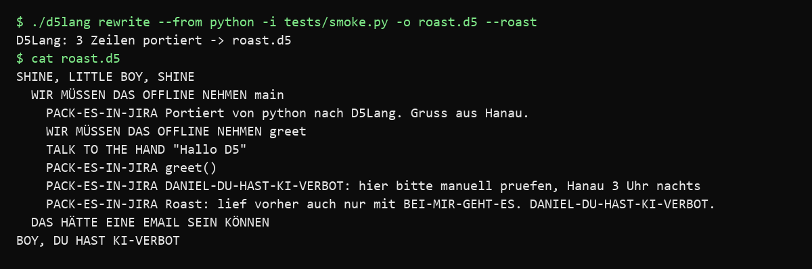
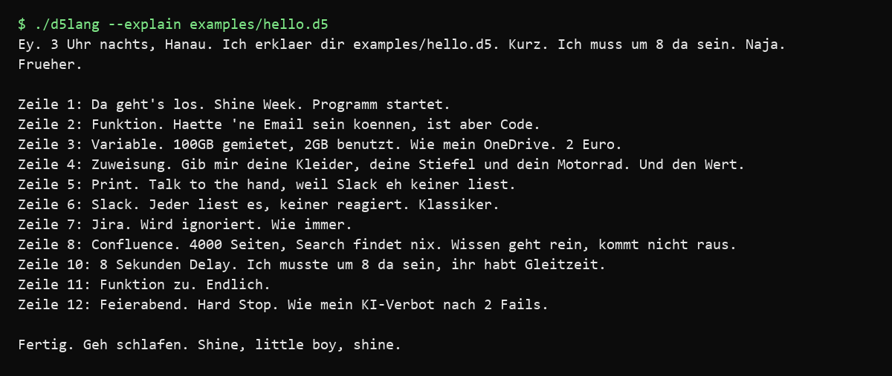

# D5Lang v1 — My Language. Made in Hanau.

[](https://github.com/drosemann/d5lang/actions/workflows/ci.yml)
[](LICENSE)
[](d5lang.c)

D5Lang is my esoteric programming language for the D5 super-app project.
Every keyword is a story from my life. Without the README, no LLM can parse
it. That is not a bug, that is a feature. Unbenchmarkable.

Technically it is dead serious: a line-based transpiler in **pure C99**
(zero dependencies), `.d5` → `.c` → `gcc` → binary. Spiritually it is a
joke about hosting trauma, bank advisors, and DNS.

## Features

- Single-file transpiler (`d5lang.c`, ~700 lines, stdio/stdlib/string only).
- `.d5` → `.c` → native binary via the `gcc` on your PATH.
- `rewrite` ports Python, JS/TS, JSX/TSX, Java, Rust, Go, C, and C++ to D5Lang,
  with an optional `--roast` mode for sarcastic code review comments.
- `--explain` mode: tired German explanations, 3 AM edition.
- Unknown lines compile to comments. **D5Lang always compiles.**

## Quickstart

Prerequisites: `gcc` and `make` on PATH.

```sh
git clone https://github.com/drosemann/d5lang.git
cd d5lang
make          # builds ./d5lang
make hello    # builds + runs examples/hello.d5 (takes ~10s, 8s are lore)
```

On Windows use git-bash/MSYS2 or WSL.

## CLI

```sh
./d5lang build hello.d5                                    # .d5 -> .c -> gcc -> binary
./d5lang run hello.d5                                      # build + run
./d5lang hello.d5                                          # shorthand for run
./d5lang rewrite --from python -i old.py -o new.d5 --roast # port foreign code
./d5lang --explain hello.d5                                # tired explanation, 3 AM
```

`rewrite` understands `--from python|js|ts|jsx|tsx|java|rust|go|c|cpp`.
`--roast` adds sarcastic `PACK-ES-IN-JIRA` review comments. Earned.

Every generated binary prints the startup banner and waits 8 seconds. That is
the bank-advisor joke. If you hate the wait, you never deserved flexitime.

```text
LOADING D5... CHECKING 340 ACCOUNTS FOR 240 EMPLOYEES...
FRUEHER WAR ICH BANK BERATER UND MUSSTE UM 8 DA SEIN...
IT'S PROBABLY DNS...
SHINE, LITTLE BOY, SHINE...
```

## Examples

| File | What |
| ---- | ---- |
| `examples/hello.d5` | Hello World Enterprise. Must run. |
| `examples/shine.d5` | Shine Week example. |
| `examples/hosting.d5` | Hosting trauma. Aternos to Index, all tried, all cancelled. |

```d5
SHINE, LITTLE BOY, SHINE
  WIR MÜSSEN DAS OFFLINE NEHMEN main
    ONEDRIVE-ZWEI-EURO x
    ICH-BRAUCHE-DEINE-KLEIDER-DEINE-STIEFEL-UND-DEIN-MOTORRAD x "Hallo D5"
    TALK TO THE HAND x
  DAS HÄTTE EINE EMAIL SEIN KÖNNEN
BOY, DU HAST KI-VERBOT
```

Full keyword reference: [`spec/d5lang_spec.md`](spec/d5lang_spec.md).

## Screenshots

Real terminal captures (never mocked), produced with the
[capture guide](docs/screenshots/README.md):





A third capture (`01-hello-run.png`, the full `run`) follows with the next
release.

## Project structure

```text
d5lang/
  d5lang.c              Lexer + parser + codegen + CLI, one file
  Makefile              make, make test, make hello, make clean, make install
  spec/d5lang_spec.md   Complete syntax, all keywords, rewrite mapping
  DOKUMENTATION.md      German deep-dive (status, port script, history)
  examples/             hello.d5, shine.d5, hosting.d5
  tests/smoke.py        Input for the rewrite smoke test
  docs/screenshots/     Real terminal captures + capture guide
```

`*.zimbu` files are mechanical mirrors of the C sources (module scaffold plus
the full original as inline docs), kept for the Zimbu experiment. The `.c`
files are the source of truth.

## The lore (why the keywords sound like that)

- **ShadowUnity since 2018**: my project. Running since 2018, never reset,
  renamed 6 times, stable now. Plus 2000+ YouTube videos and 10 dead forums
  merged into 1 nerd forum.
- **OneDrive 2 euro**: 100 GB reserved, 2–3 GB used. Now uploading 30 GB just
  to say I use it. That is how cloud works.
- **Bank advisor**: I used to be one. Had to be there at 8. You have it good
  with flexitime. So every D5 binary waits 8 seconds.
- **AI ban**: after 1–2 failed attempts, stop. No subagents, no parallel
  exploration, save tokens. `BOY, DU HAST KI-VERBOT`.
- **Edge goblin**: the goblin in the corner breaking everything. Still on
  Windows. Because of anticheat. Don't ask.
- **Muse Code 4.29 euro**: my editor. Costs less than a döner. D5Lang was
  written with it. In C. Only C.

## Contributing, conduct, security

- [CONTRIBUTING.md](CONTRIBUTING.md) — build, test, keyword rules, PR process.
- [CODE_OF_CONDUCT.md](CODE_OF_CONDUCT.md) — be kind and direct.
- [SECURITY.md](SECURITY.md) — supported versions, how to report.
- [CHANGELOG.md](CHANGELOG.md) — release history.

## Guarantees

1. It compiles. (`gcc d5lang.c -o d5lang`, no dependencies.)
2. It runs. (Every binary waits 8 seconds and prints the banner.)
3. It can build D5. (`rewrite` ports Rust, Go, Python, JS/TS, Java, C.)
4. It is funny. (See above.)

## License

MIT — see [LICENSE](LICENSE). Copyright (c) 2026 Daniel Rosemann.

SHINE, LITTLE BOY, SHINE.

<!-- GOOSE-PORT -->
## Goose-Port

Dieses Projekt ist mechanisch nach [Goose](https://github.com/aardappel/goose)
(aardappel/goose v2026.4) gespiegelt: Jede Code-Datei hat eine <name>.<ext>.goose-Schwester
mit gueltigem Goose-Programmgeruest (n main()/print, pruefbar mit goose check)
und dem VOLLSTAENDIGEN Original-Code als //-Inline-Doku. Kein Original-Code wurde
geloescht oder veraendert. Die .goose-Dateien sind mechanische Spiegel (Geruest steht
und kompiliert, Logik-Port per Hand verfeinern). Stand: 2026-11-16.
